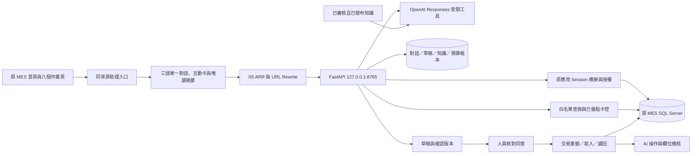
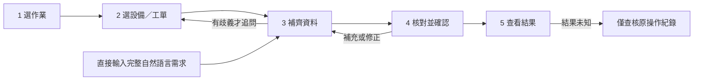
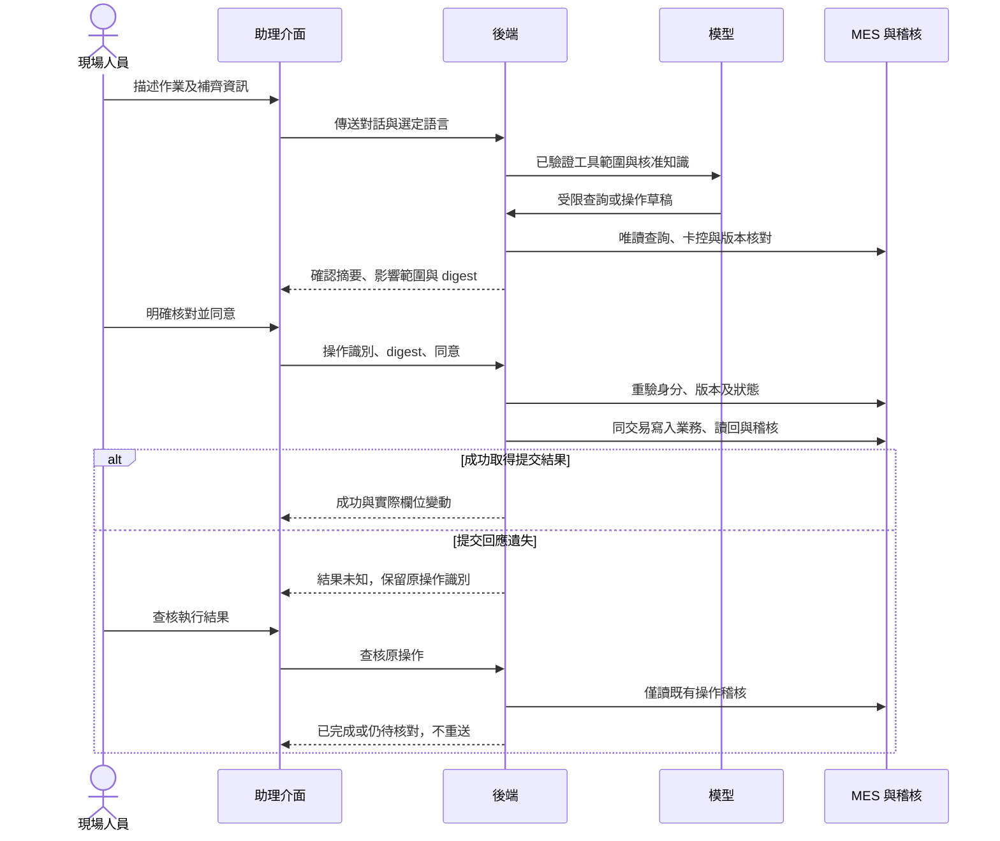

# 高塑 MES 對話操作助理

以自然語言操作 EPS 排程、報工及模具上下模。本分支依使用者最新指定的本機 4173 參考頁，將正式 React 介面改為 Emerald assistant-ui 的黑白外觀、圓形入口、精簡浮窗與展開導覽，保留三語、深色及可信身分契約。選擇作業範圍後沿用 MES 身分，補齊資料、核對確認卡後才寫入。

本輪來源核對、元件對照與測試詳見 [4173 介面對齊與驗收](docs/4173介面對齊與驗收-20261101.md)。前端 **76 項**、後端 **200 項／10 跳過**與正式建置通過；重啟桌面 App 後瀏覽器控制已恢復，已完成核心報工的實際介面驗收及三尺寸起始比較；完整 V08–V16 與 R06 首次原句重載恢復仍有待辦，詳見 [瀏覽器驗收補充](docs/4173瀏覽器驗收補充-20261101.md)。隔離預覽為 `http://127.0.0.1:8012/`，模型未啟用，可操作人工流程。

PR #18 保持草稿；本輪黑白改版尚未部署。正式 MES 仍為前輪深藍／黃版本 `9855a89`，其 [實作紀錄](docs/WeYu介面實作與驗收-20261031.md) 與 [部署紀錄](docs/IIS部署.md) 保留為歷史。以下既有流程驗證不代表本輪視覺已驗收。

前輪依 [PR #14](https://github.com/WeYuTech/KaosuAiAgentTest/pull/14) 實作對話優先產品：操作卡與唯一確認卡留在對話，「本次作業摘要」按需展開且僅供核對。核心報工100／缺料2改120／2已完成隔離UI、公開HTTP及真實模型驗證；完整53項矩陣尚有未執行邊界，不能視為全部驗收完成。見[實作紀錄](docs/對話優先產品實作紀錄.md)與[逐項矩陣](docs/對話優先本輪驗收矩陣.md)。本輪未更新正式部署。

本機預設設定為**隔離模擬環境**，內建設備、模具、工單、班別與人工／IoT 資料皆為合成資料。正式主機已透過 SSH 部署至 IIS `/KSS_MES/ai-agent/`，首頁與原八個操作頁面共九頁已加入助理入口，保留原始備份與雜湊。正式寫入啟用及現場核對結果以 [IIS 部署紀錄](docs/IIS部署.md) 為準；串接契約見 [MES 整合](docs/MES整合.md)。隔離驗收不等同正式業務寫入驗收。

前輪依使用者核准計畫加入三語、主題及五步引導，並將首頁 `wwwroot/index.html` 納入入口安裝，共九頁。工作追蹤為 [Issue #9](https://github.com/WeYuTech/KaosuAiAgentTest/issues/9)，完整條件見 [三語步驟引導規格](docs/三語步驟引導規格.md)。已完成本輪後端 **197 passed／10 skipped**、前端 **55 passed 與正式建置**、兩輪三語真實模型各 12 階段及候選版本現場檢查，範圍與證據見 [三語改版驗收](docs/三語改版驗收.md)。最後發行封裝與部署版本另依部署紀錄核對。

## 架構與資料邊界



模型只呼叫白名單查詢及草稿工具，不能指定任意 SQL、端點或資料表，也沒有「同意」工具。正式登入由原 MES 伺服器 Session GUID 與有效期限，對應未刪除的工作階段登錄及啟用帳號，再核對部署授權；URL、角色選單與對話中的自稱身分不構成授權。詳見 [ADR 003](docs/adr/003_可信MES工作階段橋接.md)。正式交易在同一 SQL 交易內保存可證明的欄位變化；伺服器 SQLite 保存對話、草稿、回饋與知識，模型預算另用累計帳本。

## 桌面對話與作業摘要

新版以單一對話為主；使用者可打開唯讀摘要、查資料與操作紀錄，再接續原工作。新版位置與完整功能對照見本輪實作紀錄。以下雙欄描述是 PR #12 已部署版本的歷史背景。

目前採使用者選定的 B 版型：左側對話、右側本次作業單，排程／報工／模具上下模在同一工作區切換。設備與工單摘要固定可見，右側可切換資料查詢及操作紀錄。欄位與對話共用後端草稿；送出聊天前先保存欄位，準備確認卡期間鎖定聊天送出，人工同意只在右側確認卡進行。工作追蹤：[Issue #11](https://github.com/WeYuTech/KaosuAiAgentTest/issues/11)；[規格與驗收範圍](docs/桌面對話作業單規格.md)。

以下是業務流程，介面不再呈現大型五步表單條：



三個模組的原操作保留。人員可以在右側選取，也可以在左側直接說完整句子，由助理只補問缺少的資料。介面及後續 AI 回覆支援繁體中文、英文、泰文；既有歷史訊息、設備／工單／品號／模具識別及備註不翻寫。預設繁體中文及跟隨系統主題，可記住瀏覽器偏好。選完模組後小窗放大為桌面工作區，採鍵盤滑鼠尺度，不再以平板按鈕尺寸配置桌面；本輪不做平板驗收。收合後再開啟會回到完整工作區。

## 確認寫入順序



## 啟動

需要 Python 3.12 以上、Node.js 與 npm。

```powershell
python -m venv .venv
.\.venv\Scripts\python.exe -m pip install -e '.[test]'
Copy-Item .env.example .env
# 在本機 .env 填 OPENAI_API_KEY；不要提交此檔。
cd frontend
npm ci
npm run build
cd ..
.\.venv\Scripts\python.exe -m uvicorn app.main:app --host 127.0.0.1 --port 8000
```

開啟 `http://127.0.0.1:8000`，點選右下角助理。模擬身分包含排程員、報工員、換模員與主管；角色選單僅供模擬，正式模式必須由 MES 可信身分授權。

## 三個模組

| 模組 | 對話操作 |
|---|---|
| 排程 | 查詢、排序與換頁，品號與模具交集選項，同品號多模具明細明確選取，新增與修改、模穴分配、班別、生產日與目標件數計算 |
| 報工 | 人工良品與不良原因新增／修改／刪除、模穴數、整排程完工，人工與 IoT 推算值分開 |
| 模具 | 廠別設備查詢、候選排程、上模開始／完成、下模開始／完成、歷史與清除 |

例如：「列出 MC36 的排程」、「MC37 的 WO-A 良品20個、缺料2個」、「排程1003上模開始」。若有多筆目標，助理會追問；沒有模型金鑰時會明確顯示未設定，可用結構化表單驗證流程。

所有寫入都需要確認卡。排程摘要列出模具明細名稱、編號及各自模穴數；新增省略唯一明細識別、修改沿用既有明細，或目標不在目前分頁時，均使用後端解析且納入確認雜湊的摘要。刪除、完工、清除及有完工連動的下模完成須獨立核對。同一對話修改需求後舊卡失效；確認卡過期或資料已改變就拒絕；重複確認不重複寫入；取消不寫入業務資料。提交回應遺失時保留結果未知，僅查核原操作稽核，不重新送出業務寫入。

## 模型與知識

使用 **OpenAI Responses API + gpt-6.1-sol**，以嚴格工具參數產生受限草稿，沒有模型可呼叫的執行／同意工具。原查詢、業務規則與交易由後端控制，不讓模型生成 SQL。

第一版 RAG 採本機已審核知識檢索，使用詞與中文字組排序；沒有額外購買向量資料庫或建立雲端 Vector Store。知識有來源、版本與模組。回饋先待審，主管修正後仍不會自動上線；部署管理員必須提供具體問答案例，固定回歸及候選知識的真實模型驗證通過後才發布：

```powershell
.\.venv\Scripts\python.exe scripts/publish_knowledge.py --case .local/knowledge-case.json -- '<已審核回饋ID>'
```

案例格式與發布證據見 [模型選型與知識修正](docs/模型選型與知識修正.md)。候選只在隔離資料庫與既有已發布知識共同檢索，必須命中同一內容雜湊、回覆符合案例，且沒有產生操作草稿才可發布；真實模型呼叫共用下列累計預算。這是知識修正流程，**不是模型自行訓練**。新的業務規則仍須修改程式與對應測試；不能只改知識文字來繞過卡控。

模型呼叫用量由持久帳本跨啟動累計，本次上限 US$20；呼叫前預留費用，回傳用量後結算，逾時未知保留預留且不自動重試。部署後有效帳本已移至 `192.168.2.123` 後端，開發機用量上限設為 0，避免跨機各用一份帳本而超支。不要刪除或複製帳本來重置預算。前端只呼叫同來源後端，不持有 OpenAI 金鑰。

官方依據：[模型規格與價格](https://developers.openai.com/api/docs/models/gpt-6.1-sol)、[工具呼叫](https://developers.openai.com/api/docs/guides/function-calling)。價格以文件核對日 2026-10-30 的輸入 US$2／百萬 token、輸出 US$10／百萬 token 保守計算，不依賴快取折扣。

## 驗收與追溯

```powershell
.\.venv\Scripts\python.exe -m pytest -q
# 以下會使用真實模型，與全專案共用 US$20 帳本。
.\.venv\Scripts\python.exe scripts/evaluate_dialogue.py
.\.venv\Scripts\python.exe scripts/evaluate_lifecycle.py
.\.venv\Scripts\python.exe scripts/evaluate_multiturn.py
```

上一輪（三語引導改版前）完整快速測試為 **177 passed／10 skipped**：9 條 SQL 測試須明確啟用且已另行驗收，1 條符號連結測試因 Windows 權限跳過；前端 **38 條測試、型別檢查及正式建置通過**。當時真實多輪模型完成 12 個動作，IIS 後端另完成指定報工作業的真實模型唯讀查詢，沒有產生寫入草稿；累計 111 次呼叫、估算 US$0.597262，未知用量及未結算預留皆為 0。這些為歷史基準，本輪新增驗收見 [三語改版驗收](docs/三語改版驗收.md)，完整歷史見 [驗收報告](docs/驗收報告.md)。本輪模型驗收後累計為 **171 次、US$1.110602**，未知與預留皆為 0；原 US$20 上限保持不變。付費驗收須在有效帳本所在主機依部署設定執行，不能自行解除開發機用量限制。

公開 API 包含 `/api/session`、`/api/workspace`、`/api/conversations`、`/api/proposals`、`/api/audit`、`/api/feedback` 與 `/api/budget`；詳細契約可查看啟動後的 `/docs`。

模擬狀態、草稿與稽核在同一 SQLite 交易保存。AI 專用表一律 `ZZ_AI_AGENT_OPERATION_` 前綴。稽核保留操作者、模組、動作、事件／確認時間、結果、資料表、主鍵、欄位前後值；取消與成功明確分開。

## 實際伺服器部署

部署目標為 `192.168.2.123`。後端位於 `C:\Services\KaosuAiAgent\current`，原 MES 應用根目錄為 `C:\inetpub\wwwroot\KSS_MES`，九頁入口的根目錄為其下的 `wwwroot`。IIS 代理目錄只放代理設定；金鑰、帳本與後端程式均在網站之外。原部署已具備 Python 3.12.10、ODBC Driver 18、URL Rewrite 及 ARR；本輪更新不重裝這些元件。重新建機時先依 [IIS 部署紀錄](docs/IIS部署.md) 核對具簽章的原廠安裝檔與固定 Python 相依版本。

### 1. 在開發機驗證、封裝及傳送

以下為實際路徑的 PowerShell 範例；以本次唯一發行名稱取代範例值，SSH 帳號及私鑰路徑由部署管理員填入。命令不包含憑證內容。

```powershell
$ErrorActionPreference = 'Stop'
$Release = 'kaosu-agent-guided-20261030-01'
.\.venv\Scripts\python.exe -m pytest -q
if ($LASTEXITCODE -ne 0) { throw '後端驗收失敗' }
Push-Location frontend
try {
    npm.cmd ci
    if ($LASTEXITCODE -ne 0) { throw '前端相依安裝失敗' }
    npm.cmd test
    if ($LASTEXITCODE -ne 0) { throw '前端驗收失敗' }
    npm.cmd run build
    if ($LASTEXITCODE -ne 0) { throw '前端建置失敗' }
} finally { Pop-Location }
.\.venv\Scripts\python.exe scripts/package_release.py --name $Release
if ($LASTEXITCODE -ne 0) { throw '封裝失敗' }
$SshUser = '<已授權的主機管理帳號>'
$SshKey = '<本機私鑰完整路徑>'
ssh -i $SshKey "${SshUser}@192.168.2.123" 'powershell -NoProfile -Command "New-Item -ItemType Directory -Force C:\Services\KaosuAiAgent\incoming | Out-Null"'
if ($LASTEXITCODE -ne 0) { throw 'SSH 連線或目錄準備失敗' }
scp -i $SshKey ".local/releases/$Release.zip" ".local/releases/$Release.sha256" "${SshUser}@192.168.2.123:C:/Services/KaosuAiAgent/incoming/"
if ($LASTEXITCODE -ne 0) { throw '傳送失敗' }
ssh -i $SshKey "${SshUser}@192.168.2.123"
```

SSH 首次連線核對管理員提供的主機指紋，不停用主機鍵驗證。伺服器不需要 Node.js；前端正式產物已包含在白名單 ZIP。首次準備 Python 虛擬環境時使用 `C:\Services\KaosuAiAgent\Python\python.exe -m venv C:\Services\KaosuAiAgent\venv`，再由該 venv 的 Python 依 `requirements.lock.txt` 安裝；隔離網路可加 `--no-index --find-links <已準備的 wheel 目錄>`。不要重建目前使用中的 venv。

### 2. 在主機管理員 PowerShell 核對封裝及備份

```powershell
$ErrorActionPreference = 'Stop'
$ServiceRoot = 'C:\Services\KaosuAiAgent'
$Release = 'kaosu-agent-guided-20261030-01'
$Archive = Join-Path $ServiceRoot "incoming\$Release.zip"
$ExpectedHash = ((Get-Content -LiteralPath (Join-Path $ServiceRoot "incoming\$Release.sha256") -Raw).Trim() -split '\s+')[0]
if ((Get-FileHash -LiteralPath $Archive -Algorithm SHA256).Hash -ne $ExpectedHash) { throw 'ZIP SHA256 不符' }
$Stage = Join-Path $ServiceRoot "staging\$Release"
$Previous = Join-Path $ServiceRoot "backups\code-before-$Release"
$Current = Join-Path $ServiceRoot 'current'
$WidgetBackup = Join-Path $ServiceRoot "backups\widget-$Release"
foreach ($Target in @($Stage, $Previous, $Current, $WidgetBackup)) {
    if (![IO.Path]::GetFullPath($Target).StartsWith($ServiceRoot + '\', [StringComparison]::OrdinalIgnoreCase)) { throw '目標超出部署目錄' }
}
if ((Test-Path -LiteralPath $Stage) -or (Test-Path -LiteralPath $Previous) -or (Test-Path -LiteralPath $WidgetBackup)) { throw '發行或備份名稱已存在' }
New-Item -ItemType Directory -Force (Join-Path $ServiceRoot 'staging'), (Join-Path $ServiceRoot 'backups') | Out-Null
Expand-Archive -LiteralPath $Archive -DestinationPath $Stage
foreach ($Line in Get-Content -LiteralPath (Join-Path $Stage 'SHA256SUMS.txt') -Encoding UTF8) {
    $Parts = $Line -split '  ', 2
    $File = [IO.Path]::GetFullPath((Join-Path $Stage $Parts[1]))
    if (!$File.StartsWith($Stage + '\', [StringComparison]::OrdinalIgnoreCase)) { throw '清單路徑超出發行目錄' }
    if ((Get-FileHash -LiteralPath $File -Algorithm SHA256).Hash -ne $Parts[0]) { throw '來源檔案校驗失敗' }
}
& "$env:windir\System32\inetsrv\appcmd.exe" add backup "KaosuAiAgent-before-$Release"
if ($LASTEXITCODE -ne 0) { throw 'IIS 備份失敗' }
Stop-ScheduledTask -TaskName 'KaosuAiAgent'
while ((Get-ScheduledTask -TaskName 'KaosuAiAgent').State -eq 'Running') { Start-Sleep -Seconds 1 }
# 停止服務後複製完整本機狀態，包含 SQLite WAL；不能拿舊帳本重設累計。
Copy-Item -LiteralPath (Join-Path $Current '.env') -Destination (Join-Path $Stage '.env')
Copy-Item -LiteralPath (Join-Path $Current '.local') -Destination (Join-Path $Stage '.local') -Recurse
Move-Item -LiteralPath $Current -Destination $Previous
Move-Item -LiteralPath $Stage -Destination $Current
```

`.env` 與 `.local` 不在 ZIP 中，原設定與累計帳本必須延續。首次部署才在後端以受保護的編輯器填入下列範例；更新時保留既有有效值，不把佔位符覆蓋正式設定，也不要在終端印出完整 `.env`。

```dotenv
OPENAI_API_KEY=<由管理員填入>
OPENAI_MODEL=gpt-6.1-sol
AI_TEST_BUDGET_USD=20
MES_MODE=live
MES_BASE_URL=http://127.0.0.1/KSS_MES
MES_CONNECTION_STRING=<只存於後端的完整 ODBC 連線設定>
MES_IDENTITY_CONTRACT=session-registry-v1
MES_MODULE_ALLOWLIST={"ADMINV2":["schedule","report","mold"]}
MES_KNOWLEDGE_REVIEWERS=["ADMINV2"]
MES_SERVER_UTC_OFFSET_HOURS=7
MES_ENABLE_WRITES=0
MES_WRITE_CONTRACT=transaction-v1
AI_ALLOWED_ORIGINS=http://192.168.2.123
AI_SECURE_COOKIE=0
```

範例首次預設鎖閉正式寫入；已部署主機的實際啟用狀態見 [IIS 部署紀錄](docs/IIS部署.md)，不要因更新重設開關。切換 HTTPS 時一併更新允許來源與 Cookie 設定。六張 AI 專用 SQL 表已由前輪建立；本輪三語與引導不新增正式業務表，不重跑隔離測試庫的 provision／seed 命令到正式庫。

### 3. 設定權限、同來源代理及九頁入口

以下接續同一個主機管理員 PowerShell 工作階段。`configure_iis.ps1` 會核對原 KSS_MES 應用、建立獨立代理 pool、設定 ARR 主機層代理與五分鐘逾時，並以 LOCAL SERVICE 註冊工作；會影響主機層 ARR 設定，不只新增子應用。若已存在不同的 `AiAgentSession.ashx`，腳本會拒絕覆寫，須先比較與備份。

```powershell
icacls $ServiceRoot /inheritance:r /grant:r '*S-1-5-18:(OI)(CI)F' '*S-1-5-32-544:(OI)(CI)F' '*S-1-5-19:(OI)(CI)RX'
if ($LASTEXITCODE -ne 0) { throw '服務目錄權限失敗' }
icacls (Join-Path $Current '.local') /grant '*S-1-5-19:(OI)(CI)M' /T
if ($LASTEXITCODE -ne 0) { throw '狀態目錄權限失敗' }
& "$ServiceRoot\venv\Scripts\python.exe" -m pip install -r "$Current\requirements.lock.txt"
if ($LASTEXITCODE -ne 0) { throw '固定相依安裝失敗' }
powershell.exe -NoProfile -ExecutionPolicy Bypass -File "$Current\scripts\configure_iis.ps1" -Root $ServiceRoot
if ($LASTEXITCODE -ne 0) { throw 'IIS 或工作排程設定失敗' }
& "$ServiceRoot\venv\Scripts\python.exe" "$Current\scripts\install_widget.py" --mes-root 'C:\inetpub\wwwroot\KSS_MES\wwwroot' --backup-root $WidgetBackup
if ($LASTEXITCODE -ne 0) { throw '九頁入口安裝失敗，請依備份核對' }
Get-ScheduledTask -TaskName 'KaosuAiAgent' | Select-Object TaskName, State, Principal
Get-NetTCPConnection -LocalPort 8765 -State Listen | Select-Object LocalAddress, LocalPort
Invoke-RestMethod 'http://127.0.0.1:8765/api/health'
Invoke-RestMethod 'http://192.168.2.123/KSS_MES/ai-agent/api/health'
```

確認只監聽 `127.0.0.1:8765`，未登入 session 請求應被拒絕。使用原 MES 正常登入後檢查首頁、三個模組、語言／主題、宿主上下文與唯讀查詢；不可為驗收向正式工單寫入測試資料。`install_widget.py` 先預檢全部九頁，保留原編碼及 SHA256；既有八頁原標記不重複插入，備份格式仍支援原八頁還原。重複執行若已全部安裝回 `already_installed`，不建立新備份。

### 4. 回復本輪版本

使用本輪記錄的 `$Release`、`$Previous` 與 `$WidgetBackup`，先停止工作。先以目前版本腳本還原本次入口，會拒絕覆蓋安裝後的他人修改；九頁升級備份還原只移除本次新增首頁，保留原八頁。若安裝回 `already_installed` 且未建立 manifest，跳過入口還原。

```powershell
Stop-ScheduledTask -TaskName 'KaosuAiAgent'
while ((Get-ScheduledTask -TaskName 'KaosuAiAgent').State -eq 'Running') { Start-Sleep -Seconds 1 }
$Manifest = Join-Path $WidgetBackup 'manifest.json'
if (Test-Path -LiteralPath $Manifest) {
    & "$ServiceRoot\venv\Scripts\python.exe" "$Current\scripts\install_widget.py" --restore $Manifest
    if ($LASTEXITCODE -ne 0) { throw '入口回復拒絕，保留現況待核對' }
}
$Failed = Join-Path $ServiceRoot "backups\failed-$Release"
$SavedState = Join-Path $ServiceRoot "backups\state-before-rollback-$Release"
foreach ($Target in @($Current, $Previous, $Failed, $SavedState)) {
    if (![IO.Path]::GetFullPath($Target).StartsWith($ServiceRoot + '\', [StringComparison]::OrdinalIgnoreCase)) { throw '回復目標超出部署目錄' }
}
if (!(Test-Path -LiteralPath $Previous) -or (Test-Path -LiteralPath $Failed) -or (Test-Path -LiteralPath $SavedState)) { throw '回復來源不存在或保存目的已存在' }
# 原碼回復仍沿用最新帳本與操作狀態，不能覆蓋已完成操作或重置費用。
Copy-Item -LiteralPath (Join-Path $Current '.env') -Destination (Join-Path $Previous '.env') -Force
Move-Item -LiteralPath (Join-Path $Previous '.local') -Destination $SavedState
Move-Item -LiteralPath (Join-Path $Current '.local') -Destination (Join-Path $Previous '.local')
Move-Item -LiteralPath $Current -Destination $Failed
Move-Item -LiteralPath $Previous -Destination $Current
& "$ServiceRoot\venv\Scripts\python.exe" -m pip install -r "$Current\requirements.lock.txt"
if ($LASTEXITCODE -ne 0) { throw '原版相依回復失敗' }
Start-ScheduledTask -TaskName 'KaosuAiAgent'
Invoke-RestMethod 'http://192.168.2.123/KSS_MES/ai-agent/api/health'
```

若本輪變更了持久資料格式，先依對應遷移方案核對舊版相容性再回復程式；保留 `.local` 原始副本及未知結果，不以刪除資料解決版本差異。整台 IIS 還原命令為 `appcmd restore backup <本次備份名稱>`，但會影響其他站台，只有核對期間其他管理變更後才使用；一般版本回復不需要整台 IIS 還原。

## 原系統證據

- `docs/實作規格.md`：已確認範圍與六個開發切片。
- [三語步驟引導規格](docs/三語步驟引導規格.md)：本輪核准計畫、三切片及驗收條件。
- [三語改版驗收](docs/三語改版驗收.md)：本輪測試、真實三語模型、審查修復與九頁候選部署證據。
- `docs/inventory/`：現行畫面、API、反編譯後端、真實卡控與缺陷的來源行號。
- `docs/模擬情境.md`：合成資料與模擬投影的界線。
- `docs/前端操作.md`：介面與嵌入方式。
- `docs/MES整合.md`：正式登入、查詢、交易及部署限制。
- [IIS 部署紀錄](docs/IIS部署.md)：正式入口、服務、備份、現場核對與寫入啟用狀態。
- `docs/程式審查.md`：固定基準雙軸審查、具體發現與修復證據。
- `docs/SQL驗收.md`：隔離 SQL Server 真實交易、觸發器及失敗回復。
- `docs/驗收報告.md`：本次完成項目、測試證據、模型費用與交付界線。

來源版本為 `WeYuTech/test@979d2c63d90a3310b00486c755c18e7a25aaba5c`。不把舊版 OPI 排程規則誤套到現行 setup 新版，也不把原程式缺陷當成必須複製的功能。
