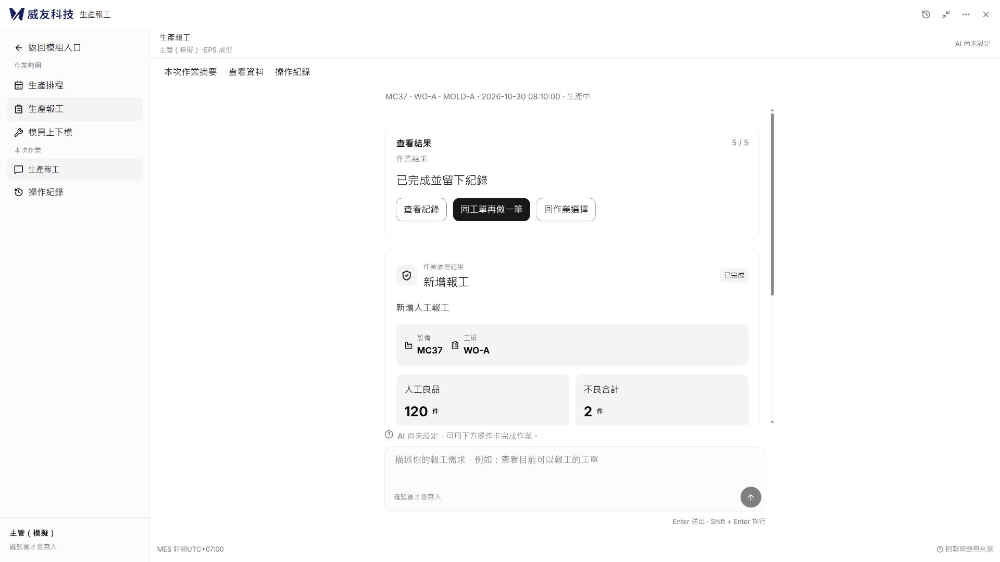

# 4173 瀏覽器驗收補充

## 連線恢復與環境

使用者重新啟動 ChatGPT／Codex 後，本聊天重新探索成功列出 Edge 與內建瀏覽器，並實際讀取參考頁。先前的控制權拒絕已解除；未修改任何權限驗證程式或放寬安全設定。

重新啟動本機 8012 隔離預覽；正式 MES 未部署、未寫入。預覽明確設定 `MES_MODE=simulation`、空模型金鑰、模型額度 0，沒有真實模型呼叫。4173 靜態參考前端也重新啟動，4199 查詢服務未啟動，因此來源畫面的離線提示不是 Kaosu 的服務狀態。

前後比較使用已部署封裝 `9855a89` 的原始前端，在 8013 搭配獨立模擬資料；不是把重新製作的 mock 當改版前畫面。原 8011 是更早一輪建置，未用於本輪前後比較。

## 實際操作結果

| 情境 | 狀態 | 實際證據 |
|---|---|---|
| 開啟、放大與收合 | 通過 | 從圓形入口進入，桌面放大後顯示左側導覽；收合再開啟仍是原草稿與展開狀態 |
| MC37 明確選 WO-A／EPS-A | 通過 | 候選中包含 WO-B；人工明確選擇正在生產的 WO-A／EPS-A |
| 良品 100、缺料 2 → 良品 120 | 通過 | 先輸入 100／2，開啟唯讀摘要後返回改為 120；收合、重新開啟仍為 120／2 |
| 三語與深色切換 | 通過（核心報工） | 繁中 → 英文 → 泰文 → 繁中，深色／淺色切換，確認卡保持 MC37、WO-A、120／2；主檔「缺料」維持來源原文 |
| 重新整理恢復已保存草稿 | 通過 | 重載後重新選報工模組，恢復原待確認卡 120／2；不是重建確認卡或自動寫入 |
| 核對、人工同意、查看結果 | 通過（隔離庫） | 在泰文畫面人工按下確認，顯示成功；操作 `1e4b4e3e-9875-4062-b790-fa72ea8899d2`，有 18 項實際欄位變動 |
| 同工單再做一筆 | 通過 | 明確按下後選新增報工，仍是原工單，但人工良品及有無不良答案均清空；不自動寫入 |
| 返回修改與唯一確認入口 | 通過 | 另建 121／0 待確認卡，回上一步後確認按鈕數量為 0；改成 122／0 後只有 1 個有效同意按鈕；舊卡為 `superseded` |
| 取消 | 通過 | 122／0 卡取消，顯示「已取消，沒有寫入」；稽核變動欄位數為 0 |
| 摘要唯讀與窄版返回 | 通過 | 1920 側欄摘要及 390 覆蓋摘要均可開關，摘要沒有第二個寫入按鈕，關閉可回到原卡 |
| 窄版鍵盤 | 通過（已列情境） | 開啟後焦點在可見標頭；Shift+Tab 到最後任務、Tab 循環至第一工具，Esc 收合且焦點回入口 |
| 三模組入口 | 通過（入口／查詢表面） | 排程查詢入口可顯示結果且不要求寫入同意；模具的查詢、四階段與清除入口仍存在 |
| 窄版橫向溢出 | 通過（已列畫面） | 390 寬的泰文深色核對畫面 `scrollWidth=innerWidth=390`，可垂直捲動 |

隔離稽核補充見 [稽核摘要](evidence/4173-ui-20261101/隔離稽核摘要.json)。僅有一張成功報工卡，另兩張分別為已撤換及已取消。本次結果不能作為正式 MES 寫入成功證據，也不代表自然語言模型驗收完成。

## 實測後修正

1. 窄畫面原本重複顯示模組標題與三個模組按鈕，佔用過多填寫區域。640px 以下隱藏重複列，透過既有返回入口切換作業，登入者與連線狀態仍可見。
2. 將開啟助理時的焦點移到固定可見的標頭；窄版隱藏重複標題後，焦點不再落到不可見元素。
3. 窄版即使未按放大，也按全畫面對話處理焦點圈選及背景隔離，避免 Tab 跑到被遮住的宿主入口。切換尺寸不重建 Guide。

修改後再次執行前端 **76 項全部通過**及 TypeScript／Vite 建置；只修改前端布局及焦點，後端仍使用前次 **200 通過、10 跳過**的驗證版本。既有大型 chunk、lucide 指令與後端棄用提醒維持記錄。

## 畫面證據

以下為瀏覽器實際截圖。檔名標示要求的 CSS 視窗尺寸；工具輸出的 JPEG 可能因縮放取整少 1–15 像素，實際像素與 SHA256 見 [檔案清單](evidence/4173-ui-20261101/畫面檔案清單.json)，沒有重繪或合成。

| 視窗／內容 | 改版前 | 新版 |
|---|---|---|
| 1366×768、繁中淺色起始 | [9855a89](evidence/4173-ui-20261101/改版前9855-1366-起始.jpg) | [新版](evidence/4173-ui-20261101/新版-1366-起始.jpg) |
| 1920×1080、繁中淺色起始 | [9855a89](evidence/4173-ui-20261101/改版前9855-1920-起始.jpg) | [新版](evidence/4173-ui-20261101/新版-1920-起始.jpg) |
| 390×844、繁中淺色起始 | [9855a89](evidence/4173-ui-20261101/改版前9855-390-起始.jpg) | [新版](evidence/4173-ui-20261101/新版-390-起始淺色.jpg) |

來源淺色：[4173 參考畫面](evidence/4173-ui-20261101/來源-1366-淺色.jpg)。該來源已保存使用者調整的 564×672 浮窗；Kaosu 使用來源預設視覺尺度設計的 450×562.5 上限，沒有複製其拖拉尺寸保存功能，因此不宣稱逐像素一致。來源偏好在比較後恢復深色。

其他階段：[1366 填寫與摘要](evidence/4173-ui-20261101/新版-1366-填寫摘要.jpg)、[1366 核對](evidence/4173-ui-20261101/新版-1366-核對.jpg)、[1920 核對與摘要](evidence/4173-ui-20261101/新版-1920-核對摘要.jpg)、[390 泰文深色核對](evidence/4173-ui-20261101/新版-390-泰文深色核對-改善後.jpg)、[390 泰文摘要](evidence/4173-ui-20261101/新版-390-泰文摘要.jpg)、[390 泰文結果](evidence/4173-ui-20261101/新版-390-泰文結果.jpg)、[1920 繁中結果](evidence/4173-ui-20261101/新版-1920-繁中結果.jpg)、[模具入口](evidence/4173-ui-20261101/新版-1920-模具入口.jpg)。

## 未通過及尚未執行範圍

- 初次窄版檢查發現重複導覽與焦點問題，已依上文修正並重測；[修正前畫面](evidence/4173-ui-20261101/新版-390-泰文深色核對.jpg) 保留。
- 日期欄位的自動 `fill` 未更新 React 的日期值，實際仍為預設 2026-11-01，該日查詢回傳空結果。未將這次視為 2026-10-30 日期篩選通過，也未在證據不足時判定後端查詢錯誤；需另做原生日期輸入驗收。
- 工具的 Ctrl+加號沒有改變瀏覽器倍率，**200% 縮放未執行成功**。實體中文 IME、讀屏、系統深淺切換、全套主題對比量測仍未執行；函式級 IME 回歸仍通過。
- 三尺寸的起始前後比較已完成；三尺寸 × 五階段 × 三語 × 雙主題的完整交叉矩陣尚未完成。已驗畫面列在上方，不將單張截圖外推為全部通過。
- 登入失效、明確拒絕、跨分頁 unknown 的完整瀏覽器組合案例尚未重跑；保留既有函式／HTTP 回歸證據。排程、模具的全部寫入動作本輪未重新執行。
- R06／U15 首次未送出原句重載恢復仍待實作；本次證明的是已保存業務草稿恢復。
- PR #18 維持草稿，Issue #13 不關閉；本輪沒有合併或部署正式 MES。
