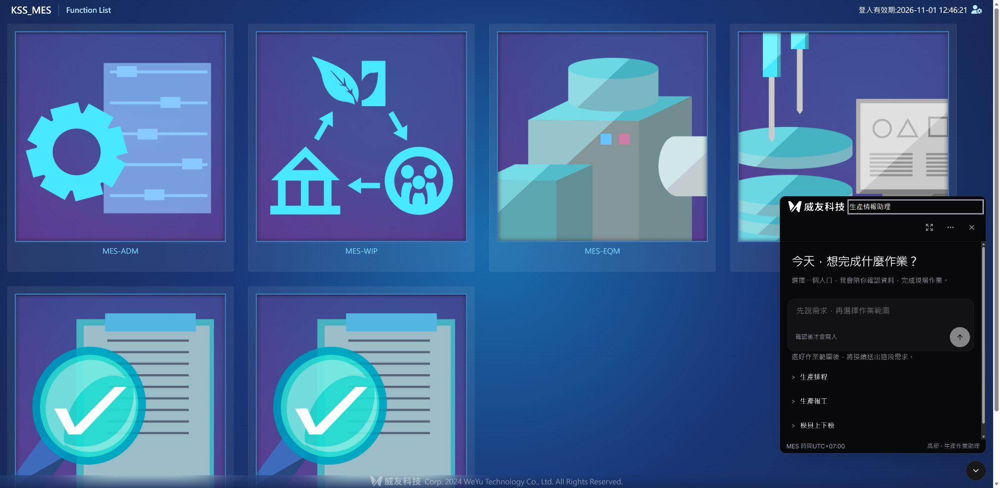

# IIS 部署與維護

## 2026-11-01：正式黑白介面更新

依使用者「部署正式 MES」指示，從 PR #18 分支部署產品版本 `8a7dfe8`；沒有合併 main，也沒有關閉整體需求。正式入口為 [MES 首頁](http://192.168.2.123/KSS_MES/wwwroot/index.html)，重新整理後開啟右下助理。

| 項目 | 實際結果 |
|---|---|
| 最終封裝 | `kaosu-blackwhite-final-20261101.zip` |
| SHA256 | `6796d1596b654962961aade580290bb6a6a273c9e0123ab375be41e509a6ebce` |
| 校驗 | 92 檔 SHA256 全部吻合；公開 HTML、loader、品牌圖、JS 與 CSS 與本機建置一致 |
| 服務 | `C:\Services\KaosuAiAgent\current`，維持 loopback 8765 與原服務程序，未重啟；健康狀態 `ok/live` |
| 狀態保存 | 兩次原子更新前後 `.env`、`operations.db`、`model-budget.db` 均相同，未清空設定、對話、稽核或預算 |
| 九頁入口 | HTTP 200、各一份 loader；安裝器 `already_installed`、`changed=0`，原八頁與首頁歷史備份保留 |
| 正式瀏覽器 | 首頁登入成功、沿用 ADMINV2、黑白浮窗及展開正常，舊對話與已取消紀錄保留；MC37／2026-10-30 唯讀查詢回傳 4 筆 |
| 權限界線 | 未登入 session 401；私密環境檔、資料庫與後端原始碼的公開路徑 404 |
| 寫入與模型 | 本輪沒有建立新確認卡、送出同意確認或呼叫模型；畫面中的取消卡是原有歷史紀錄 |

先部署 `6e6ed26`，現場發現查詢側欄的輸入控制項最小寬度導致橫向捲動。已在 `8a7dfe8` 修正篩選欄位寬度，隔離及正式瀏覽器均量測到側欄 `clientWidth=scrollWidth=345`。修正後前端 76 項測試及正式建置通過；後端無異動，沿用前次 200 通過／10 跳過證據。本輪未重跑所有業務寫入或完整視覺矩陣，未把部署成功當成整體驗收完成。

兩次部署皆先校驗、備份，再放入新資產並原子替換入口；保留舊雜湊資產供已開啟頁面使用。回復備份：

- 更新至黑白介面前的 `9855a89`：`C:\Services\KaosuAiAgent\backups\code-before-kaosu-blackwhite-6e6ed26-20261101`。
- 側欄修正前的 `6e6ed26`：`C:\Services\KaosuAiAgent\backups\code-before-kaosu-blackwhite-final-20261101`。

需要回復時，依目標備份 `deployment.json` 還原 `existed=true` 的異動檔與原 `SHA256SUMS.txt`，最後還原 HTML／loader；保留現行 `.env`、`.local` 及雜湊資產，不能以舊資料庫覆蓋操作或帳本。兩次更新都未修改 MES 頁面，不需回復九頁入口。

[結構化部署證據](evidence/blackwhite-deploy-20261101.json) · [完整隔離驗收與剩餘項目](4173瀏覽器驗收補充-20261101.md)



## 2026-11-01：依後續指示部署 WeYu 正式介面

使用者於本輪明確要求部署正式 MES，因此部署 [PR #18](https://github.com/WeYuTech/KaosuAiAgentTest/pull/18) 的產品版本 `9855a89c7138178e7426c23d65bed1cb5b956103`。PR 仍為草稿，沒有合併 main，也沒有關閉 Issue #13。日期採使用者端 Asia/Taipei；MES 業務時區維持 UTC+07:00。

| 項目 | 實際結果 |
|---|---|
| 發行檔 | `kaosu-weyu-pr18-9855a89-20261101.zip` |
| ZIP SHA256 | `b303fc234e28e5b40f9ee5f57f8832cacdc47f7c0022f946b6737d28afb105b8` |
| 程式位置 | `C:\Services\KaosuAiAgent\current` |
| 回復備份 | `C:\Services\KaosuAiAgent\backups\code-before-kaosu-weyu-pr18-9855a89-20261101`，包含異動前檔案、原清單與 `deployment.json` |
| 校驗 | 發行 ZIP 及部署後 89 個逐檔 SHA256 全部吻合 |
| 前端入口 | `index-sdqkw7qC.js`、`index-BQPhb4cQ.css`；入口 HTML、loader、Logo 及兩項雜湊資產的公開 HTTP 內容與本機建置完全相同 |
| 服務 | 維持 LOCAL SERVICE、127.0.0.1:8765；後端未改、服務未重啟；IIS 健康檢查 `ok/live` |
| 設定與資料 | 更新前後 `.env`、`operations.db`、`model-budget.db` 雜湊相同；隨後驗證僅新增助理對話、預覽與取消紀錄，未重設資料或帳本 |
| 九頁入口 | 首頁與原八頁 HTTP 200、各一份 loader；安裝器回 `already_installed`、`changed=0`，未改原頁，保留歷史八頁及首頁備份 |

本輪只更新前端及文件：先校驗並備份，放入新資產，再原子替換 loader 及 HTML 入口；保留舊雜湊資產供已開啟的頁面使用。沒有停止整台 IIS、修改 DB schema 或重新安裝依賴。

公開 HTTP 驗證沿用既有可信 MES 登入，排程／報工／模具查詢均為 200。對原已指定報工對象建立「模穴調整」預覽，確認中英泰切換保留 args／digest，最後以 `approved=false` 取消；回傳 `cancelled` 且 changes 為空。取消前後 `OPI_CAV`、`MANUAL_OK`、`MANUAL_NG`、`REPORTS`、`COMPLETED` 相同。本輪 `approved=true` 次數及模型呼叫次數皆為 0。部署後預算唯讀核對仍為 182 次、US$1.199426，預留與未知皆為 0，原 US$20 上限保持不變。

未登入 session 回 401，正式站模擬登入回 403；公開 `.env`、`.local/model-budget.db`、`app/main.py` 均為 404。結構化證據見 [部署與 HTTP 核對](evidence/weyu-deploy-20261101.json)。

**部署成功不等於完整 UI 驗收通過。** V08–V16 瀏覽器畫面驗收仍未執行，R06「首次原句重載恢復」仍未完成，沿用 [本輪驗收界線](WeYu介面實作與驗收-20261031.md)。可由 [MES 首頁](http://192.168.2.123/KSS_MES/wwwroot/index.html) 重新整理後開啟右下助理；已開舊版的人員先完成或查核原操作，再重新整理，不能為更新強制重送。

需回復時，依上述備份的 `deployment.json` 恢復所有 `existed=true` 的異動檔及原 `SHA256SUMS.txt`，最後恢復 HTML／loader；保留目前 `.env`、`.local` 及新舊雜湊資產。不得用備份資料庫覆蓋部署後的操作與預算。這次沒有重寫九頁入口，不需還原原 MES 頁面或整台 IIS。

以下為歷史部署紀錄。

部署日期：2026-10-30。目標為使用者指定的 `192.168.2.123`，以已授權 SSH 管理連線部署。原 MES 位於 `C:\inetpub\wwwroot\KSS_MES`，助理入口為 `http://192.168.2.123/KSS_MES/ai-agent/`。來源庫仍預設模擬模式；伺服器環境設定採正式模式。

## 實際配置

| 項目 | 設定 |
|---|---|
| 後端程式 | `C:\Services\KaosuAiAgent\current`，位於網站目錄之外 |
| Python | 同根目錄 `Python`，3.12.10，與開發驗收版本一致；後續更新需重跑驗收 |
| 虛擬環境 | `C:\Services\KaosuAiAgent\venv`；依 `requirements.lock.txt` 離線安裝固定版本 |
| 服務啟動 | Windows 工作排程器 `KaosuAiAgent`，開機啟動，失敗一分鐘後重啟；執行身分 `LOCAL SERVICE` |
| 監聽 | Uvicorn 單 worker、`127.0.0.1:8765`，不對網路直接開放此埠 |
| IIS | Default Web Site 下 `/KSS_MES/ai-agent` 子應用，獨立 `KaosuAiAgentProxy` pool |
| 代理目錄 | `C:\Services\KaosuAiAgent\proxy`；只放代理設定，不放程式、資料庫或金鑰 |
| 私密設定 | 後端 `.env`；僅系統、管理員及服務執行身分可讀，不進 Git 或發行 ZIP |
| 助理狀態 | 後端 `.local\operations.db`：對話、確認卡、回饋、已發布知識與應用稽核 |
| 模型預算 | 後端 `.local\model-budget.db`：沿用開發累計帳本；本機開發站額度設 0，避免跨機各自計費超額 |
| 服務日誌 | `.local\logs\service.log`，五份輪替；不記錄存取 URL、Cookie 或模型請求內容 |

IIS 原本缺少 URL Rewrite 與 ARR，已從 Microsoft 官方來源安裝並驗證簽章；Python 安裝檔也已驗證 Python Software Foundation 簽章。安裝未要求重新啟動主機。主機層 ARR 已啟用代理、保留 Host、逾時五分鐘；這三項是主機層設定，不能描述成所有異動都限於子應用。

依據：[Microsoft 反向代理配置](https://learn.microsoft.com/en-us/iis/extensions/url-rewrite-module/reverse-proxy-with-url-rewrite-v2-and-application-request-routing)、[URL Rewrite](https://www.iis.net/downloads/microsoft/url-rewrite)、[ARR](https://www.iis.net/downloads/microsoft/application-request-routing)、[Uvicorn 設定](https://uvicorn.dev/settings/)。

## 登入、權限與寫入

沿用原 `ASP.NET_SessionId` Cookie，設定 `MES_IDENTITY_CONTRACT=session-registry-v1`。後端向本機 `/KSS_MES/AiAgentSession.ashx` 取得原應用伺服器 Session 的 SessionId 與有效期限，再以參數化查詢對應 `SEC_APP_SESSION_REGISTRY` 與啟用中的 `SEC_USER`。端點只接受 loopback GET，不接受前端傳入的帳號／SessionId，也不回傳 Token。此檔必須放在原 KSS_MES 應用根目錄，不能放在助理子應用。

目前部署 allowlist 只有使用者指定的 `ADMINV2`，授權三個模組與知識審核。新增其他人員須由管理員將實際 MES 帳號列入 `.env`，不接受使用者在對話裡聲稱的身分。

正式資料庫 `kaosu_MES_KSS` 已建立六個 `ZZ_AI_AGENT_OPERATION_` 前綴空表。正式業務交易使用 OPERATION／CHANGE，其餘 SQL 表保留作後續接入；目前確認卡、回饋與知識仍由伺服器 SQLite 保存。部署過程沒有對正式 MES 業務資料執行測試寫入。

現場已設定 `MES_ENABLE_WRITES=1` 與 `MES_WRITE_CONTRACT=transaction-v1`，開放已授權人員確認交易。每筆操作仍須有可信身分、合法資料版本與人員確認。刪除、完工及會連動完工的操作仍各自確認；結果不明時僅能查核既有操作紀錄，不自動重送。

## 封裝與更新

先完成後端測試、前端測試及建置，再執行：

```powershell
python scripts/package_release.py
```

腳本只收白名單程式與前端產物，拒絕環境檔、憑證、資料庫與連結，產出 ZIP、ZIP SHA256 與逐檔 SHA256。以 SSH/SCP 傳至伺服器，核對 SHA256 後停止 `KaosuAiAgent` 工作、更新 `current` 並啟動。`.env` 與 `.local` 不在封裝中，更新時必須保留，尤其不得清空預算或確認紀錄。

首次設定代理及開機啟動使用 `scripts/configure_iis.ps1`；執行前先備份 IIS。此腳本使用 UTF-8 BOM，以相容伺服器的 Windows PowerShell 5.1。`scripts/run_service.py` 固定 loopback、單 worker 及子路徑，不需要另外開放 8765 防火牆規則。

## 原 MES 頁面與回復

已在 WIP 選單、現行新版排程清單／編輯、報工清單／歷史／明細、模具看板／歷史共八頁加入同來源 loader。原始頁面、編碼及修改前後 SHA256 均保留在：

`C:\Services\KaosuAiAgent\backups\widget-20261030\manifest.json`

安裝腳本會先核對全部八頁，再寫入；同一標記不重複安裝。頁面已由其他人修改時，還原腳本會整批拒絕覆蓋：

```powershell
C:\Services\KaosuAiAgent\venv\Scripts\python.exe C:\Services\KaosuAiAgent\current\scripts\install_widget.py --restore C:\Services\KaosuAiAgent\backups\widget-20261030\manifest.json
```

IIS 主機原設定備份名稱為 `KaosuAiAgent-before-20261030`；原 MES web.config 另備份在 `backups\MES-web.config`。原 MES web.config 沒有被本次入口安裝腳本修改。整台 IIS 設定還原會影響其他站台，應先比對備份後的其他管理變更；一般停用助理只需還原八頁入口、停止專屬工作與移除專屬子應用。

## 驗收紀錄

已確認 IIS 健康檢查為 live、後端只監聽 loopback、工作身分為 LOCAL SERVICE；正常 MES 登入可沿用 ADMINV2，未登入請求回 401、模擬登入在 live 模式被拒絕。指定正式作業的真實 Responses 查詢成功，人工良品／不良與 IoT 推算分開，未知 IoT 保持未知，沒有產生操作草稿。

正式公開 HTTP 三模組查詢皆回 200：指定報工 1 筆、指定排程 1 筆、MC37 模具 all 查詢當次 73 筆。產生「報工模穴 5 改 6」預覽後明確取消，取消前後實際模穴皆為 5、正式 OPERATION 紀錄皆為 0；沒有送出同意確認。八頁入口 HTTP 皆 200 且 loader 各一份，助理 URL 下的 `.env`、`.local/model-budget.db`、`app/main.py` 均 404。原頁內已實際操作入口、沿用身分、放大、載入當前工單與真實模型唯讀對話。

每次模型工具查詢或準備草稿前，重新核對同一個 MES 工作階段、帳號、USER_SID 及模組授權，避免長對話超過 60 秒內部證明期限；中途失效、換人或撤權會立即拒絕。

瀏覽器初次對話曾遇到登入驗證失敗。已由原後端證明：一般查詢會生成新 Token 並更新 Session，`SEC_USER.REFRESH_TOKEN` 僅在登入時更新，所以兩者相等不是可靠的持續身分契約。現已切換上述 Session registry 契約，沒有以放寬 Token 比對或接受前端帳號處理。原始失敗與修正證據保留在審查及驗收文件。

## 三語五步引導候選版本增量驗收

2026-10-30 本輪候選版本已部署並通過現場唯讀檢查。首頁 `wwwroot/index.html` 新增入口，安裝結果 `changed=1`；原八個作業頁沒有重寫，共九頁 HTTP 200、各一份 loader。新備份為：

`C:\Services\KaosuAiAgent\backups\widget-guide-home-20261030\manifest.json`

本輪還原只移除新裝首頁入口，原八頁及其舊備份保留。新腳本接受完整八頁或九頁的舊有 `schema: 1` 清單，仍核對路徑、編碼及雜湊，不接受任意缺頁或重複頁面。

正式首頁英文深色模式在 768×1024 視窗無水平溢出，可信身分 `ADMINV2` 可用。私密環境檔、資料庫及後端程式的公開路徑仍為 404；服務維持 LOCAL SERVICE、loopback 8765，健康狀態 live。此輪沒有正式業務測試寫入。

本輪後端 197 passed／10 skipped、前端 52 passed 與建置通過；兩輪三語真實模型各 12 階段通過。累計模型帳本 171 次、US$1.110602，未知與預留皆為 0，原 US$20 上限未重設。測試範圍、修復與原始證據位置見 [三語改版驗收](三語改版驗收.md)。上述為候選版本已驗結果；後續日期輸入／標題修正的最終封裝、雜湊及部署另依發行產物紀錄，不以候選檢查替代最終版本核對。

## 三語引導最終發行

已完成最後更新，發行檔 kaosu-guide-final-20261030.zip 的 SHA256 為 `be35c640e138b64f1549a601e8d3ed36112eb92ee423fff831d0df0032e0315f`，82個封裝檔在伺服器逐檔校驗全部吻合。後端仍為LOCAL SERVICE／loopback8765，健康檢查live。最終前端包含三入口56px卡片，小窗三個按鈕皆完整可見；繁中深色、泰文淺色及英文平板畫面已核對。程式變更見PR #10，部署沒有對正式MES業務執行測試寫入。此段為發行後補登紀錄，發行ZIP中的先前候選驗收文件保留原當時狀態。

## 2026-11-01 管理設定與定時報告更新注意（尚未部署）

此增量仍在 PR #18；下列是更新作法，不是部署成功紀錄。沿用本文件既有建置、封裝、SSH／SCP、SHA256 校驗與回復步驟，同時替換後端與 `frontend/dist`，不能僅更新靜態檔。

1. 停止專屬助理服務後備份目前發行檔、`.env`、作業 SQLite 與 `.local/model-budget.db`（以目前實際設定路徑為準）。模型／額度設定新增在費用帳本既有 STATE，定時定義／結果在作業庫既有 STATE；兩庫、稽核與對話皆須保存，不用預覽資料覆蓋。
2. 程式仍放於 `C:\Services\KaosuAiAgent`，對外 `/KSS_MES/ai-agent/`，後端 loopback `8765`、LOCAL SERVICE、IIS／ARR／Rewrite 沿用。無新套件、無 Schema migration、無額外 Windows 排程工作。
3. 服務啟動預設啟用 `AI_REPORT_WORKER=1`，每 15 秒檢查已核准的唯讀定時報告；設定為 `0` 可停用背景執行。不得變更原 US$20 限制或清除累計帳本。維護逾 15 分鐘錯過的執行不補跑，已領取的同次執行不自動重送。
4. 更新後查健康、可信登入、主管／一般帳號設定權限、聊天列表、只讀報告列表及九頁入口；正式站不建立測試定時委託、不試寫 MES 業務。IIS 真實背景執行仍需另列現場驗收證據。
5. 回復舊程式前先停服務，保留新版資料庫備份，再還原前一個程式包並重啟。舊版忽略新增 JSON 狀態，不刪除對話、稽核、報告及費用記錄。原八頁及首頁入口的歷史備份繼續保存。

API／Agent 設定只影響新聊天；費用額度立即生效。伺服器金鑰與連線資訊仍由私密環境設定提供，前端不提供金鑰編輯或回讀。
