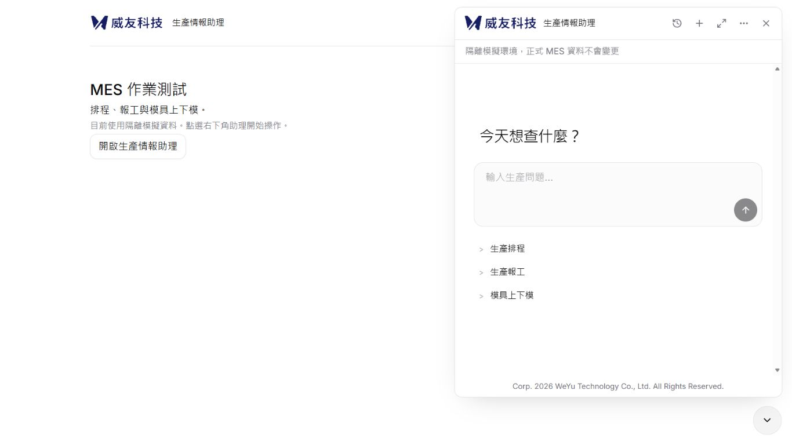
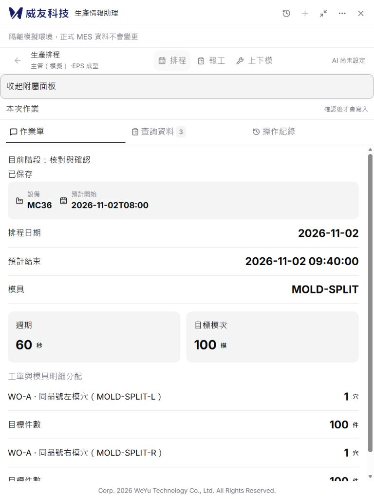
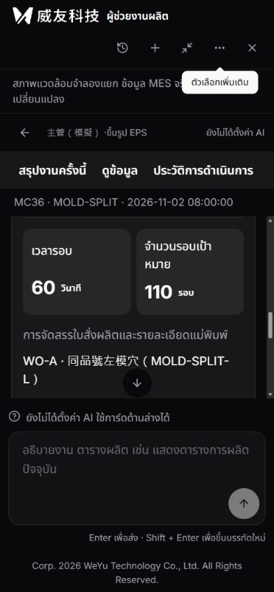

# Issue #19：來源元件移植與本輪驗收

日期：2026-11-01。追蹤：[Issue #19](https://github.com/WeYuTech/KaosuAiAgentTest/issues/19)、[整體需求 #13](https://github.com/WeYuTech/KaosuAiAgentTest/issues/13)。

**本輪已進入正式 React 應用，但仍是待補驗收的產品實作，不能宣稱「完全比照」，也不據此關閉 #19／#13。未合併；依後續授權已部署產品 `678a903`，見 [部署紀錄](IIS部署.md)。** 本文件取代舊文件中「只以 CSS 投影、不引入 assistant-ui／Radix／Tailwind」的前端限制；業務、身分、確認、交易與恢復契約仍依原規格。

## 現況與固定來源

- 目標從 `main@e5d30f981fd8223ae3d20bf81804d631b554d530` 建立 `codex/issue19-source-ui`。PR #18 已合併；舊文件的「草稿／未合併」是當時紀錄。
- 找到本機 `Emerald-automatic-reports/frontend/mes-ai-copilot`，remote 為 `WeYuTech/WeYu-MesAiAgent`，分支 `codex/acceptance-standard-v1-20261013`，完整 HEAD 為 `294bc02d3bfb153175513ea7276b44727cb710bb`。前端工作樹無差異；來源儲存庫其他未提交檔未動。
- 閱讀其 DESIGN_SYSTEM、tokens、styles、App、runtime、Thread、Modal、Markdown、清單、preferences、共用 UI、manifest／lock。沒有改採舊 main 或混用 Emerald 遠端另一版。
- 保存 [原版前端封存](evidence/issue19/原版前端294bc02d.zip) 與 [逐檔 SHA256／來源資訊](evidence/issue19/來源鎖定.json)。封存只含 212 個已追蹤前端檔案，不含 node_modules、dist 或私密設定。
- 來源重建 JS／CSS 與實際 4173 提供的 `index-D6Zldj3I.js`、`index-BIm1ew7j.css` 雜湊完全相同。對應 SHA256 分別為 `1cd90b4060543a3798c62c974df5380429666297fd23a07293db5eb0cc8b344e`、`dd4666c2c4d5f503a1eb880d78587de6f129c09551915f10717a98d01d9559d6`。G0 已通過。

來源／前版／新版分別使用 4173／8020／8019 隔離預覽。來源的 4199 是來源原有 UI mock；Kaosu 8019 是既有 FastAPI＋隔離 SQLite 真實模擬流程，沒有模型金鑰。8021 僅用於明確標示的訊息故障注入，不是正式模型或正式 MES。

## 元件對照與必要適配

路徑以下以 `frontend/src/` 為根。這張表描述實際程式移植；完整視覺驗收狀態另見下節，不以安裝套件替代驗收。

| ID | 來源 → 目標 | 已接入與契約 | 差異狀態／證據 |
|---|---|---|---|
| UI01 | `design-tokens.css`、styles → `source-design-tokens.css`、`source-styles.css`、原 MES CSS | 來源 tokens、Tailwind 4／PostCSS、Inter／IBM；原 CSS 收入 components layer，刪除被替代的訊息、composer、選單／backdrop 規則 | 本規格允許的適配：MES 藍與泰文 fallback；全部共通狀態的 2px 核對未完成 |
| UI02 | assistant-modal → `components/assistant-ui/elements/assistant-modal.aui.tsx`、AssistantChrome、main | 真正 Modal Root／Trigger／Content、Portal、forceMount；原 iframe、尺寸記憶、展開與收合 handler 保留 | 本規格允許的適配：既有宿主控制尺寸與焦點，不使用來源另一個 controller；尺寸／宿主契約測試通過，全部拖曳矩陣未完成 |
| UI03 | Thread → `thread.aui.tsx`、ConversationComposer、main | Thread／Message／Composer／ActionBar primitives 及受控 external-store runtime；原 Guide 與唯一確認卡仍在同一 Thread | 本規格允許的適配：App 掌控原作業閱讀位置，關閉套件額外自動捲動；原句、IME 事件與重複送出測試通過；長歷史捲動全矩陣未完成 |
| UI04 | MarkdownText → `markdown-text.tsx`、MessageContent、safe-link | 同一 renderer、GFM、單換行、表格、程式碼複製；user 純文字，skipHtml／安全 URL／禁止遠端圖片；HTTP 複製 fallback 失敗不假報成功 | 本規格允許的適配：保留安全／換行契約；安全測試與 fallback 測試通過，長表格各尺寸視覺未完成 |
| UI05 | thread-list／conversations → ConversationHistory、`thread-list.aui.tsx` | 真正 ThreadList／Item／New；來源搜尋框與 Skeleton；既有搜尋、命名、釘選、封存、可恢復刪除 API | 本規格允許的適配：伺服器搜尋／分頁、MES UTC+07 日期分組、美元用量；瀏覽器實作操作與待確認更名通過 |
| UI06 | 共用 UI／AssistantMoreMenu → `components/ui/`、HeaderMenu、OperationDialog、SettingSelect | 來源 Button／Input／Dialog／Dropdown／Tooltip／Select／Skeleton／Table；Portal 留在助理 root | 本規格允許的適配：保存中不可 Esc，核對 Esc 回表單、外點不丟未存設定；三語鍵盤元件測試與設定流程通過；全焦點矩陣未完成 |
| UI07 | ProviderSettings／operations → ManagementPanel | 既有 API／Agent、用量及唯讀定時報告 handlers 接來源 UI；管理面板 lazy load，載入失敗只隔離面板 | 本規格允許的適配：白名單模型、既有權限、美元累計／未知預留與 US$20 上限；API 設定保存通過，其他管理 UI 全流程未完成 |
| UI08 | MES 活動／結果 → GuidedFlow、ProposalBusinessSummary、main | 原候選、Guide、保存／核對／結果；摘要唯讀，沒有第二個同意來源 | 本規格允許的適配：僅顯示真實 busy／回應，不虛構工具串流；12 次隔離操作均一個 confirm，結果讀回通過 |
| UI09 | preferences／品牌 → 原 theme／i18n、來源字型 tokens | 繁中／英／泰，light／dark／navy／mes／system；原 logo／版權；隱藏登入成功列、固定時區、回報入口與標題框修正保留 | 本規格允許的適配：額外語系／MES 主題；15 組冒煙通過，system 隨 OS 即時變更未執行 |

沒有移入來源 API、ChatController、任意 Agent URL、前端憑證、ADMINV2 限制或另一個業務 store。附件、語音沒有 Kaosu API；編輯／重新生成可能重送 MES 命令，未提供該入口；圖表沒有來源結構化資料契約。這些為「不適用且有證據」，沒有放置空按鈕。逐套件版本、import／理由與授權見 [依賴盤點](Issue19-前端依賴與授權.md)。

## 本輪修正的互動問題

1. 原句依可信帳號、MES context、聊天保存於本分頁 sessionStorage，只保存文字、版本、時間及 unsent／rejected／unknown，24 小時失效；不保存憑證。登出清除，切聊天不帶入上一張工單資料。未建立可信身分之前不持久化文字，不能宣稱未登入的匿名首頁也完成跨刷新恢復。
2. 恢復原句不自動 POST。先恢復原聊天再決定首次需求，避免已恢復文字被首次需求重送。unknown 的業務確認仍沿原 submission-recovery 契約處理，沒有換 pid 解鎖。
3. 歷史查詢以帳號、scope、關鍵字、頁碼及刷新版本隔離；條件變更的同一次 render 撤下舊列，晚到回覆不能顯示前人清單。原 metadata_version 並發契約保留。
4. Portal 原先被 Modal 層級遮住的問題已修正，Dialog 可以出現在浮窗上方；管理 lazy chunk 失敗以局部錯誤視窗承接，保留原作業。
5. 補測發現原日期查詢欄位的 DOM 值與 React 查詢值不同步：DOM 已顯示 10/30、attribute／實際查詢仍為 11/01。沿用原 datetime 欄位的 input 事件同步方式補正查詢起訖日期；未更動業務日期、候選或卡控。修正後瀏覽器重新查得模具排程，完成四階段驗收。

## 已執行的業務操作

[公開 HTTP 請求紀錄](evidence/issue19/公開HTTP請求.jsonl) 只保存方法、路徑與狀態碼，沒有 Cookie／Token／請求 body。[隔離操作讀回](evidence/issue19/隔離操作讀回.json) 保存原 proposal 與結果；12 個 pid 的 confirm 都剛好一次。這些是合成資料的真實目標 API 流程，不能當作正式 SQL 或真實模型證據。

| 操作 | 實際流程與結果 |
|---|---|
| 新增人工報工 | 無模型先輸入「幫 MC37 報工」，原句保留；人工明選 MC37／WO-A／EPS-A，良品100、NG01缺料2，改120；核對、唯讀摘要、本人確認並讀回。pid `930dc00c-792d-4b1e-a8dd-1e5cf02bb30a` |
| 待確認時更名 | Guide version 5 與 proposal digest 相同，metadata_version 0→1；見 [更名前](evidence/issue19/更名前.json)、[更名後](evidence/issue19/更名後.json)、[完成後](evidence/issue19/完成後.json) |
| 修改／模穴／刪除／完工 | 原紀錄120→121、模穴2→3；明選單筆121／2刪除；整張排程完工顯示 WO-A／WO-B 與下一張開始時間連動。刪除／完工獨立勾選後各自確認 |
| 上下模四階段 | MC36 原排程依序開始上模、完成上模、開始下模、完成下模；每階段重新選取、核對與確認，沒有一次串執行四階段；完成下模獨立勾選 |
| 清除換模 | 顯示四階段、進出站、完工 Y→N；獨立勾選後執行，讀回 succeeded |
| 新增／修改排程 | MC36／EPS-A／MOLD-SPLIT，左右模穴各1、WO-A，60秒×100模；768px 填寫、核對與摘要，完成後再明選修改至110模；結束09:40→09:50，兩筆件數各110，讀回成功 |
| 歷史與設定 | 搜尋、待確認更名、釘選、封存／取消封存、可恢復刪除／還原；API 設定改推理強度，核對 Esc 回表單保留值，再確認保存。僅本機資料 |
| 文字恢復 | 未送出、422明確拒絕、503送達未知分開驗證；刷新後文字與送達提示保留；故障情境總共只有原本2個 messages POST，刷新／切語言／主題未新增 POST。見 [請求證據](evidence/issue19/原句恢復HTTP請求.jsonl) |

## 驗收矩陣：通過／失敗／未執行

「未執行」列明已有子項證據及仍缺範圍；不是整列通過。全部必需項目完成前，不將本 Issue 標為完成。

| ID | 本輪判定 | 證據與尚缺範圍 |
|---|---|---|
| G0 | 通過 | 來源可取得、前端乾淨、212檔 SHA256、重建與4173產物相等 |
| V01 | 未執行完整矩陣 | 1366／1920 首頁、浮窗／展開、部分選單與管理有來源／前／後截圖；不是 UI01–UI09 全狀態 2px 證明。來源與目標 fixture 數量／宿主 margin 不同，見下方證據限制 |
| V02 | 未執行完整矩陣 | 390三語選單／管理、泰文深色實際結果；768多明細填寫／核對／摘要／結果無整頁水平溢出。長對話、表格、所有錯誤與歷史狀態未逐一完成 |
| V03 | 未執行完整矩陣 | [15組基礎冒煙](evidence/issue19/三語五主題.json)通過，文字未遺失；泰文深色390結果通過。system 隨 OS 即時改變與英文長文深入情境未執行 |
| V04 | 未執行完整矩陣 | 已觀察空資料、載入、busy／禁用、422／503、成功及局部管理載入錯誤測試；所有無權限／錯誤對照畫面未完整覆蓋 |
| V05 | 未執行完整矩陣 | 真實 Radix DOM 的鍵盤／三語 Portal 測試、設定 Esc 退回表單通過；中文組字 flag、Shift+Enter、雙擊不重送測試通過。實體中文 IME、螢幕閱讀器、200%及 reduced motion 實測未完成，不以合成事件取代 |
| B01 | 通過 | 瀏覽器＋原 API＋單次 confirm＋讀回，人工／IoT分離，無模型沒有自動解析腳本 |
| B02 | 未執行完整矩陣 | 新增／修改、同品號左右模穴在768px完成；同張排程多工單的新增瀏覽器情境未再跑，公開 HTTP 相關回歸通過 |
| B03 | 通過 | 報工修改／刪除／模穴／整張完工、上下模四階段與清除均實際點選、獨立確認及結果讀回；原卡控 HTTP 回歸通過。其他尺寸／主題不因此自動通過 |
| B04 | 未執行完整瀏覽器矩陣 | 版本／競爭／保存／取消等既有測試通過；409、過期、撤權與 writes gate 的完整瀏覽器故障注入未重跑 |
| B05 | 未執行完整瀏覽器矩陣 | confirm／submission-recovery 既有故障回歸通過；12次正常確認各一次。業務 confirm 回應遺失、跨分頁與 unknown 瀏覽器場景未重跑；訊息503證據不能替代寫入unknown |
| B06 | 未執行完整矩陣 | actor／聊天 epoch、晚回覆與切身分 DOM 測試通過；實際切主題／語言／尺寸／刷新保留原作業。登入失效全路徑瀏覽器未重跑 |
| B07 | 通過（可信身分範圍） | 三種送達狀態、刷新不重送、帳號／聊天／模組隔離、TTL／損壞儲存測試；匿名尚未建立身分的首頁文字不持久化 |
| B08 | 未執行完整矩陣 | 歷史全部列出操作與 API 設定核對保存已實測；Agent、額度及定時報告建立／停用／結果全 UI 流程未重跑，既有後端回歸通過 |
| B09 | 未執行完整矩陣 | 入口／子路徑、origin/source、Markdown／URL／純文字與字型測試通過；正式九頁 HTTP／入口各一份通過；首頁浮窗、歷史、唯讀查詢通過，其他八頁瀏覽器未執行 |
| 乾淨安裝、型別、前端測試、建置 | 通過 | 最終 lock 下重新 npm ci、typecheck、test（90/90）、build；精確命令見下節 |
| Python／公開HTTP回歸 | 通過，10項跳過 | 本輪重跑214通過；9項真實SQL opt-in未執行，1項Windows符號連結權限跳過；既有Starlette棄用警告 |
| 效能與產物 | 未執行完整矩陣 | 產物／gzip前後已列；初始下載請求數與開窗／輸入／換聊天的同條件效能量測尚缺。主JS超500kB警告保留，未調高門檻掩蓋 |

本輪沒有仍失敗的自動測試。測試過程發現的 Portal 遮擋、lazy chunk 白頁、清單暫態舊列、日期同步已修正並有測試或實際操作證據；視覺覆蓋不足仍是未完成，不寫成零缺陷。

## 畫面證據與限制







完整圖片放在 [screens](evidence/issue19/screens)。工具回傳 JPEG，已依實際格式存為 `.jpg`；沒有縮放／裁切成假相同尺寸。需要注意：

- 1366浮窗來源 panel 為564×672、header56、composer497.6×111.6；新版相同。來源 preview body8px／外層捲軸使絕對x差約15px；新版的隔離環境提示是額外業務列，composer的y不可直接當作無差異。見 [來源量測](evidence/issue19/來源浮窗幾何.json)。不能據此宣布V01通過。
- 較早「報工填寫／核對／摘要／結果1366」截圖發生在 body margin 修正前，實際為1351×759；只證明功能，不能作1366精準比較。新的「改後結果1366」是後續校正畫面。
- 部分早期連續切展開／尺寸的截圖可能擷取到動畫前一幀；「來源首頁浮窗1366」「改後首頁浮窗1366」「改後首頁展開1366」已分開動作後重拍。其他來源1920等畫面仍需逐張補正；不拿它們宣稱2px通過。
- 390×844 CSS viewport 的個別 JPEG 為390×843，與瀏覽器實際擷取／DPR取整相關；原圖保留，未人工補齊。來源與Kaosu目前不是全部相同fixture／字型載入時機，完整比較仍待完成。
- 泰文主檔名稱與登入者顯示名保留來源中文值，固定操作文案使用泰文；版權原文保留。

## 建置、重現與回復

```powershell
npm --prefix frontend ci
npm --prefix frontend run typecheck
npm --prefix frontend test
npm --prefix frontend run build
.\.venv\Scripts\python.exe -X utf8 -m pytest -q -rs
```

來源封存可在獨立目錄還原檢查；勿直接覆蓋目標 lock。正式應用仍用原有啟動命令，沒有另一套 Demo runtime。故障驗收工具為 `tests/manual/issue19_ui_server.py`，只監聽127.0.0.1，固定simulation／空金鑰／零預算；旗標只替換 messages 422／503，不能冒充真實模型。

[改前產物](evidence/issue19/改前產物.json)與[改後產物](evidence/issue19/改後產物.json)包含位元組／gzip／新版雜湊。改前主JS609,072 bytes（gzip184,258），CSS42,516（gzip8,750）；新版主JS約1.13MB（gzip約348kB），CSS約126kB（gzip約18kB），管理約34kB按需載入。新增量來自實際assistant-ui／Radix／Markdown與Tailwind。完整精確值以產物JSON為準，未量測的互動延遲不猜數字。

沒有修改後端程式、DB schema、正式 `.env`、對話／稽核／預算資料。回復方式為還原本實作commit的前端與建置設定，在原基準重新 `npm ci`／build；依本次IIS部署備份回復靜態產物，保留服務設定與資料。使用者後續已授權部署；未自動合併，完整驗收待辦不因部署而結案。
