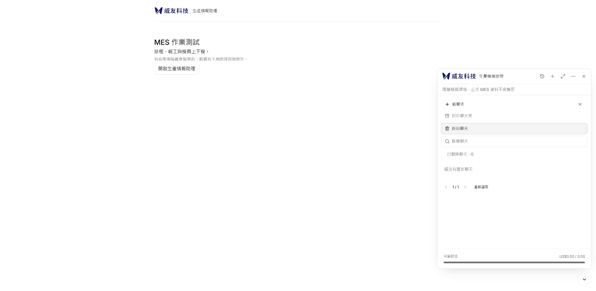
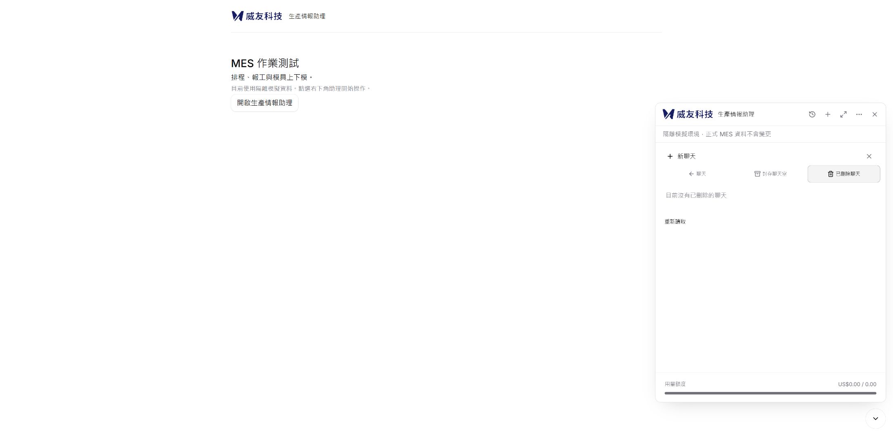
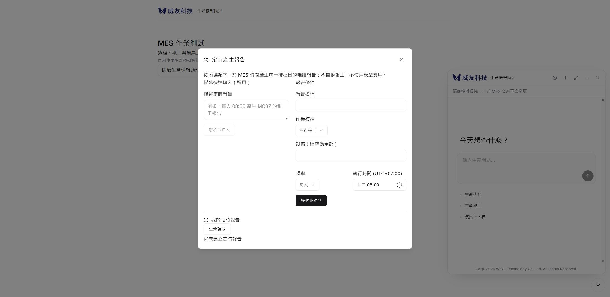

# Issue #21：轉場、聊天回饋與空態實作驗收

日期：2026-11-01。追蹤 [#21](https://github.com/WeYuTech/KaosuAiAgentTest/issues/21)，承接 [#20](https://github.com/WeYuTech/KaosuAiAgentTest/pull/20)、[#19](https://github.com/WeYuTech/KaosuAiAgentTest/issues/19)、[#13](https://github.com/WeYuTech/KaosuAiAgentTest/issues/13)。

## 基準與交付界線

從 `codex/issue19-source-ui@ee4b3e0aa7ca3bbe2ef5aeba83e6544c5f213b13` 建立 `codex/issue21-motion-feedback`。開工時 #20 未合併，main 仍為 `e5d30f9`；已知正式部署產品是 `678a903`。本次沒有更新正式主機、合併或關閉需求，PR 以 #20 分支為 base，避免重複顯示來源移植差異。

已完成下列程式修正與局部驗收，**尚未滿足 M01–M11 的完整證據要求**。特別是五組動態錄影、效能 trace、指定尺寸及實體無障礙驗收仍缺；不能宣稱全面滑順或 Issue 已完成。

## 本輪具名 UX 適配

| 範圍 | 修正與保持的契約 |
|---|---|
| 聊天清單 | 固定聊天／封存／已刪除導覽；依 actor／scope／query／page／刷新版本判定載入、成功及錯誤。換範圍立即撤下舊列；只有搜尋 debounce 180ms，其餘立即查詢。真正空集合與搜尋無結果分開，單頁不顯示無效分頁，以 response.page_size 計算。聚焦／組字時不隱藏搜尋。 |
| 定時報告 | 描述快速填入、報告條件、我的定時報告三區；桌面雙欄、CSS 窄版單欄。區分初載／錯誤／成功空集合與讀取／解析／儲存回饋。移除 busy 結束無條件搶焦點；核對聚焦標題，返回修改保留表單並回到核對入口。保留 daily／weekdays、三模組、UTC+07:00、client_id 與版本卡控。 |
| Dialog | 父層保留同一受控 open 的 Dialog，由 Radix presence 處理關閉；退出內容立即 inert。管理視窗每次重新開啟有獨立 generation，舊回應不覆寫新視窗。舊退出回呼不將焦點從新 Dialog 搶走。沒有動畫完成後送網路請求或放開確認鎖。 |
| 聊天回饋 | App 保存本輪待處理投影，首次需求與一般 send 共用。messages API 以同一 processing token 的 user／assistant 結尾序號調和，沒有按文字去重；成功後 user bubble 的識別不變，後續相同文字仍是不同嘗試。草稿保存失敗、明確拒絕、送達未知分開。整包 JSON 立即呈現，不做逐字佇列或假進度。 |
| 訊息入場 | 只對本輪新增訊息加一次進場；結束／取消／減少動態時消耗標記。歷史恢復不重播；presentation 使用 memo，既有每秒時間更新不重建訊息陣列。沒有 retry／regenerate／cancel 新能力。 |
| 捲動 | useChatScroll 是唯一控制者，assistant-ui autoScroll 保持關閉。只呼叫 Viewport.scrollTo，移除 scrollIntoView；內容變高時跟隨僅限原本在底部。向上 wheel／touch／鍵盤可接管，最新內容按鈕使用原生 smooth，動態 reduced-motion 改為 instant。表單內方向鍵不被當成閱讀捲動。 |
| 外框／摘要 | 同一 iframe 與 Guide 保持；透明度及小幅位移配合 display allow-discrete，退出立即 inert／不可點。展開的寬高只在外框區域協調，不對整頁文字 scale；不支援離散 transition 的瀏覽器直接切到正確終態。 |

### 共用動效值

`frontend/public/motion-tokens.css` 同時由宿主 Shadow Root 載入，並由 Vite 編入應用 CSS：按鈕120ms、訊息180ms、Dialog200ms、退出140ms、面板220ms；曲線 `cubic-bezier(.2,.8,.2,1)`。訊息位移4px、Dialog6px。沒有全域 transition:all，沒有新動畫框架或後端／Schema 變更。原生 smooth 時間由瀏覽器決定，不能用上述 token 宣稱精確耗時。

`prefers-reduced-motion` 關閉非必要動畫、位移與 shimmer；JS 捲動監聽偏好變更。ResizeObserver 合併到單一可取消 RAF；scope 改變或卸載會移除 listener、observer 及排程。動畫事件只清理視覺標記，不影響身分、草稿、確認、交易或 unknown。

參考：[Radix CSS presence](https://www.radix-ui.com/primitives/docs/guides/animation)、[MDN scrollTo](https://developer.mozilla.org/en-US/docs/Web/API/Element/scrollTo)。

## 實際驗證環境

- Windows NT 10.0.26200；安裝的 Edge 156.0.4314.42，透過 Edge 瀏覽器控制。有效 DOM viewport 2187×1069；DPR、縮放未核實。
- 8019：既有隔離 FastAPI＋SQLite、模型未啟用；報告、歷史與版面測試。8023：獨立隔離 SQLite，明確標示的固定長表格回覆替身，2秒延遲，以及422／503故障注入；不是模型理解驗收。
- 未設定 CPU 限速；網路為 loopback。所有測試均無正式 MES 寫入、無付費模型呼叫，不變更US$20帳本。
- 來源基線 dist 已封存於未追蹤 `.local/issue21-before`。改前／改後報告與空清單截圖使用相同一般視窗環境。建置逐檔雜湊見 [驗收建置雜湊](evidence/issue21/驗收建置雜湊.json)。沒有以截圖取代影片。

## M01–M11 判定

| ID | 判定 | 實際證據與尚缺範圍 |
|---|---|---|
| M01 | 部分通過；其餘未執行 | 受控 Dialog DOM 五次、真實瀏覽器五次開關通過；既有同 iframe 測試通過。完整浮窗／摘要／展開五組錄影、背景與中斷矩陣未執行。 |
| M02 | 通過列明情境；錄影未執行 | 首次與一般送出立即 pending；成功 user 數量各只增1；422與503分開，刷新恢復原句且沒有新增 messages POST。替身測試，不代表真實模型驗收。 |
| M03 | 部分通過 | 同文字兩次仍為不同嘗試，原 user ID 保持；刷新恢復時 data-enter=true 為0。所有主題／Guide／跨分頁重掛載矩陣未完整執行。 |
| M04 | 部分通過 | 上捲後 top=0，回覆使高度6244→8187，top仍為0；點最新才到7853。單元驗證 wheel 接管與減少動態。軟鍵盤、宿主、長程式碼及完整影片未執行。 |
| M05 | 通過列明情境 | 初載不假空態、錯誤重試、封存／刪除空態、page_size=10的3頁、焦點／組字保護通過元件測試；真實空已刪除頁不顯示搜尋／無效分頁。所有資料狀態的錄影未執行。 |
| M06 | 部分通過 | 既有 actor／晚回覆隔離回歸通過；切範圍／頁碼立即請求，聚焦／組字不隱藏測試通過。實體IME與慢網路完整瀏覽器矩陣未執行。 |
| M07 | 部分通過 | 初載、解析、核對、返回值保留及焦點元件測試；瀏覽器完成同流程；三語daily／weekdays經公開preview API 6案例通過。完整建立／暫停／恢復／刪除 UI影片未重跑；既有HTTP防重送／權限測試通過。 |
| M08 | 部分通過 | JS動態減少動畫與清理測試通過；CSS有減少動態分支。OS偏好切換、背景分頁及動畫中切換的真實畫面未執行。 |
| M09 | 尺寸驗收失敗；其餘部分通過 | viewport工具要求1366、1920、768、390，但實際寬度均2187；保留失敗資料及截圖，不能當對應尺寸證據。繁中五主題、英文淺色、泰文深色報告冒煙通過，沒有整頁水平溢出。完整三語×主題×尺寸、200%、實體IME及讀屏未執行。 |
| M10 | 部分通過 | 既有重複確認／unknown／原pid恢復／跨分頁契約測試本輪通過；沒有改確認請求與交易。所有故障的瀏覽器矩陣未重跑。 |
| M11 | 未執行 | 控制介面未提供錄影／performance trace／CPU節流；沒有五組before／after影片、frame gaps／long tasks／layout量測，不能宣稱效能改善通過。 |

[實際驗收數據與工具失敗](evidence/issue21/實際驗收摘要.json) · [隔離HTTP紀錄](evidence/issue21/隔離HTTP紀錄.json)

### 本輪命令結果

- `npm --prefix frontend test`：96通過、0失敗。
- `npm --prefix frontend run build`：typecheck及Vite通過；主JS超500kB警告保留。
- `.venv/Scripts/python -m pytest -q`：220通過、10跳過；9項真實SQL opt-in及1項Windows symlink權限；既有Starlette棄用警告。
- 報告HTTP子集15通過，包含新提示三語×兩種頻率；非另加於220項。
- 初次新測試從錯誤目錄執行及缺少happy-dom的HTMLFormElement global而失敗；已修測試環境並重跑，未把這些失敗歸咎產品。

## 尚待完成與回復

本 PR 維持草稿，未將 #21 或 #19／#13 標為完成。先補可用錄影／trace與真正指定 viewport，再依表格完成未執行項目；不要只延長動畫掩蓋問題。此次沒有部署授權，不更新正式 MES。

回復本輪只需還原本 PR 的前端程式／public資產並重新建置；不刪除新聊天、稽核、私密設定或預算。若之後部署，需同時發布 `motion-tokens.css` 與 widget-loader，並依既有IIS流程備份／核對。

