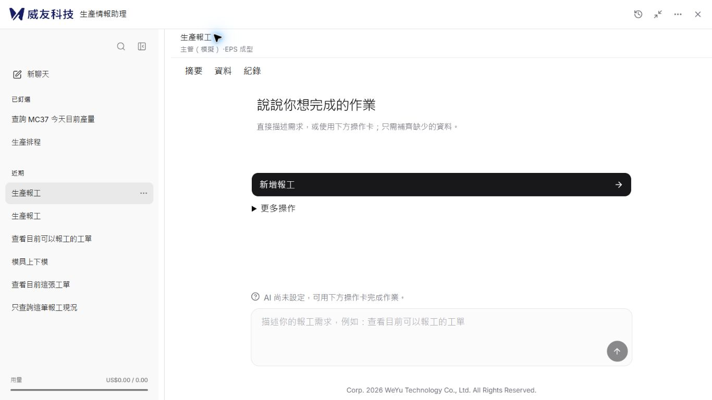
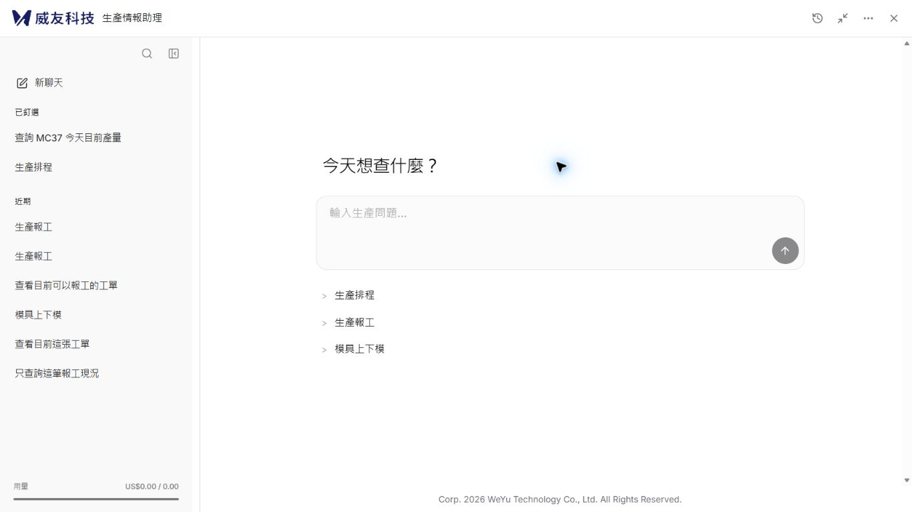
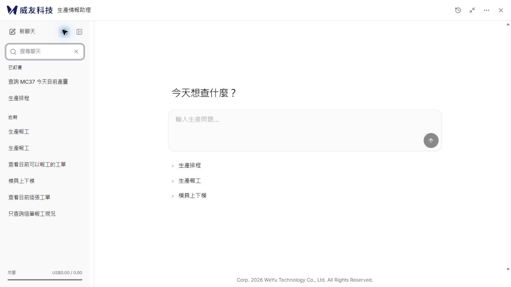
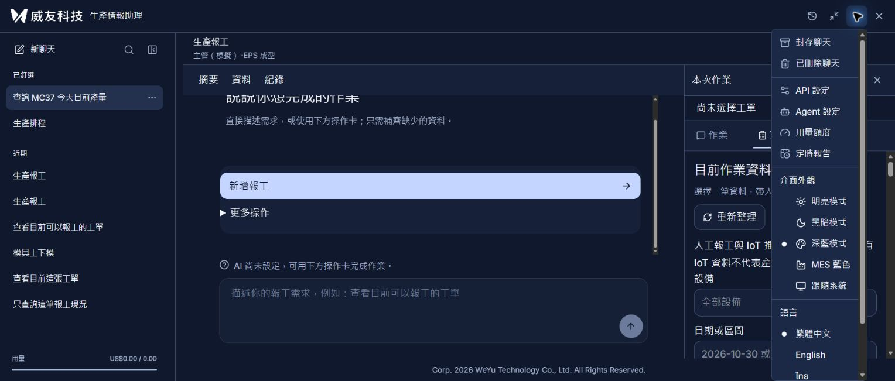

# Issue #25：平面聊天清單實作與驗收

## 狀態及規格優先順序

依 [Issue #25](https://github.com/WeYuTech/KaosuAiAgentTest/issues/25) 從 PR #24 最新 `f5401783c83c20a610ed6b680bdea3b439682dcc` 建立 `codex/issue25-flat-sidebar`。PR #24 尚未合併，本次 PR 疊在 `codex/issue23-sidebar-layout`，未從舊 main 回退既有功能。

外觀參考固定在 `f2649eddb558431a97511d87d2cd16b4a9cc3fd8` 的平面清單；未合併整個設計分支。**使用者在本輪後續明確要求移除側欄 WeYu 文字，以及「隔離模擬環境，正式 MES 資料不會變更」提示列，優先於 Issue 原稿。** 最終版只保留側欄搜尋／收合控制，原標頭公司標誌、版權、登入逾時提醒仍保留。隱藏提示不改變實際執行模式。

產品程式已完成；完整人工驗收仍有缺口，PR 保留草稿供審查。不合併、不部署、不關閉 #25、#23、#21、#19 或 #13。所有資料操作均在本機隔離環境；模型未設定、隔離額度為 0，正式 US$20 累計帳本未變更。沒有正式 MES 業務寫入。

## 正式程式修改

- 移除範圍下拉、scope radio 選項、每列 Pin 圖示、日期分組與選取左線。主視圖固定「已釘選／近期」，以真實 `is_pinned` 分組，保留伺服器順序及整體分頁。
- 封存／已刪除入口移至標頭「更多功能」。`HistoryController.showScope` 由同一份 `ConversationHistory` 管理範圍，原子清空搜尋、回第一頁；沒有以 scope key 重掛載。原 actor key 繼續隔離不同可信身分。
- Radix 選單關閉時取消預設回焦，再打開既有側欄／抽屜並聚焦子視圖標題。返回聊天聚焦搜尋圖示；主 Guide、草稿及 proposal 不重建。
- 寬度操作移入更多功能的「側欄」區，只在並排寬版可用。`SidebarSplitter.tsx` 未修改；預設 288、下限 240、上限 420、動態限制、儲存及拖曳／鍵盤契約保留。
- 新聊天採 SquarePen 透明列；依圖稿設定列高、間距、字級、圓角、選取／hover、底部真實用量。一般列更多按鈕在 hover／focus 出現，選取列常駐；粗指標命中區另有樣式。
- 搜尋明確開關，180ms debounce 與既有 IME 保護保留；關閉清條件、回第一頁及回焦。移除瀏覽器原生重複清除圖示，只保留一個關閉控制。
- 空集合只顯示一次「尚無聊天」或「找不到符合的聊天」。第二頁沒有釘選時保留段標題，不宣稱整個帳號沒有釘選。刪掉末頁最後一筆後，先回有效頁再顯示結果。
- 命名、釘選、封存、刪除、還原沿用原 metadata version、409 與 busy 保護；已封存聊天刪除後再還原，仍回封存範圍。
- 新增三語標籤及還原位置說明。淺／深色採指定色碼，深藍／MES 沿用產品色彩層級。沒有新套件、API、DB Schema 或模型流程變更。

## 版本與畫面證據

- 比較基準：`f5401783c83c20a610ed6b680bdea3b439682dcc`。
- 第一輪功能／配對畫面：`a889de4beb57da4730d527f6ad5353ab4b57a2b0`。
- 三語還原說明：`de20349`；身分隔離補驗：`e93ee77`。
- 後續移除兩處文字：`d84f09a`。
- 最終產品：`eb686b03fd53a30c5ada780a9c745de4f020e365`（額外消除搜尋的重複清除圖示）。

每張圖對應 JSON 記錄 viewport、DPR、側欄／主區 rect、語言、主題與 source SHA；[畫面清單](evidence/issue25/畫面清單.json) 另列實際影像尺寸及 SHA256。所有檔案均為實際瀏覽器截圖，沒有後製補畫 UI。兩張 390×844 DOM 畫面的影像為 390×843，保留原始工具輸出，不裁切或補像素冒充一致。

前後比較使用相同 8 筆受控聊天（2 筆釘選；7 筆預建及登入開始作業新增 1 筆），同一報工起始狀態、繁中、淺色、1366×768、304 CSS px 側欄。此資料和圖稿的示意金額不同；畫面 US$0.00 / 0.00 是實際隔離帳本，不是正式額度。

| 選定參考稿 | 修改前 | 最終修改後 |
|---|---|---|
| [304×624 原稿](evidence/issue25/選定參考稿.png) | [PR #24](evidence/issue25/修改前-1366-304.jpg) | [最終 React](evidence/issue25/修改後-1366-304.jpg) |



最終版依使用者追加要求移除兩處文字，因此內容區頂端由 97.3px 移至 56px，側欄／主區同時增加可用高度。這是明確的需求差異，不是漏套圖稿。其餘較早的功能證據仍含 WeYu／模擬提示列，僅證明當時的功能與配對測試，不冒充最終畫面。

| 場景 | 證據與實測 |
|---|---|
| 搜尋及無結果 | [MC37](evidence/issue25/搜尋-MC37.jpg)、[無結果](evidence/issue25/搜尋-無結果.jpg)，最終版本；一次空訊息，無 1/1 分頁 |
| 封存及已刪除 | [封存空集合](evidence/issue25/封存-空集合-草稿保留.jpg)、[封存清單](evidence/issue25/封存-清單.jpg)、[已刪除](evidence/issue25/已刪除-清單.jpg) |
| 待確認保護 | [管理不解鎖](evidence/issue25/待確認-管理不解鎖.jpg)，保留 1 張卡與 1 個確認入口，新聊天停用；後續只取消 |
| 240／100 字 | [長標題](evidence/issue25/長標題100字-240.jpg)，單行省略、全文名稱與更多可達 |
| 420／英文深色 | [1920×1080](evidence/issue25/英文-深色-1920-420.jpg)，底色 #171717、選取 #303030 |
| 288／泰文深藍 | [1920×1080](evidence/issue25/泰文-深藍-1920-288.jpg)，工單／聊天原文保留，固定文案翻譯 |
| 390／泰文 MES | [刪除抽屜](evidence/issue25/泰文-MES-390-刪除抽屜.jpg)、[聊天抽屜](evidence/issue25/泰文-MES-390-聊天抽屜.jpg)，無橫向溢出、主區 inert |
| 320／短高淺色 | [320×568](evidence/issue25/繁中-淺色-320短畫面.jpg)，清單高度 238、可捲動 447；頂部／用量保留 |
| 動態寬度上限 | [900×700](evidence/issue25/動態上限-900.jpg)，側欄 396＋命中區 24＋主區 480 |
| 最終 288／跟隨系統 | [正常視窗](evidence/issue25/最終版本-系統主題-288.jpg)，實際 viewport 1528×651、DPR 1.25；臨時尺寸已重設 |

[互動證據](evidence/issue25/互動證據.json) 記錄焦點、唯一確認、草稿與實際拖曳：從 x=408 拖至 368，寬度 396→356，ARIA 同步 356。截圖本身不當作焦點或拖曳證據。

## 驗收結果

| Issue 驗收群組 | 狀態 | 實際證據／未執行項目 |
|---|---|---|
| 1. 選定外觀 | 通過（依追加指示調整） | 同 fixture 304px 前後比較；最終無 WeYu／模擬提示列、無範圍下拉、無重複 Pin／選取線；288 重設及已保存 304 恢復均實測 |
| 2. 資料與空態 | 通過 | 行為測試覆蓋初載／錯誤／全空／跨頁／第二頁沒有釘選／末頁刪除／actor／舊回覆；瀏覽器實測搜尋與管理空集合 |
| 3. 聊天管理 | 通過 | 新增、開啟、搜尋、關閉、命名 100 字、釘選／取消、封存／取消、刪除／還原走實際 UI；分頁、版本 409 與還原保留封存由公開 HTTP／元件測試驗證 |
| 4. 新入口與焦點 | 通過 | 展開、收合、窄抽屜均可進管理，標題取得焦點，返回清搜尋／頁碼；MC37／WO-A 人工良品 120／不良 0 保留；待確認未解除鎖定 |
| 5. 尺寸與內容 | 部分通過 | 上表尺寸、三語與五種外觀設定完成風險配對；200% 瀏覽器縮放未完成。快捷鍵嘗試後 DOM 尺寸未變，不將縮小 viewport 冒充縮放驗收 |
| 6. 互動與無障礙 | 部分通過 | Tab、Escape、搜尋回焦、管理標題回焦、真實 1:1 拖曳及鍵盤 Home／End／方向鍵／重設實測；pointer cancel、blur、卸載及未知結果／重複送出由既有測試通過。真實 IME、實體觸控、讀屏、OS reduced-motion 實機切換、瀏覽器 unknown 故障注入未執行 |
| 7. 實際證據 | 部分通過 | 已保存原始截圖、尺寸、版本與互動讀回；目前工具未提供已確認可用的瀏覽器錄影介面，短操作錄影未執行 |
| 8. 程式驗證 | 通過 | 前端 104 項、相關後端 9 項、型別及正式建置通過；無新增套件或正式資料寫入 |

必要驗證命令：

```powershell
npm --prefix frontend test
npm --prefix frontend run build
.venv/Scripts/python.exe -X utf8 -m pytest tests/test_conversation_history_http.py tests/test_conversation_first_http.py -q
git diff --check
```

[前端原始測試輸出](evidence/issue25/前端測試.log)、[型別及建置輸出](evidence/issue25/型別與建置.log)、[後端相關回歸](evidence/issue25/後端相關回歸.log)。建置仍有既有 chunk 大於 500kB 提示；後端有 Starlette/httpx 相容性棄用提醒，均非本次失敗。沒有宣稱本輪重跑全部後端測試。

[隔離 HTTP 讀回](evidence/issue25/隔離HTTP讀回.json) 顯示 simulation、未設定模型及取消的 report.add 稽核；畫面或截圖不當作正式寫入成功證據。

## 失敗／修正紀錄及待辦

- 初始 fixture 用報工員建立模具聊天被 403 拒絕；確認該身分只有 report 權限後，改用既有模擬主管建立跨模組 fixture，沒有放寬產品權限。原 HTTP 方法／路徑／狀態紀錄留於 `.local/issue25-http.jsonl`，不含憑證。
- 視覺初查發現作用域前綴令主題選擇器未命中，以及舊全域按鈕樣式覆蓋尺寸；在 `history.css` 的單一樣式來源修正，重新讀回指定色碼、32／28px 控制與 63px 用量區。
- 截圖曾出現 DOM 1366×768、影像 1366×582 的不一致；頁面導覽後重設再套用 viewport 可恢復。失敗影像保留 `.local/issue25-capture-mismatch/`，正式前後比較與搜尋圖已重新拍攝並讀回真實影像尺寸。
- 瀏覽器曾有一次 frame tree timeout，回來時頁面已重新載入；未將未完成的管理動作當成成功，重新讀取狀態與 HTTP 紀錄後完成驗證。
- 保留未執行的人工驗收，不以自動測試、CSS 宣告或圖片取代。這些缺口及 #23／#21 的其他要求仍各自追蹤。

本機可由既有命令啟動；本輪另保留 `http://127.0.0.1:8029/` 隔離比較預覽（模型停用）。正式部署與回復仍依既有 IIS 文件，這次沒有變更正式站。


## 後續調整：側欄上半部垂直間距（2026-11-02）

依使用者最新指示，只修改 `history.css` 的間距與對齊，不改動功能或 DOM 結構。本段取代前述圖稿相應的 spacing 數值。

| 規則 | 原值 | 新值 |
|---|---|---|
| 頂端搜尋／收合控制區 | 固定高 66px；水平 20／16px | 最小高 48px；上下 8px、左右 12px；依圖示高度自然增高 |
| 新聊天相對側欄頂端 | 66px | 48px，整體上移 18px |
| 搜尋控制按鈕至新聊天 | 17px | 8px |
| 新聊天下方區塊留白 | 17px | 12px |
| 搜尋欄／管理子視圖下方 | 16px | 12px |
| 已釘選與近期組間 | 27px | 20px |

保留標題到清單的 8px、每列 2px 間距、42px 聊天列及原按鈕命中區。上方操作區使用 8／12px 間距，清單分組使用 20px，形成較清楚的層級；沒有新增邊框或變更色彩。

實際瀏覽器讀回：1366×768、288px 側欄，頂部 48px、新聊天前距 8px、到已釘選 12px；搜尋展開時上下皆 12px且正確聚焦。390×844 抽屜仍能開關搜尋，沒有橫向溢出。粗指標控制的原 40px 命中區不縮小，頂部可自然增高為 56px；本輪未使用實體觸控裝置。

型別與正式建置通過；這是純樣式微調，不新增照抄 CSS 的測試，也未重跑不受影響的業務測試。先前 104／9 項測試結果屬前一輪。未部署正式 MES。




## 後續調整：新聊天與搜尋同列（2026-11-02）

依使用者最新指示，將新聊天放在頂端左側，搜尋／收合圖示放在右側，同列垂直置中；搜尋輸入框仍獨立展開在下一列，不與新聊天搶寬度。此布局取代上一節的兩列操作區。頂列左右 12px、上 8px、下 12px，控制之間 8px；其他清單間距保留。

收合側欄再開啟時，焦點明確回搜尋圖示，不因新聊天成為第一個按鈕而改變原焦點行為。待確認狀態的新聊天鎖定沿用原條件。

實際檢查 1366×768 視窗、最窄 240px 側欄：新聊天與搜尋圖示中心皆為 y=85px，按鈕間距 8px，搜尋欄位於下一列，頂列沒有橫向溢出。前端 104 項與型別／正式建置通過；未部署正式 MES。



## 後續調整：移除側欄寬度選單（2026-11-02）

依使用者最新指示，移除更多功能選單的「側欄」標題與「縮窄側欄／加寬側欄／重設寬度」三項指令，取代先前提供寬度選單的設計。側欄分隔線與既有拖曳、鍵盤調寬能力保持原樣。

繁中、英文、泰文的三項選單操作測試及型別／正式建置通過；本機隔離預覽實際開啟選單，確認該區塊已消失，其餘選單仍可見。未部署正式 MES。


