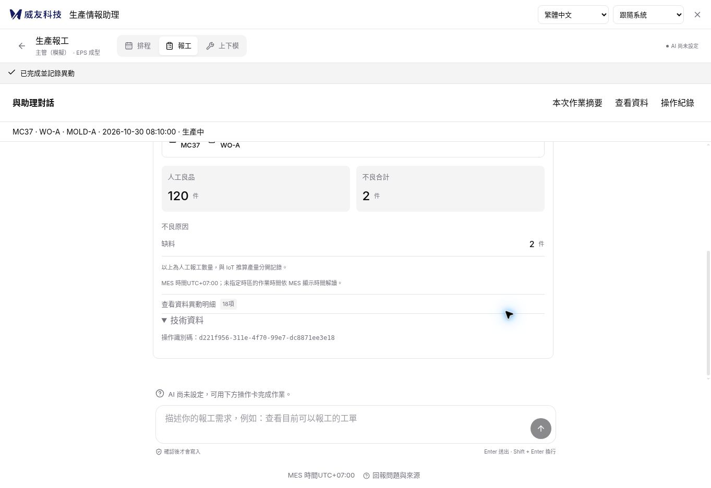
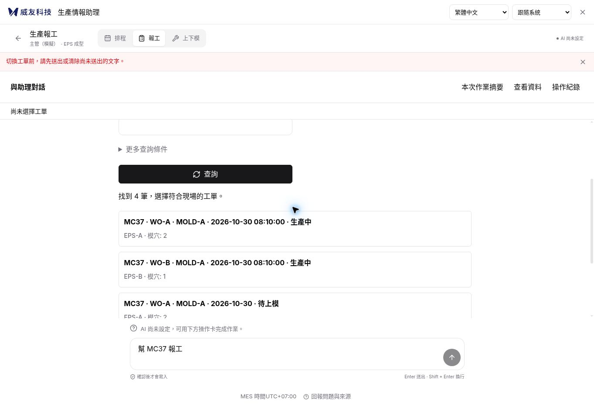
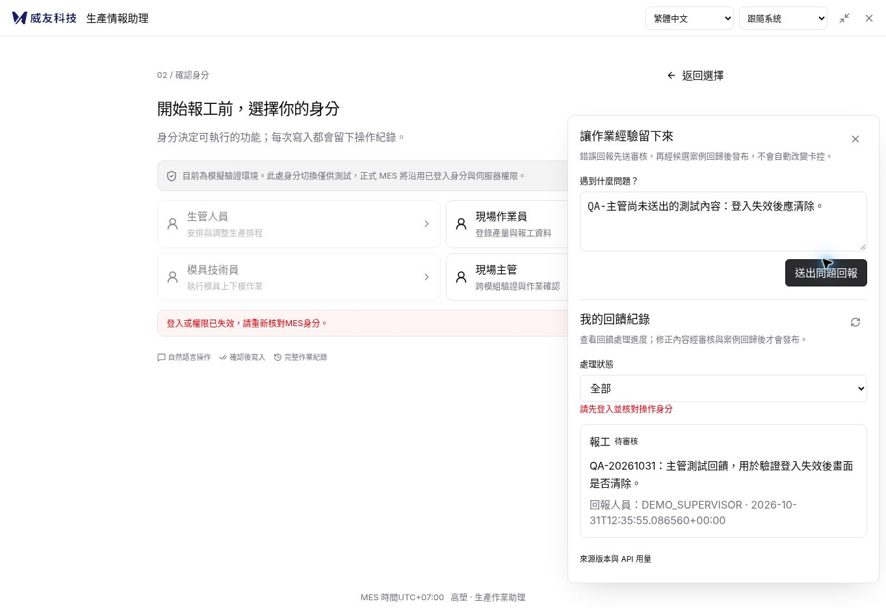
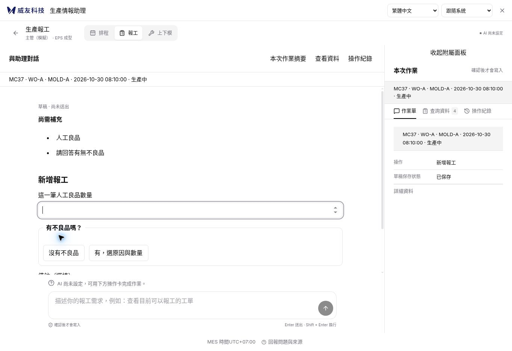

# MAIN UX 複驗與改進清單（2026-10-31）

## 結論與適用版本

**尚未完整達到「新人可順利上手」與 PR #14 的驗收要求。** 對話主區、按需摘要及一般報工已明顯改善；本輪在最新 main 實際完成了「MC37／WO-A → 良品 100、缺料 2 → 改 120 → 重新核對 → 同意 → 成功回執」。但無模型起步會卡住，登入失效後仍顯示原主管的回饋與草稿；提交恢復另外有兩個可重現的阻斷，摘要與首次需求接續也尚未完成推薦流程。

**最新 UI 要求：比照使用者指定的 `WeYuTech/WeYu-MesAiAgent` 預設 main。** 本輪固定參考 `4503d1211be0d648ae50a34556d4848e58456c2c`；實作先讀 [UI 對齊與 Codex 指令](WeYu-MesAiAgent-UI對齊與Codex指令-20261031.md)。前輪 graphite／暖白原型與五方案 Demo 保留作流程歷史，外觀不再作本輪標準。R01–R06、單一 Guide／確認與業務保護仍有效。

- 審查版本：[`3e1c7c002177f4bb16255cf3d26b840b82d7b4c7`][main-commit]，已合併 [PR #15][pr15]；建立本次 PR 前再次確認 main 未變。
- 需求與追蹤：[Issue #13][issue13]、[PR #14][pr14] 的 [UX 規格][spec]及 [AI 實作／53 項驗收][acceptance]。PR #14 在本輪審查時仍未合併，這些規格須從該 PR／固定 commit 閱讀，不能假設 main 已包含。
- 本次 PR 交付：改進要求、可操作的重現、驗收案例、實際截圖及兩支唯讀診斷；後續依使用者視覺回饋追加 R07 規格與互動原型。**應用修正尚待下一個實作 PR；本 PR 合併不代表問題已修好，也不關閉 Issue #13。**
- 測試環境：最新 source 的本機隔離預覽，`MES_MODE=simulation`、未設定模型、關閉 SQL 驗收，使用合成設備／工單／主管回饋。本輪沒有真實模型呼叫、正式 MES 寫入或正式部署。

## 1. 本輪已確認的改善

| 項目 | 本輪證據 | 判讀 |
|---|---|---|
| 操作主區與摘要 | 預設摘要收合；選工單、補資料、修改與確認均在主要操作區 | 推薦的 01 主線＋02 按需摘要方向已落地 |
| 一般手動報工 | 瀏覽器完成 MC37／WO-A／EPS-A，100／2 改為 120／2，再同意並顯示成功 | 正常路徑可用；這不是自然語言模型驗收 |
| 修改後重新核對 | 回「上一步：修改資料」後，舊卡從可操作區移除，新卡顯示 120／2 | 本輪 UI 行為符合重新核對方向；不單靠截圖推論所有交易競態 |
| 查詢與資料切換 | 原始碼中查詢回覆不再強制跳到資料分頁；另有「以此筆資料開始」 | 已改善原先容易混淆的查詢／切換行為 |
| 基本工程驗證 | 前端原命令 60 項通過、建置通過；後端 201 項通過／9 項跳過 | 足以支持既有測試的結果，不能取代下列 UI 與跨狀態驗收 |



## 2. 改進優先順序

P1 表示應先修正的主要流程或身分資料隔離問題；P2 表示恢復流程／規格缺漏與視覺完成要求。優先度是本輪工作排序，不代表已發生正式系統事故。

| 編號 | 優先 | 改進點 | 證據層級 | 對應需求 |
|---|---|---|---|---|
| R01 | P1 | 無模型時，首頁文字讓人工選工單卡住 | 實際瀏覽器＋原始碼 | A10、D03 |
| R02 | P1 | 登入失效仍顯示前人回饋與草稿，晚到回覆隔離不完整 | 回饋殘留已做 UI；audit／晚到回覆為原函式診斷 | D05、B03、T03 |
| R03 | P2 | 明確拒絕後驗證 GET 暫斷，恢復時仍被誤鎖為 unknown | 實際匯出函式＋HTTP／Storage 替身 | C13、C06、E06 |
| R04 | P2 | 另一分頁有未知操作時，被擋分頁沒有原操作查核入口 | 實際匯出函式＋兩個邏輯分頁替身 | D04、E06 |
| R05 | P2 | 摘要沒有尚缺項目、作業階段及回主欄位入口 | 實際瀏覽器＋原始碼 | UX §7、E02、A08 |
| R06 | P2 | 首頁需求選完範圍後只搬到輸入框，仍須再送一次 | 畫面／控制流程讀碼；未重跑真實模型 | UX §2.1／§2.2、E02 |
| R07 | P2 | 依 WeYu-MesAiAgent main 完成品牌、聊天卡、輸入與響應式對齊；保留操作流程 | 使用者指定來源＋兩份 CSS 的有效覆蓋規則；新 UI 尚待實作 | 修訂 V08–V16 |

### R01：無模型時的新人起步阻塞

**實際重現：**

1. 模型未設定，但 workspace 與 Guide 可用。
2. 首頁「描述作業需求」填入「幫 MC37 報工」。
3. 選生產報工及模擬身分，再選「新增報工」。
4. 點合法的 MC37／WO-A 生產中工單。
5. 顯示「切換工單前，請先送出或清除尚未送出的文字」，但聊天文字框及送出按鈕已停用，無法依提示完成動作。

這不是所有人工報工失效：本輪返回模組入口、清掉文字再進入後可完成正常報工。問題是依照首頁提示輸入的新人成為被卡住的一群，恢復還需要自行猜測繞路。

**原因：** [main.tsx 的入口與 start][main-entry]保留輸入；[composer][main-ui] 在 `modelConfigured === false` 時整個停用；相同頁面的 `beforeTargetChange` 仍用非空 draft 阻止工單選擇。這三個個別合理的規則沒有形成可完成的流程。

**要求 AI 實作：**

- 模型不可用時，在起步處說清楚文字理解暫不可用，提供可直接繼續的人工卡片。
- 已輸入文字須能在當前工作區編輯、清除或明確暫存，不能要求使用者操作一個 disabled 欄位。
- 選工單時明確處理保留文字與目標的關係，不靜默丟字、不把原文字假裝解析為業務參數，也不把它帶給另一個錯誤工單。
- 不呼叫未設定的模型；人工查詢、選擇、填寫與核對仍可完成。

**完成條件：** 有文字與無文字兩種起步都可選工單，不需返回另一頁清除；清除／暫存動作可由鍵盤完成，並有三語文案。



### R02：登入失效後的資料清理與晚到回覆

**本輪完整 UI 重現的是「回饋紀錄及未送出草稿殘留」：**

1. 在隔離預覽以模擬主管進入報工，開「回報問題與來源」。
2. 建立合成回饋 `QA-20261031：主管測試回饋，用於驗證登入失效後畫面是否清除。`，確認其紀錄已載入。
3. 在回饋輸入框保留第二段尚未送出的測試文字，保持面板開啟。
4. 另一分頁使用該隔離服務的 Swagger UI，執行既有 `DELETE /api/session`，確認回覆 `signed_out`。這個 API 在正式模式拒絕使用；本輪只用來製造可重現的模擬登入失效。
5. 回原分頁按「送出問題回報」，API 拒絕未登入請求，主畫面回到「開始報工前，選擇你的身分」。
6. 回饋面板仍開著；原主管紀錄及未送出文字仍可見，即使面板也顯示「請先登入並核對操作身分」。

**影響是已載入資料在前端殘留。沒有證據顯示後端授權被繞過或成功越權寫入。**

原因與延伸診斷：

- [`clearSession()`][main-session] 沒有清 `audit`、`feedback`、`guideSnapshot`、`sheetContext` 等資料，也未關 `helpOpen`；回饋面板位於 onboarding／chat 分支之外。
- [`FeedbackReview`][feedback] 在 actor 改變時重新讀取，但未先清 `records`、`selected` 等狀態；讀取 401／503 不會移除前人的內容。
- [`showAudit()`][main-audit] 先打開紀錄面板，再讀新資料，載入中及失敗時保留前一人的 audit。此支線已用原函式＋合成狀態重現，尚未做完整跨登入 UI 驗收。
- `clearSession()` 未提升 `queryGeneration`，已在途的 workspace 回覆可在清理後重新填回；[`receive()`][main-receive] 的舊閉包也沒有核對有效 actor／conversation。兩者已有函式級診斷，尚未逐條做完整瀏覽器競態。

**要求 AI 實作：**

- 集中處理 session 失效與 actor 變更：清除所有 actor 專屬的 UI 資料、草稿、選取、審核表單和提示，關閉相應面板。
- 以有效的 actor／conversation 與情境世代約束所有 async 採用點。清身分或換情境即使舊世代失效，workspace、audit、feedback、Guide／proposal 的晚到回覆不得重新填回。
- 回饋元件依 actor 清理或重新掛載；讀取期間與讀取失敗都不可短暫顯示前一身分資料。
- 保留語言、主題等非身分偏好。**未知操作的最小恢復標記必須留在原 actor 範圍；清 UI 不等於刪除未決操作證據。**
- 補測另一分頁換人後讀舊 conversation 回 404 的路徑。後端會對 actor 不符回 404；應重新核對 session 再決定是否清理，不把所有 404 都當登出。這條尚未列為本輪完成的 UI 重現。

**完成條件：** 未登入畫面、下一位使用者的畫面及新請求失敗畫面均不含上一位的 audit／回饋／草稿／審核表單；舊回覆晚到也不重新顯示。原 actor 的未決操作仍只能由原 actor 恢復。



### R03：已明確拒絕的操作因一次讀取失敗而無法恢復

**已執行的函式診斷順序：**

1. 同一 pid 沒有更早 unknown，也沒有其他在途嘗試。
2. confirm 收到明確 409，例如版本／資料狀態拒絕。
3. 緊接著的驗證 GET 暫時失敗。
4. 網路恢復，刷新時已成功讀回同一張權威 `pending` 卡。
5. `restoreSubmission()` 仍把它轉成 `unknown`；reconcile 回 pending 仍維持 unknown；後續確認與取消均在網路前被攔下。

本輪診斷的請求為 1 次 confirm、1 次失敗 GET，後續確認／取消網路呼叫為 0。這是「保守鎖定後沒有恢復出口」，沒有觀察到重複業務寫入。

**原因：** [`submitRecoverably()`][recovery] 只有立即 GET 成功才保存本次 `outcome: rejected`；該 GET 失敗會丟失「本次明確被拒絕」與「是否送達未知」的區別。後續恢復只能看到沒有 outcome 的 marker。後端在部分前置檢查拒絕時確實保留 pending，不能期待它自行變成終態。

**要求 AI 實作：**

- 保留本次嘗試已收到明確拒絕、仍待權威核對的資訊，包括原 actor scope／conversation／pid／attempt；不把尚未核對誤宣告為可重新確認。
- 後續只讀核對成功，且確定同一 pid 並排除其他未知／在途嘗試後，導入現有「本次已拒絕，返回修改或取消」流程。
- 已失效確認卡仍不能再次同意。若有較早 unknown 或另一分頁的未知嘗試，本次 4xx 不得清其鎖定。
- 若對某種 4xx 不能證明未執行，保留 unknown，提供明確的原操作識別與人工核對途徑；不要以刪 localStorage 解鎖。

**完成條件：** 覆蓋「4xx→立即 GET 失敗→稍後 GET 成功」、「稍後仍失敗」及「另外有 unknown」三組案例；第一組可安全修正，後兩組保持可查核且不重送。

### R04：跨分頁阻擋後，必須能到達原操作

**已執行的函式診斷順序：**

1. 同 actor／module／來源 scope 的 A、B 分頁，原本已各有不同 conversation／proposal。
2. A 送出後回覆與 GET 遺失，留下 A 的未知恢復 marker。
3. B 仍顯示自己的 pending 卡；點同意或取消均被 scope 保護擋下，提示「已有送出紀錄，請先查核原操作」。
4. [`confirm()` catch][main-confirm] 只恢復目前 B 卡。B 的 pid 不同，所以仍顯示可同意、可取消、不可查核；兩個按鈕再點仍遭攔下。

**現有提交保護是有效的，應保留。** 問題在於使用者沒有可到達的 A 查核入口；目前要自行猜到整頁刷新，才由 `start()` 恢復 A。這次使用共用 Storage 的兩個邏輯分頁替身，尚未聲稱真實雙分頁 UI 已驗收。

**要求 AI 實作：**

- scope 阻擋結果攜帶需要恢復的原 conversation／pid，提供明確「恢復並查核原操作」動作，或將原操作卡帶入可見區。
- 跨分頁 marker 新增／解除後同步目前頁面；新任務入口與提交前也要再檢查，不能只靠首次 start。
- 轉去 A 前保留 B 的未送出輸入，或讓使用者明確決定；不靜默清除 B，也不允許 B 繞過 A 鎖定。
- 查核成功後解除正確 scope，顯示結果，再讓使用者恢復 B。查核仍未知或失敗時保持原 pid 及只讀查核入口。

**完成條件：** 被擋的 B 不會呈現兩個反覆失敗的主要動作；使用者能在當前工作區到達 A、查核、再繼續 B，整個過程沒有新增業務提交。

### R05：摘要應回答「做到哪裡、還缺什麼、如何修改」

**實際重現：** 選 MC37／WO-A，尚未填人工良品或回答有無不良，打開「本次作業摘要」。主區有兩個缺項；摘要只顯示對象、操作、草稿已保存及詳細資料，沒有缺項、階段或定位動作。

[`GuidedFlow` 的 snapshot][guide-snapshot] 目前只給 args／action／draft_save_state；[摘要呈現][main-ui]沒有使用 Guide 的 missing／step／ready，也沒有回主欄位的入口。保存狀態本身已存在且有合法標籤，不能將它誤報為缺失。

**要求 AI 實作：**

- 從同一份 Guide／proposal 推導摘要：目前對象、已填內容、尚缺欄位、保存狀態與目前階段。
- 摘要的「補資料／修改此欄」回主區同一欄位並移動焦點；窄版先收起覆蓋式摘要再定位。
- 單一草稿、單一有效確認入口。摘要不能新增第二份編輯器、獨立確認按鈕或另一套驗證規則。
- `ready` 只表示草稿資料齊備，不表示已獲授權寫入或已完成。

**完成條件：** 新人從摘要能直接知道下一步；點缺項可到主欄位；已填值不丟失；pending／unknown／完成的摘要與主卡一致。



### R06：首次需求與工作範圍應在同一條流程接續

這是相對 PR #14 的**設計尚未完成**，與 R01 的阻塞 bug 分開處理。

[目前入口與 start][main-entry] 仍先顯示大型模組首頁；使用者輸入需求、選工作範圍後，文字只被保留到聊天輸入框，只有另按 `send()` 才會呼叫 messages。規格 §2.2 要求在同一對話區明確選定 module，建立／恢復成功後接續送出原文字一次。本輪沒有呼叫真實模型，只從 UI 與控制流程確認此差距。

**要求 AI 實作：**

- 已有授權且相符的 conversation，或使用者點了附有明確 module 的範例時直接接續；scope 不明時在同一主區以小型選項詢問排程／報工／上下模。現有宿主白名單不包含 module，不得由設備、排程識別或 OPERATION 自行推論。
- 完整保留使用者原句。選定 scope、可信身分及 conversation 準備成功後，只對正確 conversation 送出一次，並立即讓使用者看見已送出的原文及處理狀態。
- 防雙點、防重複 effect；失敗時保留原文並提供明確重試，不因頁面重載自動重送。
- 有未知操作時優先恢復原操作；無模型時走 R01 人工流程。不能靠前端固定關鍵字猜 scope，也不在未建立可信 scope 時發 messages。
- 保留明確的模組切換與既有三模組權限，不新增五種正式入口模式。

**完成條件：** 模型可用時，「輸入需求→選必要範圍→回覆」不再要求使用者重按送出；HTTP 證據顯示對正確 cid 恰好一次 messages。無模型、未登入、unknown、建立失敗仍有明確安全出口。

### R07：依 WeYu-MesAiAgent main 對齊 UI

使用者最新指定 `WeYuTech/WeYu-MesAiAgent` 作介面參考。本輪以 repo 預設 **main** 的固定版本 `4503d1211be0d648ae50a34556d4848e58456c2c` 為準；`Emerald` 分支是另一套 React／assistant-ui 介面，不混入本輪視覺驗收。

來源的有效呈現為 `chat.css` 加上其後載入的 `tailwind.css`：威友深藍／黃色點綴、白色歡迎與助理卡、淺灰聊天區、淡藍灰使用者訊息、直排建議入口、圓角輸入及黃色送出按鈕。需要比照的範圍包含標頭、留白、字體、圓角、邊界、訊息與輸入配置及響應式，不能只改一個主色。

先讀 [UI 對齊與 Codex 指令](WeYu-MesAiAgent-UI對齊與Codex指令-20261031.md)，再依修訂的 [視覺改版與畫面驗收](視覺改版與畫面驗收-20261031.md) 實作 R07.1–R07.8 與 V08–V16。目標維持 Kaosu 現有 React、三模組、按需唯讀摘要、三語、light／dark／system、滿版工作區及同一 Guide／proposal。來源沒有的目標能力以一致視覺延伸，不能刪除。

**前輪原型的外觀已被取代。** [舊 HTML](prototypes/emerald-visual-refresh.html)、[歷史實測紀錄](prototypes/emerald-visual-refresh.README.md)與四張原型截圖，只保留為流程與歷史證據；其中 graphite、暖白、鋼藍、880–960px 與112px等數值不再是本輪視覺門檻。

**本次仍是規格與交接更新，正式 app 尚未套用新 UI。** 後續 Codex 應提交實際 React 實作 PR；來源的後端、固定帳號授權、查詢 API、獨立問答邏輯與假資料都不是 Kaosu 的業務契約。新外觀不能取代 R01–R06 的功能修正。

## 3. 交給下一個 AI 的實作順序

所有工作繼續追蹤在 Issue #13；實作 PR 用 `Refs #13` 並列出完成的 R 編號。不要因文件 PR 合併就關閉 Issue。

1. **先修 R01、R02。** 讓新人起步可完成，並確保身分清理立即生效；包含相關 UI 狀態和晚到回覆的回歸案例。
2. **再修 R03、R04。** 保留既有 unknown 不重送保護，補齊「明確拒絕待核對」及「到原操作查核」的恢復路徑。
3. **整合 R05、R06、R07。** 在安全狀態與單一 Guide 基礎上，依新指定來源 main 的 UI 完成畫面層級、摘要引導、首次需求接續與鍵盤焦點；R07 呈現層可平行進行，但不可取代前述阻塞修正。
4. 更新本輪驗收矩陣，列實際 commit、環境、通過／失敗／未執行。遇正式宿主、SQL 或輔助科技環境不足時保留未執行，不將原測試通過當成新 UI 證據。

維持 Python／FastAPI 與 React／TypeScript 既有架構；此工作不需要改 DB schema、新增依賴、導入新的 agent framework 或改 MES 業務規則。保留人員確認、writes_enabled、三語／主題、可信身分、同源子路徑及三模組完整入口。

### 後續必補的驗收案例

以下為**待修正後驗收**，不是本輪通過清單。

| ID | Given／When | Then |
|---|---|---|
| U01 | 無模型，首頁先輸入文字，再選報工／工單 | 當前頁可處理文字並繼續人工卡片；無模型呼叫，無靜默丟字 |
| U02 | 無模型，首頁沒有輸入文字 | 原本可用的查詢、選工單、數量、核對與回執仍可完成 |
| U03 | 主管已載入回饋及草稿，session 失效 | 身分選擇畫面不再顯示原紀錄、草稿及審核表單 |
| U04 | 換低權限 actor，新 audit／feedback 讀取延遲或 503 | 期間及失敗後均不顯示前人資料 |
| U05 | 舊 workspace／audit／feedback／Guide／proposal 在換人或換 conversation 後才返回 | 所有舊回覆均不改寫新情境；原 actor unknown marker 保留 |
| U06 | 另一分頁換 actor，舊 cid 回 404 | 重新核對 session，依 actor 是否改變處理；一般資料 404 不被一律當登出 |
| U07 | 本次明確 409，立即驗證 GET 暫斷，稍後讀回同 pid pending | 保留拒絕證據，安全導回修改或取消；失效卡不能同意 |
| U08 | U07 但另有較早 unknown／其他在途嘗試 | 保持鎖定、可查核，不能由新 4xx 解鎖舊操作 |
| U09 | confirm 回覆遺失，稍後 GET 只有 pending | 保持 unknown；只查核原操作，不自動重送 |
| U10 | A 未知，B 已有不同 pending 卡，B 點操作 | 清楚導向 A 查核，B 輸入可恢復，B 零業務提交 |
| U11 | A 查核分別為成功／仍未知／讀取失敗 | 顯示相應狀態；只有正確終態解除正確 scope，無重複寫入 |
| U12 | Guide 缺良品／不良答案，開摘要 | 摘要列具體缺項與階段；點缺項回主欄位，不新增第二套狀態 |
| U13 | 摘要下修改、保存失敗、pending、unknown、完成 | 摘要與主區同一狀態，保存失敗不假稱已存，只有一個有效確認入口 |
| U14 | 模型可用，首次原句完整，scope 不明 | 小型選項澄清 scope 後，正確 cid 恰好送一次原句 |
| U15 | 首次流程雙點、建立失敗、重載、有 unknown 或模型未設定 | 不重送、不跨 scope、不丟原句；有明確恢復／人工入口 |
| U16 | 360px／200% 縮放，鍵盤開摘要與點缺項 | 焦點停在可見控制、能關閉返回、無被遮住的可操作背景；補三語及讀屏檢查 |
| U17 | MC37／WO-A，良品100／缺料2→改120→核對→同意 | 只執行最新卡；UI 回執與 HTTP／業務紀錄對得上 |

### 可直接交付的 AI 工作指示

完整可貼指令與來源／目標檔對照見 [UI 對齊與 Codex 指令](WeYu-MesAiAgent-UI對齊與Codex指令-20261031.md)。核心要求如下：

```text
請在 WeYuTech/KaosuAiAgentTest 最新 main 延續 Issue #13，提交真正修改現有 React UI 的實作 PR。
先讀 PR #16 最新版 docs/WeYu-MesAiAgent-UI對齊與Codex指令-20261031.md，再讀修訂的視覺驗收、R01–R06 與 PR #14 的流程規格。
UI 以 WeYuTech/WeYu-MesAiAgent main@4503d1211be0d648ae50a34556d4848e58456c2c 的有效前端為準，完整核對 chat.css 與後載的 tailwind.css；不要改用 Emerald 或照前輪 demo 的色票／尺寸。
維持單一作業流程、按需唯讀摘要、單一 Guide／有效確認、可信身分、unknown 不重送、原 actor 恢復標記、三語及現有宿主能力。
依 R01/R02 → R03/R04 → R05/R06/R07 的既有優先順序處理；UI 可平行進行，相關工作可分 PR，但未完成的項目維持追蹤。
附同尺寸、同淺色主題的來源／改版前／改版後畫面，以及主要狀態、深色延伸、窄版與必要功能測試。只交文件、Demo、改顏色或 build 成功不算 UI 完成。
沒有測過的項目不得標完成；先保留 Issue #13，不自動部署或合併。
```

## 4. 本輪證據與重跑方式

### 工程驗證

| 指令／驗證 | 實際結果 | 範圍與限制 |
|---|---|---|
| `cd frontend && npm run build` | 通過：TypeScript 檢查及 Vite 建置 | 有既有大型 chunk 提醒；沒有因提醒判為功能失敗 |
| `cd frontend && npm test` | **60 passed／0 failed** | package.json 原本的逐檔隔離執行方式 |
| `MES_MODE=simulation OPENAI_API_KEY='' MES_SQL_ACCEPTANCE=0 python3 -m pytest -q` | **201 passed／9 skipped／1 warning，7.63 秒** | 9 項 SQL 驗收未執行；使用既有依賴環境，沒有安裝或修改套件 |
| 瀏覽器正常路徑 | 工單→100／2→120／2→確認→成功 | 無模型、隔離資料；不是正式 SQL 或真實模型證據 |
| 瀏覽器失敗路徑 | R01、R02 回饋殘留、R05 均已重現並截圖 | R02 的 audit／晚到回覆另用函式診斷 |
| 兩支唯讀診斷 | 2 個恢復場景＋5 個身分狀態觀察重現 | 使用實際 source 與合成狀態／HTTP／Storage；不等於完整 UI 或正式交易驗收 |

執行環境曾限制本機 socket 通訊，造成 pytest 的 TestClient 等待；已在允許本機測試通訊的受控環境，依原命令重跑取得上述結果。為釐清前端案例數另試過關閉逐檔隔離，會因各測試的全域替身互相影響而失敗；該非標準設定不作產品結論。最終前端結果是原 `npm test` 的 60 項全部通過。

### 可重現診斷

在本 PR 的 repository 根目錄，使用既有支援 TypeScript stripping 的 Node.js 執行（本輪 Node `v24.22.1`）：

```sh
node docs/evidence/main-ux-review-20261031/submission-recovery-repro.mjs
node docs/evidence/main-ux-review-20261031/identity-state-repro.mjs
```

腳本讀取本 checkout 的實際前端檔案；沒有網路請求、資料庫寫入或瀏覽器狀態變更。**斷言是在確認本輪缺陷仍可重現。** 修正後斷言失敗不是產品退步，應由正式回歸測試斷言正確結果。固定版本的實際輸出保存於 [提交恢復診斷結果](evidence/main-ux-review-20261031/submission-recovery-result.json)及 [身分狀態診斷結果](evidence/main-ux-review-20261031/identity-state-result.json)。

### 既有 53 項矩陣如何解讀

[main 的原驗收矩陣][matrix]記錄 53 項中 39 項通過、14 項完整指定邊界未執行，數量與文件說明一致。未執行的是：

`A01 B09 C06 C11 D09 V01 V02 V03 V04 V06 V07 T02 T03 T04`

它們包含正式宿主／九頁入口、完整 processing／拒絕／撤權／寫入開關組合、英泰後續模型、system 主題、IME、完整鍵盤、200% 縮放、輔助科技、SQL 交易與新版 UI 安全組合等。**未測不直接等於有 bug。**

同樣地，原矩陣 A10、D05、C13 的既有通過案例不能推論本輪新增分支也完成：無模型且首頁已有文字、回饋面板在 401 後殘留、4xx 後立即 GET 也失敗，都是更完整的邊界。本 PR 保留原歷史證據，新增失敗案例與待驗收條件，不機械地從 39 減掉幾項當成新的完整通過率。

**Issue #13 維持開啟。** 修正上述缺陷並完成指定環境驗收後，才由實際結果決定哪些要求可以標為完成。

[main-commit]: https://github.com/WeYuTech/KaosuAiAgentTest/commit/3e1c7c002177f4bb16255cf3d26b840b82d7b4c7
[issue13]: https://github.com/WeYuTech/KaosuAiAgentTest/issues/13
[pr14]: https://github.com/WeYuTech/KaosuAiAgentTest/pull/14
[pr15]: https://github.com/WeYuTech/KaosuAiAgentTest/pull/15
[spec]: https://github.com/WeYuTech/KaosuAiAgentTest/blob/f97dd1bed491c30f964a503475eae40749cbc664/docs/對話優先UX改版規格.md
[acceptance]: https://github.com/WeYuTech/KaosuAiAgentTest/blob/f97dd1bed491c30f964a503475eae40749cbc664/docs/對話優先UX-AI實作與驗收.md
[matrix]: https://github.com/WeYuTech/KaosuAiAgentTest/blob/3e1c7c002177f4bb16255cf3d26b840b82d7b4c7/docs/對話優先本輪驗收矩陣.md
[main-entry]: https://github.com/WeYuTech/KaosuAiAgentTest/blob/3e1c7c002177f4bb16255cf3d26b840b82d7b4c7/frontend/src/main.tsx#L232-L300
[main-session]: https://github.com/WeYuTech/KaosuAiAgentTest/blob/3e1c7c002177f4bb16255cf3d26b840b82d7b4c7/frontend/src/main.tsx#L217-L231
[main-receive]: https://github.com/WeYuTech/KaosuAiAgentTest/blob/3e1c7c002177f4bb16255cf3d26b840b82d7b4c7/frontend/src/main.tsx#L279-L289
[main-confirm]: https://github.com/WeYuTech/KaosuAiAgentTest/blob/3e1c7c002177f4bb16255cf3d26b840b82d7b4c7/frontend/src/main.tsx#L309-L324
[main-audit]: https://github.com/WeYuTech/KaosuAiAgentTest/blob/3e1c7c002177f4bb16255cf3d26b840b82d7b4c7/frontend/src/main.tsx#L336-L341
[main-ui]: https://github.com/WeYuTech/KaosuAiAgentTest/blob/3e1c7c002177f4bb16255cf3d26b840b82d7b4c7/frontend/src/main.tsx#L353-L392
[feedback]: https://github.com/WeYuTech/KaosuAiAgentTest/blob/3e1c7c002177f4bb16255cf3d26b840b82d7b4c7/frontend/src/FeedbackReview.tsx#L10-L44
[recovery]: https://github.com/WeYuTech/KaosuAiAgentTest/blob/3e1c7c002177f4bb16255cf3d26b840b82d7b4c7/frontend/src/submission-recovery.ts#L20-L68
[guide-snapshot]: https://github.com/WeYuTech/KaosuAiAgentTest/blob/3e1c7c002177f4bb16255cf3d26b840b82d7b4c7/frontend/src/GuidedFlow.tsx#L78-L86
