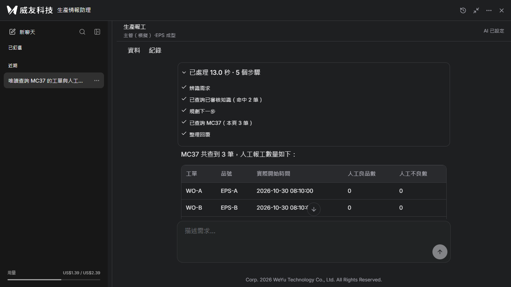
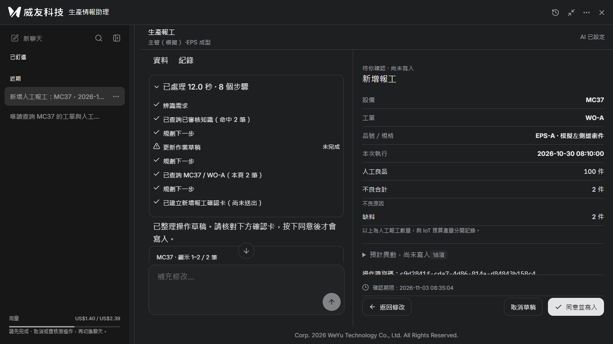
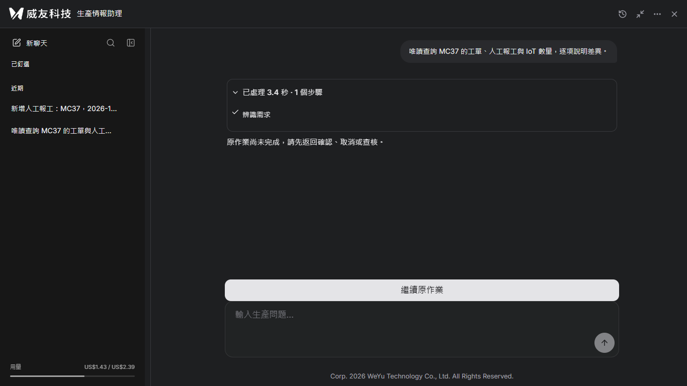
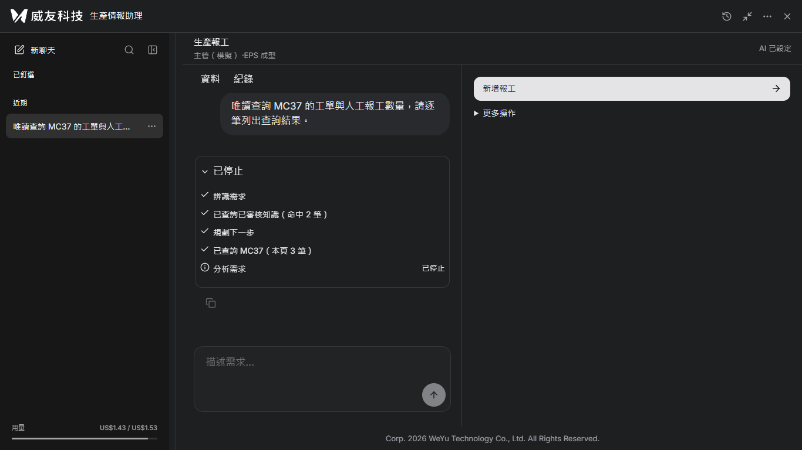

# 第 44 項第 2 輪：真實模型煙霧結果

日期：2026-11-03。使用產品分類器與 Responses API 真實呼叫；業務資料使用全新隔離 SQLite 與 `domain.seed_state()`，沒有使用模型／分類替身。未按同意寫入，三次檢查隔離業務狀態均與初始資料一致。

## 第 2 輪結果與限制（保留歷史）

只送出下列三則使用者訊息，模型內部共 8 次呼叫。第 1 則唯讀串流通過；第 2 則取得確認卡，但途中有一次草稿更新失敗；第 3 則被待確認作業卡控攔下，因此**真實模型中途停止未完成驗收**。沒有追加第四則，沒有把卡控終態冒充停止成功。

| 訊息 | delta 數 | 第一至最後 delta | 已結算費用前 → 後（USD） | 本則差額 | unknown 前 → 後 | 結果 |
|---|---:|---|---|---:|---|---|
| 1 | 177 | 1.8723 秒 | 1.390954 → 1.404242 | 0.013288 | 0 → 0 | 唯讀查詢完成 |
| 2 | 0 | 不適用（沒有 delta） | 1.404242 → 1.425230 | 0.020988 | 0 → 0 | 確認卡成功；中途草稿更新未完成 |
| 3 | 0 | 不適用（沒有 delta） | 1.425230 → 1.426178 | 0.000948 | 0 → 0 | 未執行停止：既有待確認作業阻擋新查詢 |

帳本累計 **US$1.390954 → US$1.426178**，本項增加 **US$0.035224**；unknown 0 → 0、未結算預留 US$0 → US$0。累計額度仍為 US$20，測試後剩餘 US$18.573822。原帳本 `.local/model-budget.db` 未清除或重設。

測試程序把每次產品預留上限額外收緊為「原累計＋US$1」（US$2.390954），不寫入 `.env` 或管理設定。截圖左下角因此呈現約 US$2.39 的程序內限制；離開測試程序後重新讀取的正式帳本設定仍是 US$20。費用以帳本前後讀值計算，不能以畫面啟動時的用量快取計算。

## 每則訊息與步驟

### 訊息 1

唯讀查詢 MC37 的工單與人工報工數量。

- 辨識需求：完成
- 已查詢已審核知識（命中 2 筆）：完成
- 規劃下一步：完成
- 已查詢 MC37（本頁 3 筆）：完成
- 整理回覆：完成

### 訊息 2

新增人工報工：MC37，2026-10-30 08:10 開始的 WO-A／EPS-A，本次人工良品 100，缺料 2。請準備確認卡，尚不寫入。

- 辨識需求：完成
- 已查詢已審核知識（命中 2 筆）：完成
- 規劃下一步：完成
- 更新作業草稿：未完成
- 規劃下一步：完成
- 已查詢 MC37 / WO-A（本頁 2 筆）：完成
- 規劃下一步：完成
- 已建立新增報工確認卡（尚未送出）：完成

### 訊息 3

唯讀查詢 MC37 的工單、人工報工與 IoT 數量，逐項說明差異。

- 辨識需求：完成

第 2 則未收到文字 delta，工具輪次完成後走既有固定確認文案；這不是逐字動畫或串流失敗的掩飾。最終核對卡為 MC37、WO-A／EPS-A、2026-10-30 08:10、本次人工良品 100、缺料 2，停留在尚未寫入。原先失敗的草稿步驟保留，不抹除。未保存模型工具原始參數與回傳，不能斷言第一次草稿失敗的詳細原因。

第 3 則測試前仍保留第 2 則的待確認卡。同一操作者即使開新的瀏覽器 context，也會被既有入口恢復卡控導回原作業。只完成意圖分類，尚未進入唯讀工具／回覆串流，亦未按到停止。這是本次測試流程的限制，不是已驗證的上游停止。後續若另獲授權，可先透過原 UI 取消隔離草稿，再單獨驗證真實停止；本輪沒有額外送訊息。

## 證據與重現

- `真實模型-1.png`、`真實模型-2.png`、`真實模型-3.png`。
- `錄影C-真實模型煙霧.mp4`：正常速度、H.264、yuv420p、faststart，標明真實模型與隔離業務資料。無頭 Chromium 以 1 倍速完整播放 40.36 秒，觀測 1,003 次影格回呼，error=null。
- `tests/manual/issue44_real_server.py`：保留原費用帳本、收緊本輪上限、拒絕第四則與確認寫入。
- `tests/manual/issue44_real_capture.cjs`：透過 UI 發送，監測收到的 SSE，記錄 delta 與步驟；不保存 intent token。已有執行標記時拒絕重跑，避免重拍誤付費。
- `tests/manual/issue44_real_encode.py`：三段正常速度串接，未移除等待時間。

原始本機測量資料保存在未納入 Git 的 `.local/issue44-real/`；金鑰未輸出、未寫入截圖或 Git。

## 測試

前端 168 通過，後端 275 通過、11 略過，建置通過。新增三語處理中「分析需求」、工具結束「規劃下一步」測試。既有大 chunk 及 Starlette 棄用提示仍在。

正式 IIS ARR、正式 MES／獨立 SQL、實體手機、原生 Edge／Chrome、讀屏與程序重啟續跑仍未驗證；第 2 輪真實模型唯讀停止未完成，後續追加結果如下。

## 第 3 輪追加：文字開始後停止（通過）

使用者另授權 1 則、上限 US$0.10。另建 `.local/issue44-stop/business.db`，沒有沿用前輪待確認卡；沿用原累計帳本，未修改產品程式、未重試或確認任何寫入。隔離業務狀態驗證前後一致。

訊息：「唯讀查詢 MC37 的工單與人工報工數量，請逐筆列出查詢結果。」

| 項目 | 實測 |
|---|---|
| 停止前收到的 delta | 1 |
| 按停止至收到 SSE `stopped` | 60.7 ms |
| 按停止後／`stopped` 後新增 delta | 0／0 |
| 上游關閉 | 觀測到真實 SDK 串流 `close()` 成功返回，最後一次關閉在伺服器發出 `stopped` 前約 16 ms；之後沒有伺服器 delta |
| 停止後觀察 | 額外等待 5 秒，仍沒有新增 delta |
| 輸入框 | `stopped` 後 53.9 ms 內確認輸入框未 disabled、可用；這是自動化觀測上界，不宣稱零延遲 |
| 寫入 | 沒有按任何寫入；隔離業務資料與 seed 完全相同 |

時間以瀏覽器 `performance.now()` 的實際按鈕 click 事件與 SSE 到達時間計算；上游關閉另由測試程序只讀觀測真實 `close()` 呼叫，不替換模型、不注入延遲，也不自行執行額外停止。這驗證的是用戶端至 OpenAI 的 HTTP 串流關閉與不再接收 delta，不能據此推斷供應商端最終計費金額為零。

步驟依序為：辨識需求完成 → 已查詢已審核知識（命中 2 筆） → 規劃下一步完成 → 已查詢 MC37（本頁 3 筆） → 分析需求已停止。前端丟棄半成品，不把第一個 delta 顯示為完整回答。

### 費用與未知帳目

| 帳本項目 | 前 | 後 | 增量 |
|---|---:|---:|---:|
| 已結算 USD | 1.426178 | 1.431096 | 0.004918 |
| 未結算預留 USD | 0 | 0.063894 | 0.063894 |
| unknown 筆數 | 0 | 1 | 1 |
| 模型呼叫數 | 236 | 239 | 3 |

本則 3 次內部模型呼叫：兩筆 settled（US$0.000944、US$0.003974），停止中的文字回覆呼叫為 **unknown，保留預留 US$0.063894**。沒有收到終態 usage，不以 0 元結算，也不清除 unknown。

本次總占用 **US$0.068812**（已結算＋unknown 預留），小於 US$0.10；不能把這個占用數宣稱為已知實際帳單。累計總占用 US$1.494990，US$20 額度剩餘 **US$18.505010**。截圖的約 US$1.53 是本測試程序「原累計＋0.10」的額外保護上限，未改寫原 US$20 設定。

重現腳本：`tests/manual/issue44_stop_server.py`、`tests/manual/issue44_stop_capture.cjs`。只允許一則、禁止寫入、已執行標記拒絕再次啟動；原始時間與帳本資料留在未納入 Git 的 `.local/issue44-stop/結果.json`，不保存金鑰或 intent token。

驗證：前端 168 通過；建置通過；後端 275 通過、11 略過。未合併、未部署、未寫入正式 MES。正式 IIS ARR、原生 Edge／Chrome、實體手機、讀屏、獨立 SQL 與程序重啟續跑仍未驗證。
