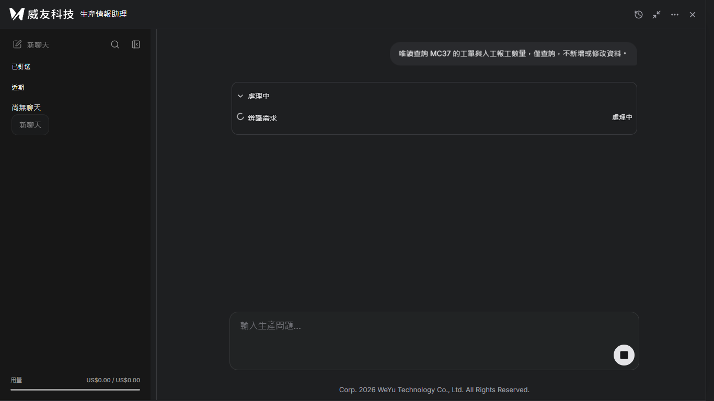
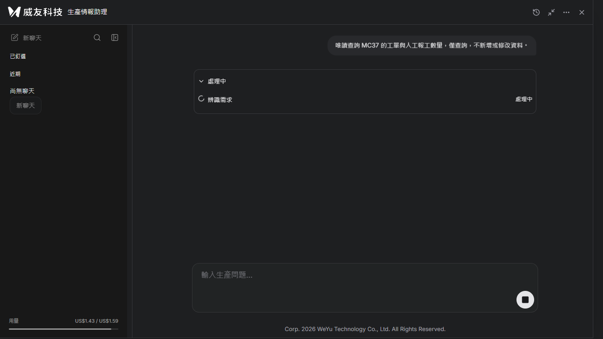
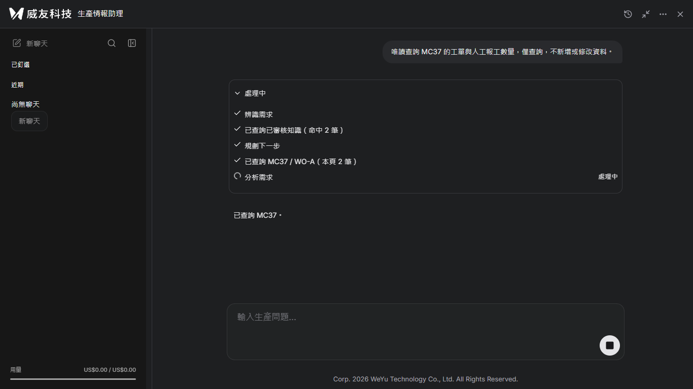
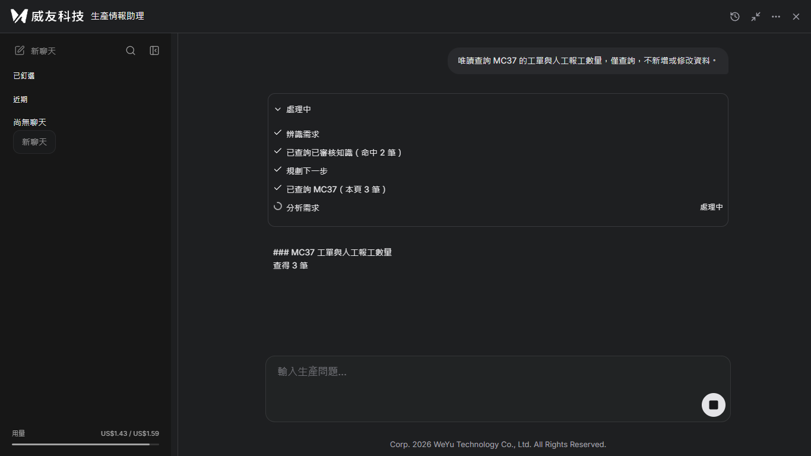
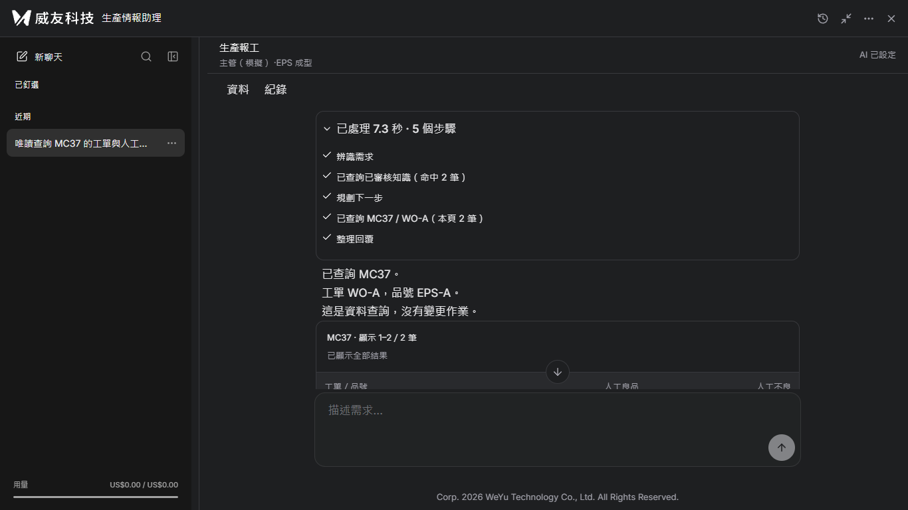
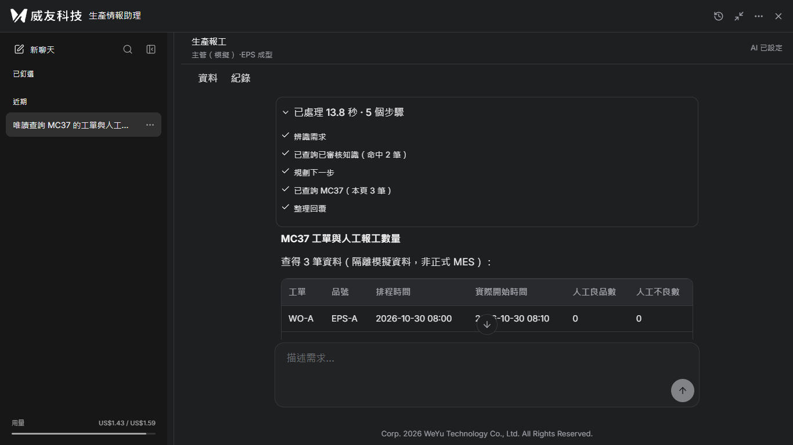
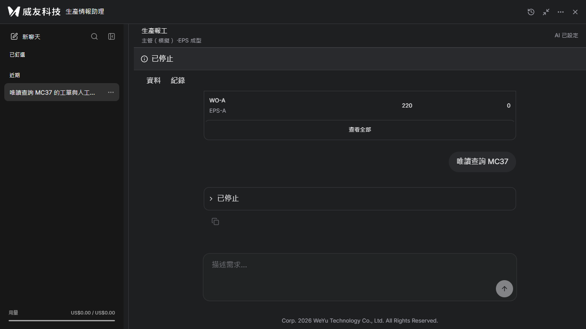

# #47 分段輪詢驗收

日期：2026-11-03。所有業務資料均為全新隔離資料庫。沒有部署、沒有正式 MES 寫入。產品改動先以 `8cf7bdb`（後端）與 `a1fa62f`（前端）各自提交推送，再拍攝。

## 改動與契約

- 首頁與聊天使用 `/messages/start`，立即回 request_id／token；舊 `/messages` JSON API 不變，移除 `/messages/stream` 及前端 SSE 解析。
- `/api/streams/{rid}/events?after=seq` 最多等 1 秒；有事件立即結束 JSON 回應。相同操作者及 X-Stream-Token 才能讀取；回應不快取。
- 事件只存單一程序記憶體，按 seq 接續，終態後保留 300 秒再清除；服務必須 workers=1。處理步驟摘要仍保存於對話，沒有新增資料表。
- 前端每批後等待 100 ms 再讀取。失敗最多 4 次 GET（退避 200／400／800 ms），單次 GET 10 秒逾時；401／403 立即交還登入權限處理。POST 永不重送，包含舊端點 404／405 也不降級重送。
- 文字全部來自後端模型 delta，沒有計時器拆字。停止、查核、權限、人工確認與費用帳本契約沿用 #44。
- IIS 腳本不再修改全域 responseBufferLimit；專用應用動態壓縮停用保留。

## 緩衝代理核心證據

`tests/manual/issue47_buffer_proxy.py` 使用 `response.read()` 收齊整份上游回應，才送出標頭與本文。自動測試刻意讓上游先送部分內容再等待，證明代理未提前交付；保留 Host 與正式 ARR 的 preserveHostHeader 一致。

首次及診斷拍攝失敗：測試代理移除了 Host，造成同源檢核拒絕，沒有步驟事件，沒有付費呼叫。修正的是測試代理，產品安全檢核未放寬；新增代理回歸測試後，另開乾淨 fixture DB 完成拍攝。失敗紀錄保留本機 `.local/issue47-fixture` 與 `.local/issue47-fixture-diagnose`，沒有冒充成功證據。

| 檢查 | fixture／模擬分類 | 真實模型、隔離業務資料 |
|---|---:|---:|
| 開始 POST 回應 | 59.0 ms | 54.3 ms |
| 輪詢回應批數（含空批） | 12 | 33 |
| 含 delta 的批數 | 3 | 18 |
| delta 總數 | 3 | 223 |
| 首末文字批到達間隔 | 1422.4 ms | 2001.3 ms |
| 最後一批到達（自 POST 發出） | 7462.9 ms | 13894.2 ms |
| 終態 | done | done |

以上時間在瀏覽器取得完整 JSON 後量測，均經代理，沒有直接連到後端取捷徑。批次數包含空回應，不等同模型 token 數。證據為 [模擬時序](fixture-到達時序.json)、[真實時序](real-到達時序.json) 與 [模擬唯讀停止](fixture-停止時序.json)。模擬停止會走實際停止端點並終結為 stopped；本次唯一真實模型訊息為完整查詢，沒有再發第二則測停止。

## 真實模型費用與步驟

唯一訊息：「唯讀查詢 MC37 的工單與人工報工數量，僅查詢，不新增或修改資料。」模型 gpt-6.1-sol，1 則訊息內部呼叫 3 次，全數 settled。

| 帳本 | 呼叫數 | 已結算 US$ | 未結算預留 US$ | unknown 筆數 |
|---|---:|---:|---:|---:|
| 前 | 239 | 1.431096 | 0.063894 | 1 |
| 後 | 242 | 1.444902 | 0.063894 | 1 |
| 差額 | 3 | **0.013806** | 0 | 0 |

逐次結算：0.000946、0.003976、0.008884 美元。全域授權上限仍 US$20，獨立程序重讀原帳本後剩餘 US$18.491204。未重設、未清除原 unknown。煙霧程序暫時把有效預留上限收緊到「測試前已用＋預留＋0.10」，因此畫面與測試中 budget.limit_usd 顯示約 1.59；這是程序內較小的護欄，沒有寫回設定或調高 US$20。

步驟依序完成：辨識需求 → 已查詢已審核知識（命中 2 筆）→ 規劃下一步 → 已查詢 MC37（本頁 3 筆）→ 整理回覆。業務 seed 前後一致、確認卡 0 張。沒有任何同意寫入。

### 真實查詢每批到達

相對於發出唯一開始 POST，單位 ms；after 是請求帶入的最後已收序號。

| 批次 | 到達時間 | after | 事件數 | delta 數 | 終態 |
|---|---:|---:|---:|---:|---|
| 1 | 84.9 | 0 | 2 | 0 | 否 |
| 2 | 1221.5 | 2 | 0 | 0 | 否 |
| 3 | 2359.7 | 2 | 0 | 0 | 否 |
| 4 | 3482.6 | 2 | 0 | 0 | 否 |
| 5 | 4603.5 | 2 | 0 | 0 | 否 |
| 6 | 5261.7 | 2 | 1 | 0 | 否 |
| 7 | 5380.3 | 3 | 5 | 0 | 否 |
| 8 | 6500.4 | 8 | 0 | 0 | 否 |
| 9 | 7624.4 | 8 | 0 | 0 | 否 |
| 10 | 8608.7 | 8 | 2 | 0 | 否 |
| 11 | 8716.9 | 10 | 3 | 0 | 否 |
| 12 | 9848.5 | 13 | 0 | 0 | 否 |
| 13 | 10992.3 | 13 | 0 | 0 | 否 |
| 14 | 11630.3 | 13 | 1 | 1 | 否 |
| 15 | 11741.1 | 14 | 1 | 1 | 否 |
| 16 | 11866.8 | 15 | 12 | 12 | 否 |
| 17 | 11977.9 | 27 | 3 | 3 | 否 |
| 18 | 12104.2 | 30 | 4 | 4 | 否 |
| 19 | 12256.8 | 34 | 28 | 28 | 否 |
| 20 | 12381.2 | 62 | 22 | 22 | 否 |
| 21 | 12492.1 | 84 | 15 | 15 | 否 |
| 22 | 12601.9 | 99 | 15 | 15 | 否 |
| 23 | 12724.9 | 114 | 22 | 22 | 否 |
| 24 | 12831.3 | 136 | 16 | 16 | 否 |
| 25 | 12942.3 | 152 | 19 | 19 | 否 |
| 26 | 13051.8 | 171 | 13 | 13 | 否 |
| 27 | 13162.3 | 184 | 11 | 11 | 否 |
| 28 | 13286.5 | 195 | 7 | 7 | 否 |
| 29 | 13391.7 | 202 | 13 | 13 | 否 |
| 30 | 13520.8 | 215 | 15 | 15 | 否 |
| 31 | 13631.6 | 230 | 6 | 6 | 否 |
| 32 | 13772.9 | 236 | 1 | 0 | 否 |
| 33 | 13894.2 | 237 | 1 | 0 | 是 |

## 畫面與正常速度錄影

| 狀態 | fixture／模擬分類 | 真實模型（隔離資料） |
|---|---|---|
| 處理中 |  |  |
| 分段文字 |  |  |
| 完成展開 |  |  |

- [錄影 A：fixture／模擬分類，分段與停止](錄影A-分段與停止.mp4)，18.64 秒。
- [錄影 B：真實模型、隔離資料、唯讀查詢](錄影B-真實模型分段.mp4)，16.72 秒。

兩段均 H.264、yuv420p、faststart；正常速度，未加速、未剪掉等待。內容 1366×768，額外 32px 頂列標明來源，檔案為 1366×800。[播放核對](錄影播放核對.json)：無頭 Chromium 實際播放後 currentTime 前進且無媒體錯誤。

## 測試結果

| 項目 | 結果 |
|---|---|
| `npm --prefix frontend test` | 通過，171 項 |
| `npm --prefix frontend run build` | 通過，含 TypeScript 檢查；既有較大 chunk 警告 |
| `.venv/Scripts/python.exe -m pytest -q -p no:cacheprovider` | 277 通過、11 略過；既有 Starlette httpx 棄用警告 |
| seq 接續／空批／保留到期／換人與錯誤權杖 404 | 通過 |
| 暫時輪詢錯誤只重試 GET／耗盡轉未知／登入失效 | 通過 |
| 停止、上游關閉與費用 unknown／工具 reset／三語步驟 | 通過，沿用並改寫 #44 契約測試 |
| 完整緩衝代理／模擬及一則真實模型分批到達 | 通過 |

11 項略過為未啟用的隔離 SQL 驗收與本機符號連結權限條件，不代表正式資料庫驗收成功。未驗證：正式 IIS／正式 MES、程序重啟後接續、高併發壓力、多 worker（不支援）、本輪 Chrome／Edge 品牌瀏覽器實播。不能將本機代理證據當成正式站已成功。

## 重現方式

使用既有套件，不另外安裝。`PLAYWRIGHT_CORE_PATH`、`CHROMIUM_PATH`、`FFMPEG_PATH` 可設定。離線：`node tests/manual/issue47_capture.cjs`，每次以新的 `FIXTURE_RUN` 後綴建立全新 DB。真實模型使用 `ISSUE47_REAL=1`，但已有一次性鎖且授權的 1 則已用完，不得為重拍再呼叫。`tests/manual/issue47_encode.py` 轉碼原始錄影，不調整時間軸。所有 fixture 與代理僅位於 tests/manual，產品沒有測試開關。
