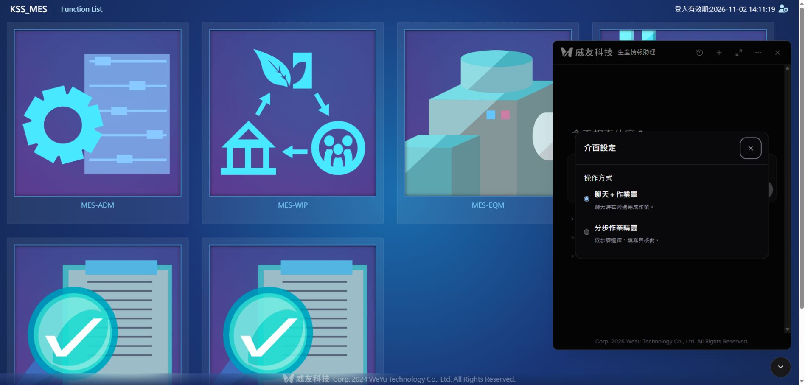
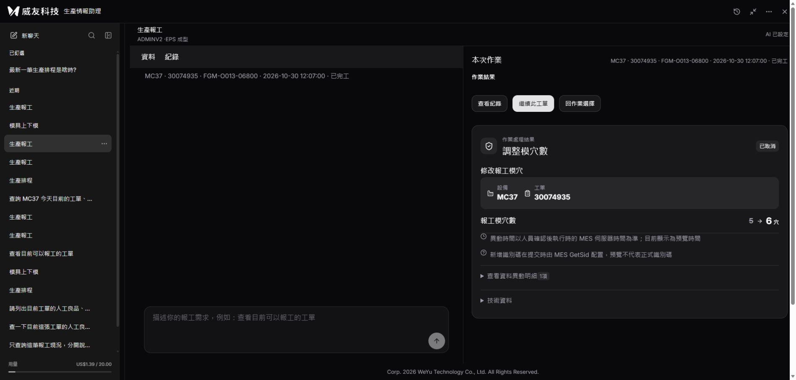
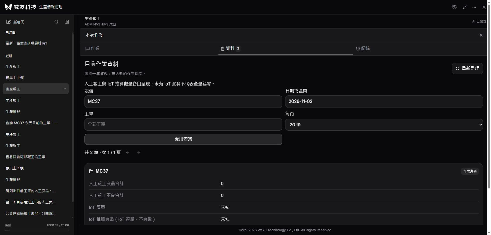

# Issue #27 正式部署與驗證

2026-11-02 依使用者「部署正式 MES」後續授權上線。最終產品版本為 `b90ab8a49f0eb3327b9572fad20f13326e5b602c`，PR #28 保留草稿，未合併 main、不關閉 Issue #27／#13。

## 發行及保留資料

- 最終封裝：`kaosu-dual-flow-final-20261102.zip`，116 檔。
- SHA256：`3dafcbb7f5f166bb9942c5c9d8701971d8e6e318b8dd5e8e72d372b1319d7bc5`。
- 路徑 `C:\Services\KaosuAiAgent\current`；既有 IIS `/KSS_MES/ai-agent/`；LOCAL SERVICE、127.0.0.1:8765。
- 助理服務因後端變更重啟，沒有重啟原 MES 或 IIS。九頁入口已存在，安裝器 changed=0，保留原八頁及首頁歷史備份。
- `.env`、對話與作業資料保留；首次更新另將開發驗收新增的44筆費用記錄合併至正式帳本，184→228筆、US$1.211242→1.390954。未覆蓋既有紀錄或重設額度。最後核對仍為228筆，預留／未知用量0，上限20。
- 本輪只建立助理預覽與取消紀錄；未送出 approved=true，沒有正式業務測試寫入，沒有付費模型呼叫。

## 發現問題及修正

| 問題 | 證據／根因 | 修正與複驗 |
|---|---|---|
| 首次版本首頁白畫面 | 正式 HTTP 瀏覽器回報 `TypeError: crypto.randomUUID is not a function`；自由入口 hook 初始化失敗 | `b4fa608` 改用可用的原生 UUID，缺少時由 getRandomValues 產生 UUID v4；不使用 Math.random、不變更權限。回歸測試先失敗再通過，涵蓋掛載、發送、重新掛載恢復同一識別、unknown只查核不重送。正式首頁已正常顯示。 |
| 模具候選 HTTP 503 | 唯讀欄位查核顯示 GET_ZZ_KAOSU_PLAN_TOL 只有 TOL_SID、TOL_NO、TOL_OPERATION、DEFAULT_CYCLE_TIME，沒有 TOL_NAME | `b90ab8a` 保留函式可選範圍，LEFT JOIN TOL_MASTER 補名稱。隔離 SQL 公開 HTTP 測試先503再200，名稱搜尋可取回合成模具，無效品號回空清單；正式候選200。 |
| 靜態修補腳本第一次解析失敗 | 遠端 Windows PowerShell 將無 BOM UTF-8 繁體文字誤判 | 該次沒有執行變更；腳本改存 UTF-8 BOM 後部署成功。 |

## 驗證結果

| 項目 | 結果 |
|---|---|
| 前端回歸、型別與建置 | 通過：111項；保留既有大於500KB bundle提醒 |
| 後端一般回歸 | 通過：235項；11項需明確 SQL 開關而略過，保留既有 httpx 棄用提醒 |
| 新增隔離 SQL 回歸 | 通過：模具名稱搜尋／品號隔離1項，唯讀，無正式寫入 |
| 發行逐檔、公開資產、九頁入口 | 通過：116檔，17資產對應本機建置，九頁200且loader各1份 |
| 登入與存取邊界 | 通過：可信MES身分、三模組授權；未登入401、demo403、私密設定及資料庫404 |
| 正式三模組唯讀 | 通過：報工1筆、排程1筆、上下模回20／共75筆 |
| 正式候選 | 通過：設備、品號、工單、模具四來源200；抽樣品號的工單為空清單，不冒稱有資料 |
| 預覽、三語與取消 | 通過：調整模穴預覽；切三語digest及args不變；取消changes為空，讀回模穴／人工良品／不良／報工明細／完工狀態不變 |
| 正式瀏覽器 | 通過：首頁登入、浮窗、更多選單、操作方式設定、展開、歷史清單、恢復已取消作業與資料面板查詢 |
| 全部A01–A18與九宿主完整互動 | 未執行完整矩陣；沿用原Issue待辦，不因部署標為全部完成 |
| 正式交易寫入及真實模型驗收 | 本輪未執行；正式站只讀取、預覽及取消 |

三模組查詢與預覽取消於本輪首次後端更新後驗證；隨後修正只涉及入口識別碼與候選名稱來源，最後另核對候選、公開資產、健康及瀏覽器資料查詢。

## 回復

更新前可用版本備份在 `C:\Services\KaosuAiAgent\backups\code-before-kaosu-dual-flow-1a3950e-20261102`。要完整回復本輪更新，停止專屬助理服務，依該目錄 `deployment.json` 還原 existed=true 的程式及 SHA256SUMS，再啟動健康核對。**保留現行 .env、.local 與費用累計，不用舊資料庫覆蓋新作業。**

另外保留 `code-before-kaosu-dual-flow-http-20261102` 與 `code-before-kaosu-dual-flow-final-20261102` 中間版本備份；兩者不是回到本輪更新前完整版本的首選。

[首次部署](部署核對.json) · [最終部署](最終部署核對.json) · [公開核對](公開入口核對.json) · [登入查詢預覽取消](正式查詢預覽取消.json) · [候選查詢](正式候選查詢.json) · [費用合併](費用帳本合併.json)

