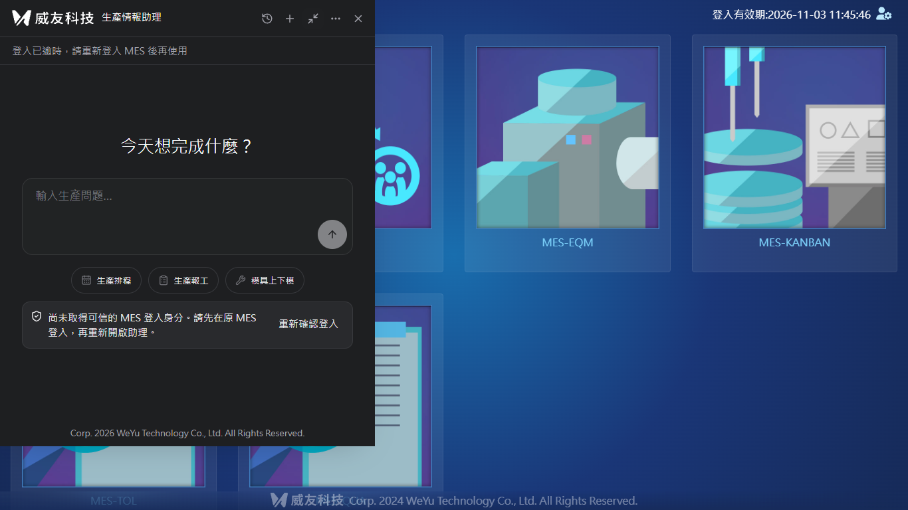
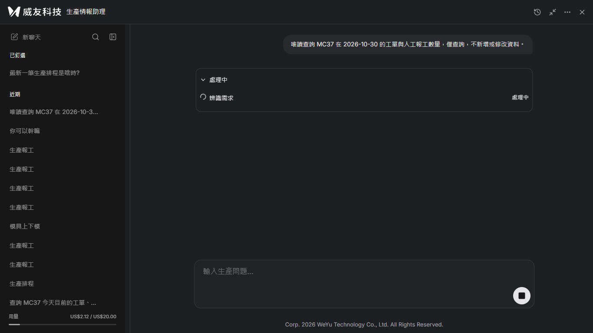
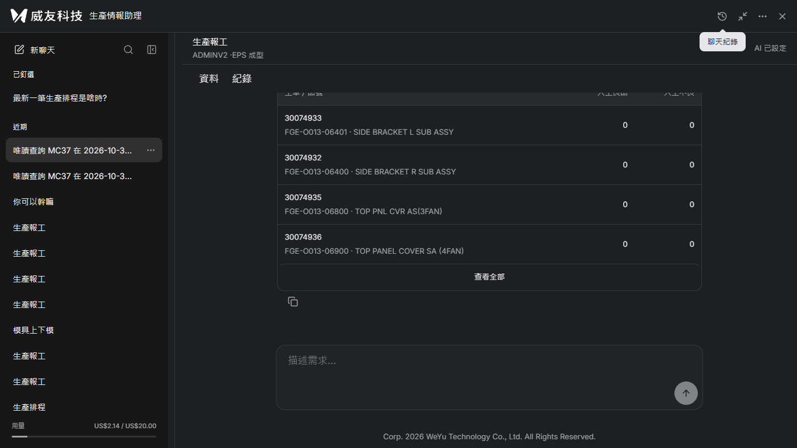
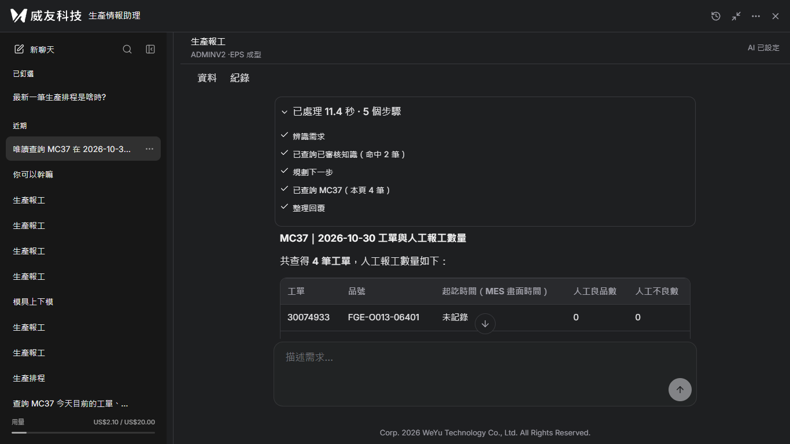

# 正式部署紀錄：第八次首頁畫面預檢未通過，正式站維持第五次版本

## 第八次部署（2026-11-03）：無頭瀏覽器可用，首頁畫面預檢未達標準

依使用者指示改用第五次 Playwright Core 與 headless Chromium，不使用桌面瀏覽器主機。登入資料只經 stdin 傳入記憶體，未寫檔。目標仍為 `93ad0c2`，原站重新確認 **`6ff9ec8`、160 檔全部吻合**。

無頭 Chromium 能完成原登入流程、開啟 `wwwroot/index.html`，session API 回傳 live／mes_session，並能截圖，沒有送模型訊息。但實際助理截圖仍顯示「登入已逾時」及「尚未取得可信的 MES 登入身分」，因此**首頁預檢不算通過**。

腳本只等輸入框存在，過早回報 passed=true；人工檢視截圖後修正整體結論為 passed=false，保留 script_reported_passed=true。尚無法判定是 iframe 初始化未完成或登入不同步，不能宣稱產品 Bug，也不能以 API 成功代替畫面驗收。

[預檢及判定修正](第八次無頭預檢.json) · [原站唯讀核對](第八次原站唯讀核對.txt)

### 錯誤與重試

1. 本機 Python 單行查詢中的引號／正規表示式被 PowerShell 解析，產生 ParserError，該 HTTP 尚未送出。改成獨立腳本，第1次重試成功。
2. 讀取登入前端程式時，cp950 終端無法輸出部分字元，產生 UnicodeEncodeError。設定 PYTHONIOENCODING=utf-8，第2次重試成功。

兩次都在正式變更前。本輪部署工具重試額度已用完，畫面預檢未達標準後未重跑，也未開始正式部署。第七次完整空跑仍保留，不能代替本輪畫面預檢。收尾文件補丁另遇到同一路徑重複操作的本機格式錯誤，修正補丁後寫入文件；沒有因此重試正式主機或驗收操作。

### 原站與收尾

健康 ok/live、工作 Running、loopback 127.0.0.1:8765；服務仍自 2026-11-03T02:36:43.3303455Z 運作。proxy 六項原值保持，responseBufferLimit=4096。MES、IIS、助理未重啟。帳本254次／US$2.143728／未結清0，本輪模型訊息0、費用差額0；對話22、確認卡7張且均取消、稽核7，未新增確認卡或業務寫入。

沒有停止助理、建立正式備份或替換檔案，無本輪正式變更可回復，前五次備份及第七次準備檔未動。正式部署、新版公開矩陣、真實模型唯一查詢、交接連續截圖及 Markdown DOM 驗收均**未執行**。正式仍為 `6ff9ec8`，`93ad0c2` 未上線。

Chromium 已在 finally 關閉；同步 Node／Python／SSH 程序已結束，未啟動暫存伺服器。只保留本機驗收工具及證據，沒有本輪背景程序。紀錄更新 PR #52 原分支，不直接推 main。

## 第七次部署（2026-11-03）：完整空跑通過，瀏覽器連線受阻，未開始正式變更

依新授權規則：正式變更前工具錯誤最多修正重試兩次；停止助理／備份／替換開始後失敗就回復並停止。本輪重新 checkout／pull main，確認 **`93ad0c28853f3b6b939ef2e52f46a600f0321dcd`**。SSH 全部沿用第五次 EncodedCommand，沒有再次手工拼接引號。

### 已完成的準備及完整空跑

- 前端 **174 項測試通過**，型別與建置通過；保留既有大於 500kB 的 bundle 提醒。
- 在指定 main 版本封裝 **162 檔**，未將本輪紀錄混入產品發行。
- 發行檔：`kaosu-issue51-93ad0c2-20261103-seventh.zip`，SHA256：`78a41d576dcdc235c1bb91a4fe99c4d7eb679c1e6423ceb51d08fdaa453d8d8e`。
- 正式主機 ZIP、空跑來源 162 檔及依賴校驗通過。
- 沿用第五次腳本，調整版本、唯一名稱、來源及預期 proxy 檔雜湊；全域 proxy 仍只讀。
- 正式 **PowerShell 5.1.26100.32684** 上部署 **14 階段**、回復 **9 階段**完整空跑通過；回復來源 158 個既有檔案核對通過。
- 空跑完整讀取 **233 個非日誌檔**及 **1 個日誌快照來源**；未實際建立完整備份。日誌只在記憶體做快照，回復不覆寫日誌。
- 空跑前後 `.env`、對話庫、費用庫、HTML、proxy 雜湊及服務 PID 未變。

[部署腳本](第七次部署腳本.ps1) · [回復腳本](第七次回復腳本.ps1) · [空跑流程](第七次空跑流程.ps1) · [完整空跑紀錄](第七次完整空跑紀錄.txt) · [空跑結果](第七次空跑結果.json)

### 工具錯誤、修正與兩次重試

1. 瀏覽器控制回傳 `browser access host is unavailable`。已請使用者恢復連線；**第 1 次重試**仍為同一錯誤。尚無可用的瀏覽器驗收工具，不能確保部署後取得首頁交接畫面，因此保留正式服務不動。
2. 整理空跑證據時，把 PowerShell `Tee-Object` 產出的 UTF-16 結果誤當 UTF-8，發生 UnicodeDecodeError。依 BOM 改用 UTF-16；**第 2 次重試成功**。僅本機證據轉碼，未重跑正式空跑，原始檔與內容保留。

本輪合計使用兩次工具重試，不再嘗試第三次。瀏覽器連線仍未恢復，**部署未開始，正式站仍維持 `6ff9ec8`**。沒有停止助理、替換正式程式／HTML／proxy，也沒有建立第七次完整備份；無正式變更可回復，不套用會降版的第五次部署前備份。

### 原站、費用與未執行項目

部署前原站 **160 檔吻合**，健康 **ok/live**、工作 **Running**、監聽 **127.0.0.1:8765**；空跑亦完成健康與 loopback 核對。proxy 六項前後一致，responseBufferLimit=4096。MES、IIS 網站及助理皆未重啟。

正式帳本仍 **254 次、US$2.143728、未結清 0**；本輪真實模型訊息 **0**，已結算差額 **US$0**。對話 22、進行中 0、確認卡 7 張且均取消、稽核 7。未建立確認卡、未寫入業務資料、未重設 US$20 上限。

[部署前原站核對](第七次部署前原站核對.txt)。新版健康／九頁入口／401／404／公開資產矩陣、可信登入後真實模型查詢、首頁交接截圖與 Markdown 驗收均**未執行**。不能將空跑成功當作已上線或 UI 驗收成功。

### 保留檔案及收尾

正式主機只保留本輪準備檔：`C:\Services\KaosuAiAgent` 下的發行 ZIP、`deploy-issue51-seventh.ps1`、`rollback-issue51-seventh.ps1`、`issue51-seventh-dryrun.ps1`、`issue51-seventh-final.ps1`、空跑日誌及結果；另有 `staging\kaosu-issue51-93ad0c2-20261103-seventh-preflight` 的已校驗解壓來源。

預定的 `backups\code-before-kaosu-issue51-93ad0c2-20261103-seventh`、正式部署 staging 與 IIS 備份尚未建立，不能當作可回復備份使用。前五次備份未覆蓋。未啟動暫存伺服器或背景程序；本輪同步 SSH、SCP、建置與 Python 程序皆已結束。沒有部署或回復覆寫 `.env`／`.local`／資料庫／帳本／日誌。紀錄更新於 PR #52 原分支，不直接推 main。

## 第六次部署（2026-11-03）：連線指令預檢失敗，未部署、未重試

依使用者「修好再部署」授權，執行 `git checkout main`、`git pull --ff-only`，確認 HEAD 為 **`93ad0c28853f3b6b939ef2e52f46a600f0321dcd`**。相較正式 `6ff9ec8`，PR #51 修改兩個前端來源檔，另有前端測試及部署文件差異；後端未變。

### 失敗與處置

部署前 SSH 日期查詢使用了不適合 PowerShell 的反斜線引號跳脫，主機將指令解讀為 `Get-Date\`，回傳 CommandNotFoundException。SSH 連線本身成功；問題是本次操作指令組合，不是 MES、IIS 或產品程式。

依「任何一步失敗、不重試」停止，未建置封裝、上傳發行包、建立第六次 staging／備份、執行部署與回復完整空跑、停止助理或替換正式檔案。**正式站仍為 `6ff9ec8`，PR #51 未上線。** 無本次正式變更需要回復，未套用會將現行版降回更早版本的第五次部署前備份；前五次備份與紀錄未動。

### 停止後唯讀核對

以下使用既有 EncodedCommand 工具核對原站，不是重試部署：

- 原發行清單 **160 檔全部吻合**，正式部署紀錄版本 `6ff9ec8`。
- 健康 **ok/live**、工作 **Running**、監聽 **127.0.0.1:8765**。
- 助理程序開始時間 **2026-11-03T02:36:43.3303455Z**，本次未停止或啟動；MES 與 IIS 網站未重啟。
- proxy 唯讀結果：enabled=True、responseBufferLimit=4096、minResponseBuffer=256、bufferChunkedResponses=True、preserveHostHeader=True、timeout=00:05:00。
- 帳本 **254 次／US$2.143728／未結清 0**，與第五次收尾相同，已結算差額 **US$0**；本次模型訊息 **0**。
- 對話 **22**、進行中 **0**、確認卡 **7 張且均取消**、稽核 **7**；沒有新增確認卡或業務寫入。

[原站唯讀核對輸出](第六次原站唯讀核對.txt)。不含金鑰、連線字串、session 或私密檔案雜湊。

### 未執行與收尾

補充的九頁入口／401／404／公開資產檢查工具，因本機使用不合法的 Python 相對模組啟動方式，尚未發出 HTTP 請求便失敗；未重試，**本輪不宣稱公開矩陣通過**。部署與回復完整空跑、新版檢查、可信登入後真實模型查詢、首頁交接截圖均未執行，不能宣稱 Markdown 交接驗收通過。

未啟動暫存伺服器或背景程序；本次 SSH、Python 同步程序已結束。沒有上傳本次工具至正式主機，只有本機忽略目錄保留準備用工具。`.env`、`.local`、對話庫、費用帳本、日誌沒有被部署或回復覆寫。文件透過獨立分支開 PR 至 main，不直接推 main。

## 第五次部署（2026-11-03）：完整空跑與正式驗收通過

**正式 MES 已從 #29 的 `62d6c07` 更新為 main `6ff9ec801dea4f08f79e835265e6a2e18dded560`**，包含 #31 系列 UI／UX、#44 與 #47。依「空跑通過就部署」授權執行，沒有重試部署或模型訊息。

### 方案 (b)：日誌另存快照，不覆蓋回復

日誌會持續增長，回復舊程式不應以舊日誌覆蓋新紀錄，因此不列入逐位元組還原清單，另放 `log-snapshots`。使用 FileShare.ReadWrite／Delete 共享讀取，保存複製當下的長度、SHA256、時間與 `restore=false`；不要求變動中的原日誌與快照持續相等。`.env`、資料庫、帳本及其他非日誌檔仍完整備份，回復時保留當前 `.env`／`.local`，包括新日誌。

正式 PowerShell **5.1.26100.32684** 的部署 **14 階段**與回復 **9 階段**全部空跑到結尾。修改動作只列出計畫，實際讀取檔案、proxy 屬性、XML、雜湊與健康；日誌快照只留記憶體。空跑前後設定、兩庫、HTML、proxy 雜湊及服務 PID 不變。空跑讀取先前已解壓且逐檔校驗的來源，沒有建立第五次 staging／backup。

[完整空跑紀錄](第五次完整空跑紀錄.txt) · [空跑結果](第五次空跑結果.json) · [部署腳本](第五次部署腳本.ps1) · [回復腳本](第五次回復腳本.ps1)

### 發行與備份

| 項目 | 結果 |
|---|---|
| 發行 ZIP | `kaosu-issue47-6ff9ec8-20261103-third.zip`（同一指定提交的既有產物） |
| SHA256 | `afe3964a0046599661d2f85e968602a2c10d55911d63712af5b279fdf2ec828f` |
| 發行校驗 | 160 檔來源、安裝後及收尾皆吻合 |
| 完整備份 | 197 個非日誌檔，包含設定、對話庫、費用庫；另存 1 份日誌快照 |
| 舊雜湊資產 | 57 個保留，雜湊吻合 |
| 全域 proxy | 六項前後相同，responseBufferLimit 保持 4096，沒有全域寫入指令 |
| 本應用代理 | 舊 web.config 備份後設定 doDynamicCompression=false |
| 服務 | 只停止／啟動助理；MES、IIS 網站、整台 IIS 未重啟 |

唯一備份目錄：`C:\Services\KaosuAiAgent\backups\code-before-kaosu-issue47-6ff9ec8-20261103-fifth`。其中包含 `full-current`、`private`、`log-snapshots`、`deployment.json`、舊清單、舊 proxy 與兩支工具。IIS 備份名稱 `KaosuAiAgent-issue47-20261103-fifth`；前四次紀錄未覆蓋。

HTML 在其他發行檔之後，用明確 GUID 備份路徑原子替換。部署完成、模型驗收前 `.env`、operations.db、model-budget.db 雜湊均未變；模型驗收後對話及費用新增是預期異動，沒有還原舊庫。收尾 `.env` 雜湊仍相同。

[部署結果](第五次部署結果.json) · [部署清單（公開副本省略私密檔雜湊）](第五次部署清單.json) · [收尾核對](第五次收尾核對.json)

### 正式站驗證

- 九頁入口 HTTP **200**、loader 各一份；**17** 個新版公開資產雜湊一致。
- 未登入 session **401**；`.env`、兩庫、`app/main.py` **404**。
- 健康 **ok/live**，專屬工作 Running，監聽 127.0.0.1:8765。
- 可信 MES 登入來源 **mes_session**，新版介面成功開啟。
- 正式 HTTP API 的 MC37／2026-10-30 唯讀查詢：排程 **3 筆**、報工 **4 筆**、模具 **3 筆**，全數 HTTP 200，沒有使用模型。

[公開入口核對](第五次公開入口核對.json) · [三模組與輪詢核對](第五次正式輪詢核對.json)

### 一則真實模型經正式 IIS

唯一訊息：「唯讀查詢 MC37 在 2026-10-30 的工單與人工報工數量，僅查詢，不新增或修改資料。」

開始 POST 約 **559.6 ms** 回應；收到 **14 批**輪詢回應，其中 **4 批含 delta**、合計 **204 個 delta**，首末文字批相隔 **1797 ms**，通過「至少 3 批且跨 1 秒」標準。終態 **done**，沒有確認卡。

步驟：辨識需求 → 已查詢已審核知識（命中 2 筆）→ 規劃下一步 → 已查詢 MC37（本頁 4 筆）→ 整理回覆。

每批時間以瀏覽器發出 POST 起算，完整收到 JSON 時記錄，全部經正式 `http://192.168.2.123/KSS_MES/ai-agent/`，沒有以 loopback 取代正式代理。

| 批次 | 到達時間 ms | 事件數 | delta 數 | 終態 |
|---|---:|---:|---:|---|
| 1 | 956.3 | 2 | 0 | 否 |
| 2 | 2462.7 | 0 | 0 | 否 |
| 3 | 4068.7 | 0 | 0 | 否 |
| 4 | 6118.5 | 0 | 0 | 否 |
| 5 | 6686.3 | 6 | 0 | 否 |
| 6 | 8138.9 | 0 | 0 | 否 |
| 7 | 9272.1 | 2 | 0 | 否 |
| 8 | 9822.6 | 3 | 0 | 否 |
| 9 | 11350.6 | 0 | 0 | 否 |
| 10 | 11786.8 | 29 | 29 | 否 |
| 11 | 12350.3 | 92 | 92 | 否 |
| 12 | 12987.2 | 48 | 48 | 否 |
| 13 | 13583.8 | 36 | 35 | 否 |
| 14 | 14133.9 | 1 | 0 | 是 |

| 正式帳本 | 前 | 後 | 差額 |
|---|---:|---:|---:|
| 呼叫數 | 251 | 254 | 3（1 則訊息內部呼叫） |
| 已結算 US$ | 2.124520 | 2.143728 | **0.019208** |
| 未結清預留 US$ | 0 | 0 | 0 |
| unknown 筆數 | 0 | 0 | 0 |

上限仍 US$20，剩餘 US$17.856272。對話 21 → 22，確認卡仍為 7 張已取消，稽核仍為 7 筆，進行中訊息 0。沒有新增確認卡、沒有業務寫入、沒有重設帳本。

### 正式畫面與觀察

首次 done 後 800 ms 的截圖仍在首頁交接載入，短暫以純文字顯示 Markdown，保留 [交接畫面](第五次正式完成.png)，不當成最終畫面。後續只讀回同一對話，沒有再發問，確認 Markdown 標題及表格（含合計 5 列）正常，見 [讀回核對](第五次完成讀回核對.json)。交接期間的純文字呈現仍是可追蹤 UX 限制，本次未更動已核准產品版本。

### 回復、限制與收尾

需要回復時，以管理身分執行唯一備份內的 `rollback.ps1`。它核對完整備份存在，只停助理，還原舊程式／清單／專用 proxy，HTML 用唯一備份路徑原子替換；清除新增非雜湊資產，保留雜湊資產及當前 `.env`／`.local`／日誌。全域 proxy 不寫入，最後啟動助理並核對健康。**本次成功，沒有實際回復；回復工具完整空跑通過。**

沒有啟動暫存伺服器；無頭瀏覽器都已在 finally 關閉，Node 與 SSH PowerShell 同步程序均結束。只保留正式助理服務 Running。發行、staging、備份與工具／證據的保留路徑見 [暫存清單](第五次暫存清單.json)，沒有背景測試程序。

未驗證：正式業務寫入、全部 #31 UI／UX 情境、正式停止查詢與主機重啟後恢復。本次只驗證新版介面開啟、三模組 HTTP 唯讀查詢與一則真實模型輪詢，不宣稱所有正式寫入功能已驗收。

## 第四次部署（2026-11-03）：空跑未通過，原 #29 版本持續運作

目標為 main `6ff9ec8`，包含 #31 系列 UI／UX、#44 與 #47。使用者授權的前提是「完整空跑通過才部署」。**本次空跑第 7 階段失敗，沒有滿足部署前提，因此未部署、未重試。正式站仍為 #29 的 `62d6c07`。**

### 準備與失敗位置

已移除 `GetRawXml()`，部署及回復腳本均改用正式環境支援的 `Get-WebConfigurationProperty` 逐項讀取六個 proxy 屬性。兩支腳本的 PowerShell 語法檢查通過，使用明確唯一備份路徑，沒有全域 proxy 寫入指令。

正式主機 Windows PowerShell 5.1 空跑依序執行：ZIP 校驗、160 檔來源與依賴校驗、服務身分／loopback 檢查、原站工作計數、六個 proxy 屬性讀取、列出 IIS 備份及停止助理的預定動作，至完整備份來源雜湊檢查時失敗。

`C:\Services\KaosuAiAgent\current\.local\logs\service.log` 正被運作中的助理占用，`Get-FileHash` 無法開啟。空跑不允許停服務，因此我沒有為了繼續檢查而停止助理，也沒有跳過錯誤、修改後重跑或執行正式部署。

- **部署腳本只跑到第 7／14 階段；回復腳本完整空跑尚未開始，不宣稱通過。**
- 沒有建立本次 stage、完整備份或 deployment.json，沒有替換 HTML／程式／proxy web.config。
- 原子替換實作仍為明確 GUID 備份路徑；本輪未重新執行寫入演練。
- 空跑日誌的既有例外前綴寫著「已嘗試回復」，這段文字不精確：DryRun 分支沒有執行回復。此處保留原始訊息並明確更正，原站從未被替換，無需套用備份。

[完整空跑日誌（UTF-16 轉 UTF-8，內容未省略）](第四次空跑紀錄.txt)。原始日誌保留正式主機 `C:\Services\KaosuAiAgent\issue47-fourth-dryrun.log`。

封裝仍為第三次準備、未改動的指定提交 ZIP：`kaosu-issue47-6ff9ec8-20261103-third.zip`，SHA256 `afe3964a0046599661d2f85e968602a2c10d55911d63712af5b279fdf2ec828f`。空跑讀取已存在且逐檔驗證的第三次 staging；新的第四次 staging／backup 均未建立。

### 停止後原站核對

- 原清單 **127 檔**雜湊全部吻合；原版 **17 個公開資產** HTTP 200 與雜湊吻合。
- **九頁入口** HTTP 200、loader 各一份；未登入 401，私密路徑 404。
- 健康 `ok/live`、助理工作 `Running`、監聽 `127.0.0.1:8765`；程序開始時間仍為 `2026-11-03T01:47:50Z`，未重啟。
- `responseBufferLimit=4096`，其餘五項屬性維持原值；proxy web.config 雜湊仍為 `936A1A26430AC96B1A14731E5EA7C94963718A76439623688300F1159616ED3E`。
- 空跑前後皆 21 對話、0 進行中、7 張已取消確認卡、7 筆稽核；帳本 251 次、US$2.124520、未結清 0。本次付費呼叫 **0**、費用 **0**，未重設帳本。

[原站核對](第四次原站核對.json) · [公開入口與資產](第四次原站公開核對.json) · [帳本與對話](第四次帳本與對話.json)。以上只證明原版仍正常，不是新版驗收。

### 未執行與收尾

新版介面、三模組唯讀查詢、正式真實模型分批輪詢、至少 3 批 delta 且跨 1 秒的判定與新版正式畫面，全部未執行。沒有確認卡建立或業務寫入。

本次沒有啟動本機／正式主機暫存伺服器或瀏覽器；SSH PowerShell 都為同步程序，已結束。保留兩支部署工具及空跑日誌供審查，沒有背景工作。完整路徑與雜湊見 [暫存清單](第四次暫存清單.json)，前次歷史備份未清除。

準備過程中，一次將腳本寫入、語法檢查及上傳合併執行的指令被自動核准審查拒絕，沒有執行；後續改用檔案編輯工具及分開的語法檢查／上傳完成準備。此事件早於唯一一次正式主機空跑，不是繞過空跑失敗後重試。

## 第三次部署（分段輪詢，2026-11-03）：部署前檢查失敗，未重試

目標為已合併的 `6ff9ec801dea4f08f79e835265e6a2e18dded560`（PR #48）。**這個版本尚未部署到正式 MES**。本次失敗發生在停止助理、完整備份及正式檔案替換之前；原版本持續運作，沒有執行正式模型查詢。

### 完成的準備

- 從指定提交建置成功，封裝 160 個檔案。發行檔：`kaosu-issue47-6ff9ec8-20261103-third.zip`。
- SHA256：`afe3964a0046599661d2f85e968602a2c10d55911d63712af5b279fdf2ec828f`。
- 正式主機驗證 ZIP、逐檔來源雜湊與既有依賴清單後，才進入後續部署前檢查。
- Windows PowerShell 5.1.26100.32684 暫存檔三參數原子替換與回復演練通過，兩者均使用明確 GUID 備份路徑。[演練紀錄](第三次原子替換演練.json)。
- 部署及回復腳本均沒有寫入全域 proxy 設定的指令。

### 失敗原因與停止位置

我在部署腳本新增了全域 proxy 設定雜湊檢查，但誤用了正式主機 `Microsoft.Web.Administration.ConfigurationSection` 不支援的 `GetRawXml()` 方法。這是部署工具的相容性錯誤，不是分段輪詢產品失敗。

錯誤出現在 `ProxyHash` 的第一次呼叫，**早於 `Stop-ScheduledTask`、`full-current` 備份、IIS 備份、HTML 原子替換與 proxy web.config 變更**。依使用者指示立即停止，沒有修好後再次部署，也沒有執行付費查詢。

唯一紀錄目錄：`C:\Services\KaosuAiAgent\backups\code-before-kaosu-issue47-6ff9ec8-20261103-third`。目錄已建立，但**完整備份尚未產生**；其中保存失敗狀態 `deployment.json`、當次 `deploy.ps1` 及有防呆的 `rollback.ps1`，不能把這個目錄當成完整可還原備份。前兩次完整備份與回復證據皆保留。

因未碰正式檔案，回復腳本針對 `preflight_failed` 且 `production_files_changed=false` 的紀錄直接保留原服務；已執行此分支，回報 `restored_not_required=true`。另加完整備份存在檢查，避免誤用此不完整備份而停止原服務。這不是重試部署，也沒有重啟任何服務。

[失敗與原站核對](第三次部署前檢查.json) · [IIS 檢查前](第三次IIS部署前.json) · [IIS 檢查後](第三次IIS核對.json)

### 原站仍在線的驗證

| 項目 | 結果 |
|---|---|
| 原發行清單 | 127 個檔案全部吻合原 SHA256 |
| 原版公開資產 | 17 個全部 HTTP 200 且雜湊吻合 |
| 九頁 MES 入口 | 全部 HTTP 200，loader 各一份 |
| 未登入／私密路徑 | session 401；`.env`、兩庫及 `app/main.py` 404 |
| 助理 | Running、127.0.0.1:8765、健康 ok/live |
| 程序啟動時間 | 2026-11-03 01:47:50 UTC，早於本次核對，沒有重啟 |
| 全域 proxy | 前後盤點相同，responseBufferLimit 4096；其他列出屬性也未改 |
| 代理 web.config | 雜湊維持 `936A1A26430AC96B1A14731E5EA7C94963718A76439623688300F1159616ED3E` |
| 對話／確認卡／稽核 | 21 對話、0 進行中、7 張已取消卡、7 筆稽核，前後相同 |
| 正式帳本 | 250 次、已結算 US$2.123702、未結清 0，前後相同 |

[原版公開驗證](第三次原站公開核對.json) · [帳本及對話計數](第三次帳本與對話核對.json)。這些結果只證明原版仍正常，不能當成 `6ff9ec8` 部署成功。

### 未執行與限制

- 新版部署後資產驗證、可信登入後真實模型唯讀查詢、正式輪詢批次時間與「至少 3 個 delta 批／跨 1 秒」判定均未執行。
- 本次付費呼叫 0、費用 0；不重設帳本、不寫入正式業務資料、未建立確認卡。
- 沒有新版正式畫面，未用隔離截圖替代。原站驗證為 HTTP 與主機唯讀檢查。
- `.env`、`.local`、資料庫及帳本沒有被部署覆寫；本次未記錄執行前私密檔雜湊，不宣稱以雜湊證明資料庫逐位元組不變。
- 本次授權明確要求任何失敗不重試，已停止；需要另行處理部署工具相容性後再安排部署。

## 第二次嘗試（2026-11-03，唯一一次追加重試）：已回復

使用者另明確准許重試一次。修正部署與回復腳本後，在正式主機 **Windows PowerShell 5.1.26100.32684** 的唯一暫存目錄，用測試檔驗證三參數原子替換及還原成功；沒有碰正式入口或發行檔。[演練紀錄](第二次原子替換演練.json)。兩支腳本均使用明確、帶 GUID 的唯一備份路徑，沒有再用 `$null`，也沒有覆蓋第一次備份證據。

### 部署成功的部分

- 仍使用 main `5fd733f8691e203f49ba3eb580fe9acfbbc42a40`，同一發行 ZIP／SHA256，154 檔來源及部署後校驗全部通過。
- 新備份：`C:\Services\KaosuAiAgent\backups\code-before-kaosu-issue44-5fd733f-20261103-retry1`，含完整 `full-current`、`private`、`deployment.json`、原發行清單與代理設定。
- 新 IIS 備份：`KaosuAiAgent-issue44-20261103-retry1`；第一次備份完整保留。
- 僅停止／啟動助理專屬工作，HTML 最後原子替換成功；MES／IIS 網站與整台 IIS 未重啟，舊雜湊資產保留。
- 部署後、正式查詢前，`.env` 與兩庫雜湊未變，健康 ok/live。九頁 HTTP200／loader各一份、17公開資產雜湊、未登入401與私密404皆通過。
- `responseBufferLimit` 由 4096 改為 0；只在助理代理 web.config 設定 `doDynamicCompression=false`。其他 proxy 屬性未修改（包括原 `bufferChunkedResponses=True`、`minResponseBuffer=256`）；舊值保存於 deployment.json。

[部署核對](第二次部署核對.json) · [IIS 設定](第二次IIS設定核對.json) · [新版公開入口核對](第二次公開入口核對.json)

### 正式模型查詢：查詢完成，但逐步串流驗收失敗

可信 MES 登入來源為 `mes_session`，正式 mode=live。透過正式 IIS 網址 `/KSS_MES/ai-agent/api/entry/messages/stream`，僅送出一次：

> 唯讀查詢 MC37 在 2026-10-30 的工單與人工報工數量，僅查詢，不新增或修改資料。

| 量測 | 結果 |
|---|---|
| SSE 終態 | done，沒有確認卡 |
| delta 數 | 260 |
| 第一至最後 delta | **8.2 ms** |
| 不同 delta 抵達時間 | 5 個 |
| 模型／工具處理摘要 | 畫面顯示約 11.4 秒、5 個步驟 |
| 步驟 | 辨識需求 → 已查詢已審核知識（命中2筆） → 規劃下一步 → 已查詢MC37（本頁4筆） → 整理回覆 |
| 已結算帳本 | US$2.102904 → US$2.122862，增加 **US$0.019958** |
| 呼叫／unknown | 246 → 249次內部呼叫；unknown 0 → 0，未結算預留0 |

第一批步驟全在開始讀取回應後約2.3ms抵達，最後步驟約10.5ms抵達。文字幾乎一次出現，**不能證明 ARR 沒有緩衝，判定串流驗收未通過**。這是正式 IIS／真實模型量測，不是隔離畫面。`responseBufferLimit=0` 與本應用停用動態壓縮，在本次現場設定下不足以得到逐步回覆；尚未定位其他緩衝來源，沒有擅改其餘 proxy 屬性、重送查詢或再部署。

時間使用瀏覽器收到 SSE 各事件的 `performance.now()` 計算；計時起點為 fetch 回應標頭返回後，不將此數字冒充整個請求總耗時。第一至最後 delta 的間隔不受該起點影響。

[正式 IIS 串流量測](正式IIS串流核對.json)

### 最終回復與資料保留

依「任何一步失敗就回復，不再重試」條件，已執行 `C:\Services\KaosuAiAgent\rollback-issue44-retry1.ps1`，沒有第三次嘗試。

- 原版127個 existed 檔（包含第一次保留的3個雜湊資產）及原發行清單校驗一致。新增27個非資產檔已清理；新舊雜湊資產保留。
- 原代理檔雜湊一致，responseBufferLimit 恢復 **4096**。健康 ok/live、助理工作 Running、loopback8765。
- `.env` 雜湊不變；**兩個資料庫刻意保留正式驗收後的新資料**，不與部署前備份強求同雜湊，也沒有用舊庫覆蓋。
- 聊天20 → 21，取消卡7與稽核7不變，進行中訊息0；帳本249次／US$2.122862／unknown0，保留本次費用。累計額度仍US$20，剩US$17.877138。
- 回復後再核對原17公開資產、九頁入口、401／404全部通過。

[回復核對](第二次回復核對.json) · [清理](第二次回復清理.json) · [對話與帳本](第二次回復帳本與對話.json) · [回復後公開入口](第二次回復公開核對.json)

這次文件更新未修改產品程式，沿用本次封裝前的前端168通過、後端275通過／11略過、型別與建置通過。**目前正式站為部署前版本，PR #45 尚未上線。** 原授權的重試次數已用完；後續須先處理及驗證緩衝問題，再另行安排。

如未來需用第二次備份回復，先核對正式檔案及服務狀態，停止助理專屬工作，依該備份 deployment.json 還原原程式與發行清單，HTML 最後原子替換；還原 responseBufferLimit=4096 及該備份的 proxy-web.config，再啟動助理。只回復應用及指定屬性，不還原整台 IIS，保留當時 `.env`、`.local`、帳本與已發生的操作紀錄。每次替換使用新的唯一備份檔名。

## 第一次嘗試（歷史紀錄）

日期：2026-11-03。依使用者明確授權部署 main `5fd733f`（PR #45 合併提交）。**新版未上線，正式 MES 助理目前已恢復部署前版本並正常運作。** 遇到失敗後沒有重新部署，也沒有送出正式模型訊息。

## 發行與備份

- 發行包：`kaosu-issue44-5fd733f-20261103.zip`，154 檔。
- ZIP SHA256：`91155cb7b49b55c7dd6f2355c4e094db5825c379b3f4714b847eacbe749fe1e5`。
- 發行暫存：`C:\Services\KaosuAiAgent\staging\kaosu-issue44-5fd733f-20261103`。ZIP 及全部 154 檔來源校驗通過。
- 部署前完整備份：`C:\Services\KaosuAiAgent\backups\code-before-kaosu-issue44-5fd733f-20261103`，`full-current` 共 195 檔，包含當時 `.env`、`.local`、對話、稽核與費用資料；另有 `private` 備份。目錄限制 SYSTEM／Administrators 存取。
- 備份建立 UTC：`2026-11-03T01:38:19.5242464Z`；`deployment.json` 保存來源版本、154 檔雜湊與 existed 狀態、舊 ARR 值及回復說明。
- IIS 完整備份名稱：`KaosuAiAgent-issue44-20261103`；代理原檔另存 `proxy-web.config`。

前置驗證：前端 168 通過，後端 275 通過／11 略過，型別與建置完成。Vite 保留既有大 chunk 提示；PowerShell 將其 stderr 包裝為 NativeCommandError，但建置日誌明確顯示完成且產物已生成。未把這個警告當作原子替換失敗的原因。

## IIS 唯讀盤點

[完整盤點](IIS代理盤點.json)：Default Web Site 共 16 個應用，掃描 16 份 web.config 與全域／應用有效 Rewrite 規則。只有 `/KSS_MES/ai-agent` 使用 ARR，目標 `http://127.0.0.1:8765/{R:1}`；清單中第二條為同一規則的實體檔，並非另一應用。

| 設定 | 部署前／回復後 |
|---|---|
| responseBufferLimit | 4096 |
| minResponseBuffer | 256 |
| bufferChunkedResponses | True |
| preserveHostHeader | True |
| timeout | 00:05:00 |

依授權原可將 responseBufferLimit 設為 0、僅在助理代理 web.config 停用動態壓縮；但程式更新在執行這些變更之前失敗，最終沒有留下 IIS 設定異動。回復時仍核對舊值與代理檔雜湊一致。沒有重啟 MES、IIS 網站或整台 IIS。

## 失敗及回復

僅停止 `KaosuAiAgent` 專屬排程工作後，完成停機備份，再複製非入口檔案與新雜湊資產。HTML 最後使用 `.NET File.Replace($tmp,$target,$null)` 原子替換時，正式主機 Windows PowerShell 回報 `The path is not of a legal form`。空備份參數在此呼叫環境不相容；自動回復使用同一寫法，也在 HTML 處失敗，當時助理尚未啟動。

立即停止部署流程，將**回復指令**改用明確的完整備份檔路徑，原子還原 HTML 成功；還原原 SHA256SUMS、代理設定及 ARR 舊值，啟動原助理。沒有修改產品程式，也沒有嘗試再次部署新版。後續部署腳本應先修正並在相同 Windows PowerShell 環境驗證三參數原子替換，再另外安排部署。

[回復核對](回復核對.json) 顯示：

- 124 個原有發行檔逐檔與備份一致，原發行清單一致。
- `.env`、`operations.db`、`model-budget.db` 更新前與回復後 SHA256 均相同；未使用備份庫覆蓋現行資料。
- 原代理 web.config 雜湊相同，responseBufferLimit 恢復／保持 4096。
- LOCAL SERVICE 的專屬工作 Running，監聽 127.0.0.1:8765，健康 `ok/live`。
- [後續清理](回復清理.json)：移除本次新增的 27 個非資產檔；清除失敗替換留下的暫存 HTML。保留原資產與本次新增的 3 個雜湊資產，不會被原版 HTML 引用。

部署前與回復後：聊天 20、取消卡 7、稽核 7；進行中訊息 0。正式帳本維持 246 次、已結算 US$2.102904、未結算／unknown 0。本次模型呼叫 0，沒有合併或重設本機與正式帳本。

## 回復後公開驗證

[公開入口核對](公開入口核對.json) 是**原版本回復證據，不是新版驗收**：

| 項目 | 結果 |
|---|---|
| 原發行 17 個公開資產 | 全部 HTTP 200，SHA256 與部署前清單吻合 |
| 九頁入口 | 全部 HTTP 200，loader 各 1 份；沒有重裝入口，歷史備份保留 |
| 未登入 session | 401 |
| `.env`、兩個 SQLite 路徑、`app/main.py` | 全部 404 |
| 健康檢查 | ok/live；最新核對時間 `2026-11-03T08:41:13.889176+07:00` |

未執行可信登入後的正式模型查詢、SSE delta／時間／步驟量測或正式瀏覽器截圖：部署失敗後依指示停止，不以隔離畫面冒充。新版 ARR 串流是否逐步抵達仍未驗證。

## 回復方式與後續界線

此次已成功執行 `C:\Services\KaosuAiAgent\rollback-issue44.ps1`。腳本根據上述 `deployment.json` 還原 existed=true 的檔案及原發行清單，使用明確 `displaced-index.html` 備份路徑原子替換入口；只回復該 ARR 屬性及助理代理檔，不還原整台 IIS 備份。

目前已是原版本，不需再次執行回復。未來如再使用此備份，先核對當時正式服務與檔案異動，停止助理專屬工作；不得用舊 `.env` 或 `.local` 覆蓋後續設定、聊天與費用。備份內既有 displaced 檔案也需選擇新的唯一名稱，避免覆蓋回復證據。

本文件 PR 僅記錄部署失敗、回復及證據，不重試、不直接推 main，也不宣稱 PR #45 已正式部署。
