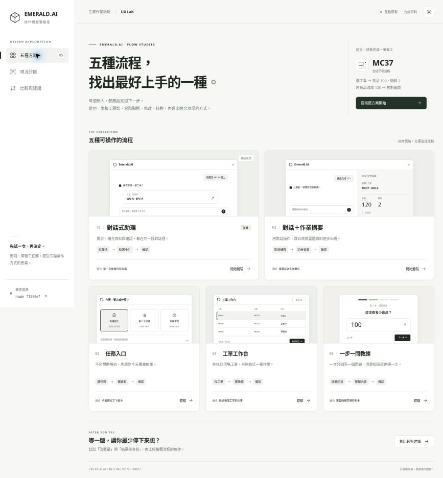

# 對話優先 UX 互動原型

## 開啟方式

下載同目錄的 [emerald-ai-five-flow-demos.html](emerald-ai-five-flow-demos.html)，用 Chrome 或 Edge 開啟。這是單一自包含 HTML，CSS、JavaScript 與圖示皆內嵌，不需安裝套件、設定 API Key 或啟動後端。GitHub 的原始碼檢視不會直接執行互動頁面，請下載檔案後開啟。

檔案中有五種畫面、現況診斷及方案比較。推薦先體驗 **01 對話式助理** 與 **02 對話＋作業摘要**；開啟後也可使用網址片段 `#demo/1`、`#demo/2` 進入對應方案。

## 比較任務

1. 選擇 MC37 的 WO-A／EPS-A 或 WO-B／EPS-B。
2. 輸入本次人工良品 100、缺料 2。
3. 在核對前把良品改為 120。
4. 確認後查看本次回執；切換「結果待查核」情境再體驗查核。
5. 另外試負數、取消、修改與深淺主題，觀察狀態是否清楚。

## 用途與限制

- 本檔是合成資料、固定腳本的 UI 互動參考，沒有呼叫真實模型或 MES；頁面禁止網路連線。外部程式碼來源連結需主動點擊才會開啟。
- 本檔保留五版供比較；正式改版方向是 01＋02，不需要把五套模式一起實作到產品。
- 本檔聚焦新增人工報工與繁體中文。正式產品仍須保留排程、模具、其他報工動作、繁中／英文／泰文、三種主題模式與既有權限。
- Demo 的固定文字解析、合成標籤、人工延遲、回執編號及本機狀態不可以取代正式 API、模型、持久化或交易處理。
- Demo 換工單時的欄位呈現不構成業務契約。正式版應依後端 merge 規則，切換目標時只傳必要目標欄位，再採用伺服器回傳草稿；不得把上一工單數量帶入另一工單。
- 本原型已逐一操作五個流程，包含修改、取消、非法數量與未知結果查核；尚未完成真實新人測試。驗證紀錄不代表正式產品功能已完成。

## 對應規格

- [對話優先 UX 改版規格](../對話優先UX改版規格.md)
- [AI 實作與驗收](../對話優先UX-AI實作與驗收.md)

基準：`WeYuTech/KaosuAiAgentTest main @ 71506e727a0844b878637c03d3b4988a163f785c`。日期：2026-10-30（Asia/Taipei）。

## 畫面總覽

## 原型驗證紀錄

日期：2026-10-30。以下均為本檔對應原型的瀏覽器操作與合成資料，不是正式產品驗收。

- 01：WO-A，100／2改為120／2，正常送出並查看單一回執。
- 02：WO-B，100／2改為120／2，回應中斷後查核同一操作，沒有重送入口。
- 03：負數阻擋核對、保留輸入；改正後取消，再重新開始並完成。
- 04：選WO-B完成報工，人工統計更新，IoT未知仍顯示未知。
- 05：逐題填寫，從核對卡返回只改良品為120，完成後查看回執。
- 補查深色主題、方案切換，以及390px寬的嵌入檢視；未觀察到主文件水平溢出，方案標籤可獨立橫向捲動。
- 單檔版本再確認非法修改會撤掉舊確認入口，修正後可核對；unknown查核後顯示同一回執。

原版main另於約1363×936桌面檢視；此觀察不冒充正式規格要求的1366×768與1920×1080完整回歸。正式產品的三語、多模組、SQL、真模型與新人可用性驗收須由實作工作另外完成。
