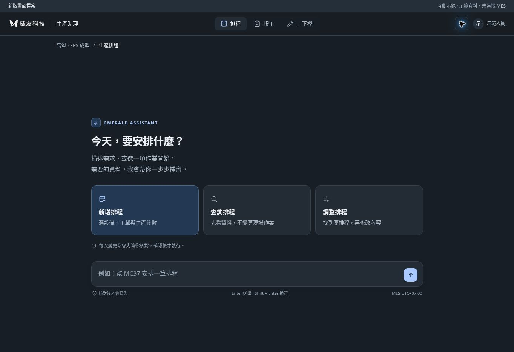
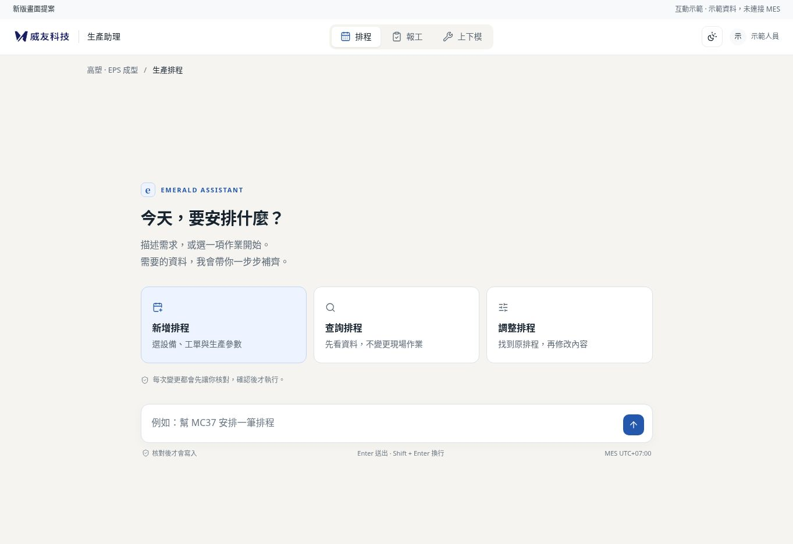
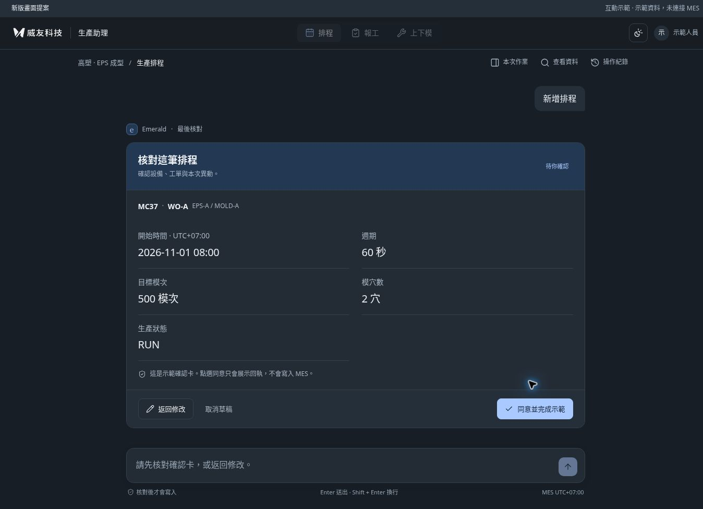
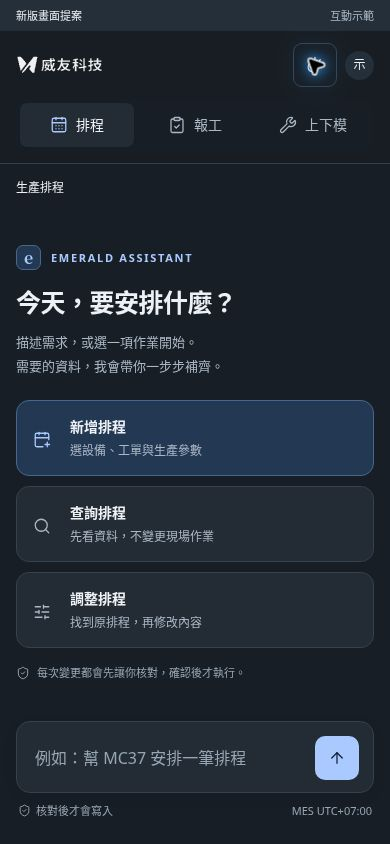

# 生產助理：前輪流程原型（外觀已由新參考取代）

日期：2026-10-31。對應 [PR #16](https://github.com/WeYuTech/KaosuAiAgentTest/pull/16) 的 R07，接續 [PR #14](https://github.com/WeYuTech/KaosuAiAgentTest/pull/14) 的對話優先 UX。

**本原型外觀已被使用者新指定的 WeYu-MesAiAgent main 取代。** 新工作請讀 [UI 對齊與 Codex 指令](../WeYu-MesAiAgent-UI對齊與Codex指令-20261031.md)，本檔只保留流程與歷史實測。以下截圖、尺寸與結果來自前輪提交 `383c643d27b7128e99db799129c9c6f346fd540e`；現 HTML 僅補上歷史標示，不能拿其畫面驗收新 UI。

**這是歷史流程原型，正式 React app 尚未套用本輪新 UI。** 用合成資料展示畫面與步驟，不連接 AI、API 或 MES，不建立正式交易，也不儲存瀏覽器永久資料。重新整理會清空示範紀錄。正式修正仍須完成 R01–R06 與原有業務驗收。

## 開啟與閱讀順序

1. 開啟 [emerald-visual-refresh.html](emerald-visual-refresh.html)。GitHub 檔案頁只顯示原始碼，請下載原始檔後，用瀏覽器開啟。檔案已包含圖示、品牌圖與樣式，不需安裝套件或啟動後端。
2. 先讀 [UI 對齊與 Codex 指令](../WeYu-MesAiAgent-UI對齊與Codex指令-20261031.md)，再讀修訂的 [視覺改版與畫面驗收](../視覺改版與畫面驗收-20261031.md)，依 R07.1–R07.8 修改既有 React 呈現層，並完成 V08–V16。
3. 讀 [MAIN UX 複驗與改進清單](../MAIN-UX複驗與改進清單-20261031.md)，一併處理功能、身分隔離與恢復流程。

原型的 JavaScript 可用來回顧流程演練；它的 CSS 與排版不作本輪視覺標準。正式實作應沿用既有元件、Guide、proposal、handler、語言及主題狀態；不要把這份原型的合成資料和簡化狀態機直接搬成正式執行器。

## 前輪設計決定（歷史紀錄，外觀不再是本輪門檻）

- 桌面頂部保留兩層：品牌／模組／偏好，以及作業脈絡／按需工具。起始頁不出現空工單帶與重複的對話標題。
- 起始只有一組「新增排程／查詢排程／調整排程」；選擇後入口卡退場，顯示目前作業。摘要、資料與紀錄只在需要時打開。
- 對話、作業卡及輸入共用內容軸；桌面最大寬度依尺寸為 880px／960px。手機入口直排，主要控制項至少 44px。
- 深色使用 graphite 分層，淺色使用暖白底與白色卡片；鋼藍只強調主要操作與目前選擇。
- 起始輸入框靠近任務入口；進入任務後，欄位與核對內容是視覺中心。摘要維持唯讀，缺項會返回主欄位。
- 核對卡突出設備、工單、數量、狀態和 MES 時區。只有同一張卡上的同意按鈕能完成本機示範。

## 可以實際體驗的路徑

| 模組／入口 | 原型呈現 |
|---|---|
| 排程／新增 | 選工單 → 填參數 → 必填提醒 → 核對 → 返回修改或示範完成 |
| 排程／查詢 | 唯讀資料 → 明確點「以此工單新增排程」後，才建立示範草稿 |
| 排程／調整 | 修改版面示意；不代表已讀取正式原排程與版本 |
| 報工／新增 | 選工單 → 本筆人工良品 → 明確回答有無不良 → 原因／數量 → 核對 → 示範回執 |
| 報工／查詢、修改 | 查詢保持唯讀；修改呈現示意，不冒充正式報工紀錄與衝突檢核 |
| 上下模／開始上模 | 選對象 → 確認「上模開始」 → 核對 → 示範回執；時間由 MES 於執行時記錄，不能人工補登 |
| 摘要、資料、紀錄 | 同一份示範草稿的摘要、唯讀資料與本機完成紀錄；不另建編輯器 |
| 自由文字 | 保留使用者文字並明示離線示範，要求選任務類型；不假裝已由模型理解 |

更換工單時可以返回原草稿；選回相同對象會保留值，選另一個對象才清除該筆欄位。切換模組／新任務會重設資料，返回修改保留已填內容。上下模的紀錄入口收起後回到原起始頁。

## 前輪實際檢查紀錄（不是新 UI 驗收）

以下結果只適用於這份原型；不算正式產品通過 A01–T04、U01–U17 或 V08–V16。

| 檢查 | 本輪結果 |
|---|---|
| JavaScript 語法 | 以 `node --check` 檢查原型 script，通過 |
| 排程主流程 | 瀏覽器選 WO-A、填 500、核對；確認卡包含時間／UTC+07、週期、模次、模穴數與 RUN，示範完成 |
| 必填／摘要定位 | 未填目標模次會提示；摘要缺項可關閉面板並聚焦 `er-shots`。390px 窄版亦實際操作 |
| 返回修改 | 填 500 → 返回修改為 600 → 重新核對顯示 600；返回目前草稿也保留原值 |
| 唯讀查詢 | 查詢 WO-A 停在唯讀結果；明確點「以此工單新增排程」後才進入表單 |
| 報工主流程 | WO-B／良品 120／NG01 缺料 2，確認卡與示範回執一致 |
| 新任務清值 | 完成報工、切至上下模再回報工 WO-A；良品、缺陷數量及有無不良選擇皆為空 |
| 上下模主流程 | WO-A 上模開始，執行時間為 MES 記錄的唯讀說明；確認後顯示示範回執 |
| 上下模歷程 | 從起始開歷程再關閉，仍在起始頁、焦點回歷程入口、模組可切換 |
| 深淺色 | 瀏覽器實際切換並保存起始畫面 |

尺寸以 Chromium 內相應大小的 iframe 檢查 CSS 排版，並讀取實際 DOM 幾何；這不等同於實體手機鍵盤、不同瀏覽器或觸控裝置驗收。

| 預覽尺寸 | 內容寬度 | 頂部兩列 | 輸入與提示區 | 水平溢出 |
|---|---:|---:|---:|---|
| 1366×768 | 880px | 112px | 約 101px | 未發現 |
| 1920×1080 | 960px | 112px | 約 101px | 未發現 |
| 390×844 起始 | 358px | 181px（模組另排一行） | 約 106px | 未發現；送出按鈕44px |
| 320×800 起始 | 273px（扣除15px直向捲軸及左右16px） | 允許自然增高 | 可自然捲動 | 未發現；送出按鈕44px |

上述高度不包含最上方的「新版畫面提案／互動示範」標示。長表單與確認卡允許自然捲動；390px 表單出現直向捲軸時，內容寬度會相應減少。這次沒有完成所有語言、200% 縮放、完整鍵盤／讀屏、所有色對對比或真實手機鍵盤測試，不宣稱 WCAG 合規。

## 畫面證據

以下均為前輪原型在瀏覽器實際渲染的歷史截圖，非本輪 UI 基準或正式 main 已更新的證據。桌面起始截圖 1363×936；確認卡是完整頁面 1348×976；手機截圖為 390×844 視窗。

### Graphite 深色起始

### 暖白淺色起始

### 同一條流程的核對卡

### 手機直排入口

## 正式實作仍須完成

正式三語、宿主入口及語言／完整 system 偏好、可信身分、完整 action 範圍、原資料與版本／digest、非同步保存、writes gate、獨立同意、過期、unknown、網路錯誤恢復、多分頁與真實 MES 結果，均以既有契約及規格驗收。原型沒有模擬這些能力，不得用示範完成畫面代替正式驗收。

下一個 AI 應依新的 WeYu-MesAiAgent main 參考實作；完成證據應包含實際 React 畫面、必要狀態測試與已填／核對／摘要截圖。只更新色票、貼原型截圖或跑通 build，都不代表 R07 已完成。
