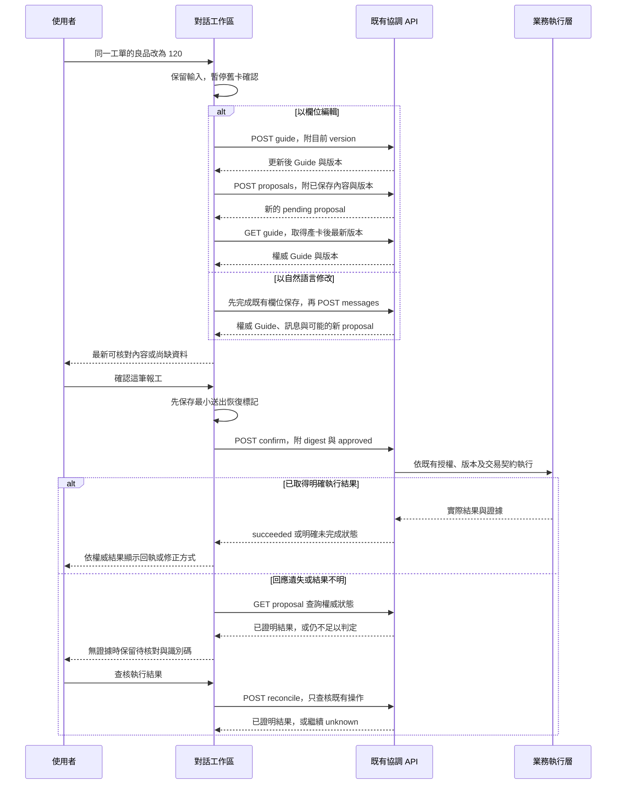

# 對話優先 UX 改版規格

日期：2026-10-30（Asia/Taipei）  
審查基準：`main @ 71506e727a0844b878637c03d3b4988a163f785c`  
狀態：待實作規格。本次 PR 交付文件與互動原型；正式應用尚未依本規格改版。

## 決策摘要

採用 **01「對話式助理」為預設入口，按使用者需要展開 02「作業摘要」**。使用者已肯定本次 Demo 的操作流程，並要求把推薦方案、應保留的 UX 細節及詳細 AI 實作要求寫進 PR。

使用者進入後，先表達需求或選一個任務範例；系統只追問缺少或有歧義的資料，將工單選擇、小表單、確認卡與完成回執留在同一個工作脈絡。摘要是同一筆作業的另一種呈現，不是第二套表單或第二個確認入口。

後續實作依本文件與 [AI 實作與驗收](對話優先UX-AI實作與驗收.md) 執行。工作進度以關聯 GitHub Issue 為準，不能因文件 PR 合併就將產品功能標記完成。

## 交付導覽

| 內容 | 用途 |
|---|---|
| 本文件 | 使用者流程、畫面層級、互動規則、文案與取捨 |
| [AI 實作與驗收](對話優先UX-AI實作與驗收.md) | 現有程式對應、工作順序、契約保護、驗收矩陣與 AI 執行指令 |
| [互動原型使用說明](prototypes/README.md) | 下載及操作同一份五方案 HTML |
| [五方案互動原型](prototypes/emerald-ai-five-flow-demos.html) | 完整可操作的設計參考；推薦比較 01 與 02 |

## 本次提案與既有規格的關係

現有 [桌面對話作業單規格](桌面對話作業單規格.md) 是 `71506e7` 的基準，明訂預設左右雙欄。本提案明確調整以下畫面決策，其餘業務、API、授權、交易與稽核契約繼續沿用。

| 項目 | 舊規格／現況 | 本提案 |
|---|---|---|
| 主要入口 | 左側對話與右側作業單同時提供起點 | 以對話區為單一主要操作路徑；範例與卡片完成相同任務 |
| 作業摘要 | 進入作業即呈現完整側欄 | 預設先維持聚焦畫面；使用者可展開摘要，複雜作業可顯示清楚的展開提示 |
| 卡片與確認 | 作業單步驟、確認卡及對話分開呈現 | 同一個有效草稿；確認入口在目前可見的主核對區只出現一次 |
| 查詢 | 查詢回覆可能切換右側頁籤 | 可保留作業脈絡的唯讀查詢使用 drawer／區段，明確返回原作業 |
| 新人引導 | 先辨識多個功能分類與動作 | 先做一件事，再逐步補齊資料；更詳細教練模式為後續可選項 |

必須保留：九頁原 MES 入口與宿主情境、排程／報工／模具三模組、繁體中文／英文／泰文、淺色／深色／跟隨系統、可信 MES 身分及原權限、草稿版本與人工確認、未知結果查核、正式環境的寫入限制及模型預算。正式實作完成時同步更新舊版畫面規格與驗收文件，標明被取代的版型決策；本次文件 PR 不把待實作結果寫成既成事實。

## 現況問題與證據

以下區分實際操作觀察與程式碼可證明的行為。沒有真實新人測試數據，也不宣稱已量測完成時間或效率提升。

| 問題 | 證據與觀察方式 | 新人影響／設計回應 |
|---|---|---|
| 同時出現兩組操作起點 | 原版模擬環境實際操作；[main.tsx](../frontend/src/main.tsx) 對話範例與 [GuidedFlow.tsx](../frontend/src/GuidedFlow.tsx) action grid | 先判斷該跟誰互動；改成單一路徑與可選摘要 |
| 右側已填資料，左側仍是歡迎畫面 | 實際選 MC37／WO-A 並填 100／2；main.tsx 的 messages 與 GuidedFlow 有不同呈現來源 | 難確認助理是否知道目前資料；由同一作業狀態推導訊息、欄位與摘要 |
| 主要確認動作需要往下找 | 原版桌面約 1363×936 的實際操作；GuidedFlow 的 review 提示後仍接完整確認卡 | 核對焦點分散；以對象、數量、影響為首要內容，動作與核對內容靠近 |
| 查詢回覆會切換頁籤，選資料會建立新對話 | 程式碼：main.tsx 的 receive()、chooseRecord() | 工作脈絡跳轉；明確區分唯讀查看與切換作業對象，保留返回路徑 |
| 部分必填錯誤只告知資料未齊 | 程式碼：GuidedFlow.tsx 在 details 階段的 ready 檢查 | 使用者仍需自行找缺項；依伺服器缺項與欄位驗證，指出下一個可修正項目 |

完整固定版本來源：[基準 commit](https://github.com/WeYuTech/KaosuAiAgentTest/commit/71506e727a0844b878637c03d3b4988a163f785c)。本次原版檢查使用隔離模擬資料、未設定模型金鑰；不能當成真實 AI 或正式 MES 的驗收。

## 五方案的取捨

| 方案 | 保留價值 | 本次決策 |
|---|---|---|
| 01 對話式助理 | 範例起步、選項卡、只補缺項、修改後核對、同一脈絡完成 | 作為正式改版預設體驗 |
| 02 對話＋作業摘要 | 對象與數量一眼可核對，支援資料較多的任務 | 與 01 共用狀態，按需展開 |
| 03 任務入口 | 不用思考開場白，先選要做的事 | 將精簡任務範例吸收進首頁；不另外新增整套模式 |
| 04 工單工作台 | 已知工單與宿主 MES 情境下可直接開始 | 沿用既有工單入口與 context；不要求新人先理解工作台 |
| 05 一步一問教練 | 一次一個決定、清楚知道下一步 | 將「只追問缺項」吸收進主流程；完整教練模式列後續選項 |

五個方案用於比較；不把五個模式選單全部放進正式產品，避免再次增加新人的選擇負擔。

## 使用者應能自行完成的示範任務

1. 從首頁或 MES 入口開始「幫 MC37 報工」。
2. 發現 MC37 有多筆可操作工單後，明確選擇 WO-A／EPS-A，不能由系統默認第一筆。
3. 填本次人工良品 100、NG01 缺料 2；這是本次新增量，不是累計量或 IoT 推算量。
4. 核對前把良品改成 120，立即看到有效內容改變，舊確認卡不可再送出。
5. 確認設備、工單、人工良品 120、缺料 2，以及「新增一次人工報工，不會結束工單」。
6. 人員確認後送出一次，取得可追溯的結果；回應中斷時先查核同一筆結果。

MC37、WO-A／EPS-A、WO-B／EPS-B 來自既有 [模擬情境](模擬情境.md)；Demo 的產品顯示文字、回執編號及部分統計是合成資料。正式實作的選項、標籤、數量與識別碼必須由既有 API 回傳，不能固定寫入畫面。

## 範圍與實作原則

- 第一個可驗收交付以「新增人工報工」走完整條路徑；其他既有報工動作、排程多明細與模具階段必須保持可用，再依功能盤點完成相同 UX 整合。不能用「先做 MVP」移除原功能。
- 保留目前程式堆疊與既有 API；不在 UI 改版中重寫後端或搬遷框架。不新增套件、不修改 DB Schema、不新增或放寬業務規則。
- 前端的視覺步驟、展開狀態與訊息呈現，不能取代伺服器的權限、版本、狀態與執行結果判斷。
- 使用既有 React／TypeScript 組件與明確型別拆分合理職責；不要為套用模式建立通用 workflow engine、額外狀態框架或過多 abstraction。
- 如 UI 目標與目前 API 契約矛盾，先列出程式證據、最小可行作法及取捨，不私自改寫契約或用前端假資料掩蓋缺口。
- Demo 的固定腳本僅供互動參考。正式自然語言走既有受限模型流程；模型不可輸出任意 SQL、表名、端點或執行程式。

## UX 實作規格：對話優先，按需展開本次作業摘要

### 1. 唯一推薦方向與變更範圍

採用 Demo 01「對話式助理」作為所有人的預設工作區；需要檢查較多欄位時，按需展開 Demo 02「本次作業摘要」。這是同一個操作流程的兩種呈現密度，不是讓使用者先選兩套模式。

本提案明確取代 `docs/桌面對話作業單規格.md` 中「進入作業後預設左右並排、右側常駐作業單」的 UI 決策。以下既有契約繼續保留：九頁 MES 啟動入口及來源情境、可信登入與模組授權、版本化草稿、人工確認、正式寫入開關、交易與稽核、結果待核對處理、繁中／英文／泰文、淺色／深色／跟隨系統，以及既有同源嵌入方式。[來源 1][S1] [來源 2][S2] [來源 3][S3] 

本次工作是前端資訊層級與互動流程調整，不新增 DB Schema、不引入套件、不重寫業務後端、不新增未驗證的業務卡控。以既有 React／TypeScript 前端與目前公開 API 完成，不因 UI 改版另建一套業務狀態機。

**完成標準：** 新人能在同一個助理工作區辨認目前對象、知道還缺什麼、修正內容、確認送出並找到結果；不需要先理解「步驟引導」「作業單」「資料分頁」「進階草稿」之間的差別。

### 2. 首頁與單一主入口

#### 2.1 預設畫面

開啟助理後，首先顯示單一對話區及固定輸入框，主標題為「今天要完成什麼？」。可提供「登記這次產量」「安排生產」「操作模具」三個簡短範例入口；入口依可信 session 的 roles 與現有 capabilities 顯示，不把使用者無權使用的動作當成可操作選項。

每次只能有一個目前作業情境與一個主要下一步。首頁不預先展開空白作業表、五階段流程條、工單清單、原始 JSON、稽核紀錄或用量明細。使用者需要資料時再開啟。

- 既有 MES 入口可帶入設備、排程或執行紀錄等資料情境；沿用可用資料並清楚顯示「目前作業」，後端仍須驗證歸屬與權限。來源欄位不是自動判定模組的證據，`OPERATION` 也不能直接當成 `module`。
- 正式環境沿用 MES 登入者，不要求再選生管／作業員等模擬角色。未取得可信 session 時顯示登入狀態與重新確認入口，不降級成模擬身分。
- 模擬身分切換保留在明確標示的測試控制中，不混入正式新人流程。
- 首頁範例只準備需求或啟動受限草稿流程；點範例、選工單與填數量都不等於確認寫入。
- 保留原品牌、現有字體資產與黑白層級；少量狀態色輔助辨識，不以大面積裝飾搶走當前動作。

#### 2.2 模組尚未確定時的處理

目前 `POST /api/conversations` 必須指定 `module`，並不存在可跨模組任意派送文字的公開入口。不可為達到單一首頁，就在前端以關鍵字比對假裝能理解所有需求，也不可擅自新增路由 API。[來源 4][S4] [來源 6][S6] 

採以下既有契約內的流程：

1. 目前已有授權且相符的對話，或使用者點了附有明確模組的範例時，直接建立／恢復該模組對話。基準版的宿主白名單不包含 `module`；設備／排程上下文只能協助查詢和選取，不宣稱現有入口已能自動派送到模組。
2. 使用者從無模組情境的首頁先輸入自由文字時，先保留完整文字，在同一對話區顯示小型選項：「這次要登記產量、安排生產，還是操作模具？」
3. 使用者明確選擇後，再使用既有 API 建立該模組對話，將保留的需求送出一次。建立對話失敗時不清除文字。
4. 這段是工作範圍選擇，不冒充模型已判讀出的結果，也不切換到另一張大型模組首頁。

若未來要求「不經明確作業範圍選擇也能完全自動跨模組判斷」，應另列後端契約需求；不能在這次前端改版中宣稱已具備。

### 3. 資料來源與狀態責任

#### 3.1 三層狀態必須分開

| 層級 | 保存內容 | 可決定的事情 | 不可自行決定的事情 |
|---|---|---|---|
| 前端呈現與尚未儲存的輸入 | 輸入框文字、原始欄位值、dirty、儲存／傳送進度、欄位錯誤、摘要與查詢抽屜是否展開、焦點 | 現在顯示哪張卡、是否暫停提交、錯誤如何修正 | 已寫入成功、正式權限、有效草稿版本、伺服器已取消 |
| 後端 Guide | `version`、`action`、`intent`、`args`、`step`、`missing`、`ready`、關聯 proposal | 已保存草稿內容、尚缺欄位、版本衝突、已採用的作業目標 | 單憑 `ready=true` 就視為允許寫入或已完成 |
| 後端 Proposal 與確認結果 | `id`、`digest`、`status`、`args`、`target`、`changes`、`expires_at`、寫入與時間政策 | 確認卡內容、是否仍可確認、執行結果、可證明的異動 | 以目前畫面或固定倒數推定真實成功 |

前端可以使用 `editing`、`saving`、`submitting` 等 UI 名稱，但不可將它們當成新的 Guide `step` 或 Proposal `status` 傳給後端。現有 Guide `step` 為 `action`、`target`、`details`、`review`、`result`；Proposal 成功值為 `succeeded`，不是 Demo 的 `done`。[來源 5][S5] [來源 6][S6] [來源 7][S7] 

`Guide.ready` 只代表草稿所需欄位已達到現有檢查條件；仍須由準備 proposal 的既有流程完成業務預覽及驗證。確認按鈕還必須同時滿足有效 proposal、未過期、版本未被取代、無本機未同步修改、無處理中的 mutation、寫入已啟用、必要獨立確認已勾選。

#### 3.2 自然語言與點選共用同一份草稿

對話、欄位卡與右側摘要只呈現同一份 Guide／Proposal。不可保留「聊天草稿」和「表單草稿」各自編輯後再比對猜測哪份較新。

- 點選目標或修改欄位，使用既有 `POST /api/conversations/{cid}/guide` 與目前 `version`。
- 自然語言使用既有 `POST /api/conversations/{cid}/messages`。目前後端回應已含 `guide`；可補齊前端 `Reply` 型別後採用這份權威回應，或沿用既有讀取 Guide 的流程，不新增 API。
- 表單有未儲存修改時，傳送下一則自然語言前先等待草稿保存完成；保存失敗則保留表單與文字，停止後續傳送。
- 同一個 conversation 的草稿保存、訊息處理與 proposal 準備串行處理，不能讓兩個元件各自發起會互相覆蓋的 mutation。
- 回應必須比對所屬 conversation、操作者與目前請求；延遲到達的上一個情境回應不可覆蓋目前畫面。
- 收到 `guide_stale`／409 時，保留本機未送出內容、重新讀取權威 Guide 並請使用者核對差異；不得把舊版本的資料自動覆寫回去。

可將現有 `GuidedFlow` 中的 Guide 同步、儲存佇列與表單片段拆成少量可讀的小元件／hook；先重用既有行為，不為套用模式另加狀態管理套件或通用工作流程引擎。

#### 3.3 同對象修改與確認時序

以下是既有契約的前端使用順序；省略認證、明細驗證與交易內部步驟，不表示它們可以省略實作。

### 4. 主驗收流程：MC37 報工 100／2，修改為 120／2

此案例沿用既有合成資料，只供隔離模擬與 HTTP／瀏覽器驗收，不代表正式 MC37 的即時資料。[來源 8][S8] 

| 階段 | 使用者看到與可做的事 | 系統必須保留的語意 |
|---|---|---|
| 開始 | 輸入「幫 MC37 報工」或選對應範例 | 僅提出需求，沒有業務寫入 |
| 對象不明確 | 在訊息內呈現 WO-A／EPS-A 左側緩衝件，以及 WO-B／EPS-B 右側緩衝件 | MC37 不是唯一作業識別，不能直接挑第一筆 |
| 選 WO-A | 明顯顯示「MC37 · WO-A · EPS-A」，接續詢問本次產量 | 綁定正確 execution `2001`；主鍵放詳細資訊，不要求新人輸入 |
| 補充數量 | 輸入「良品 100，缺料 2」，或在同一則訊息的欄位卡填寫 | 本次新增人工良品 100、NG01 缺料 2；不是累計總量 |
| 準備確認 | 顯示設備、工單、產品、本次人工良品 100、不良原因及數量 2、操作影響 | 由後端準備 proposal，畫面清楚標「尚未寫入」 |
| 修改 | 輸入「良品改成 120」或按良品欄位的修改入口 | 在同一對象下保留缺料 2；舊卡立即暫停確認，保存並產生新卡後才恢復確認入口 |
| 再核對 | 新卡顯示人工良品 120、缺料 2，可顯示「100 → 120」輔助辨認 | 只剩最新有效 proposal 可提交，舊卡保留為歷程時不可有可用的確認按鈕 |
| 確認 | 按「確認新增報工」；進入正在送出狀態 | 使用目前 proposal 的 `id` 與 `digest`，只呼叫既有確認流程 |
| 完成 | 顯示後端已證明成功的對象、這次新增內容與操作識別碼，可查看紀錄 | `succeeded` 才顯示已完成；刷新失敗不可把成功交易改標失敗 |

WO-B 必須可以走完相同流程，並始終使用其 execution `2002`、產品與工單資訊；不可在回執或確認卡中硬編碼 WO-A。

#### 4.1 首次澄清目標與更換目標不能混為一談

當使用者尚未選定任何執行紀錄，已在同一需求提供「MC37、良品 100、缺料 2」時，工單澄清完成後可依伺服器回傳的 Guide 接續作業；前端不能因還缺工單就要求把整段話重打。

但已明確綁定 WO-A／execution `2001` 後再換 WO-B，是**作業目標變更**。`app/guide.py` 對 `execution_id`、`report_id`、`schedule_id` 的變更會清除原目標相關 `args`；前端必須遵守此契約：[來源 5][S5] 

1. 僅提交新的目標識別 patch 與必要的既有控制欄位。
2. 禁止以 `{ ...oldArgs, execution_id: newId }` 或其他方式重新夾帶舊數量、原因或明細。
3. 採用後端回傳的 Guide，重新呈現它保留及清除後的欄位，再補必要資料。
4. 已有待確認 proposal 時，先依取消／修改目標的既有流程處理，不繞過目標鎖定。

Demo 為比較不同版型而保留的欄位值，不是正式目標切換契約。**同對象修改、查詢、收合視窗可保留輸入；換工單不能默默沿用舊工單數量。**

### 5. 缺欄位追問與結構化卡片

以 Guide 的 `missing`、`ready`、現有 schema 和伺服器驗證結果決定還需要什麼。每次聚焦一個可理解的決定，例如「選哪張工單」或「這次的良品與不良數量」，不把所有系統欄位一次交給新人。

- 已知且有效的資料不重問；宿主情境只是選取提示，不能略過伺服器查證。
- 候選卡至少顯示機台、工單、產品／品號及能辨認該筆的時間／狀態；同工單多次執行時仍須有足夠差異資訊。
- 找不到資料時保持「沒有符合條件的資料」，提供修改設備／日期／工單條件，不退回第一筆或全廠清單當作選取結果。
- 數量欄位可留空等待補齊；不能把空值、`null`、無法解析內容自動變成 0。
- 正式新增報工不預填 Demo 的 100／2／120。只有使用者明確輸入，或依「修改既有報工」情境從原紀錄帶入，才可顯示為作業欄位值；首頁範例數字與 placeholder 不能自動變成已採用的數量。
- 「沒有不良品」是使用者明確選擇，依既有契約保存空的 defects 陣列。不得因沒有提到不良，就自行斷定沒有不良品。
- 不良原因從既有 catalog 選取，允許契約支援的多原因明細；總不良數由明細合計，不另存一個可能不一致的總數。
- 整數與上下界依現有 schema 驗證；基準版本的人工良品、各不良數量及不良合計都受 `0..2147483647` 整數限制。每筆原因各自合法，不代表合計一定合法。不能照搬 Demo 的 `Number.isSafeInteger` 當作完整業務範圍，亦不可截斷小數、取絕對值、默默捨入或擅自新增產量上限。[S10]
- 排程多明細用可辨認的明細卡／小表格；保留同模具全部合法品號、同品號多模具明細的明確選擇，不要求新人填 JSON。
- 模具操作依資料與既有卡控呈現可用下一階段；操作時間由既有伺服器規則決定，不加入任意補登時間功能。

欄位卡的結構化輸入與自然語言是兩種輸入方式。使用者可以先打字，再點選補資料，也可以填欄位後用一句話修改；兩者都須回到相同的版本化草稿。

### 6. 修改、確認與結果的精確行為

#### 6.1 修改開始即暫停舊卡

使用者開始修改同一作業的數量、原因或明細時，先在 UI 暫停原 proposal 的確認功能，再進行保存與重新準備。這個本機狀態應顯示「內容修改中，請完成核對」，不能假裝後端已經回報 `superseded`。

伺服器成功接受 Guide 或訊息修改後，採用其權威狀態；目前後端會將該 conversation 的舊 pending proposal 設為 `superseded`。[來源 6][S6] 

- 修改失敗：保留原始輸入與錯誤，停留在可修正的欄位卡；不能無聲恢復舊值並重新開放舊卡確認。
- 例如「良品改成 -1」「良品改成 1.5」被驗證拒絕時，必須顯示具體錯誤，沒有仍可送出的舊 100 件確認卡。
- 若保存或訊息請求結果不明，先重新讀取 Guide／Proposal 釐清版本，再決定下一步；不自動覆寫或重送。
- 對否定句、歧義句或無法理解的自然語言，由既有模型與受限工具契約澄清，不能以前端局部字串擷取出「120」就套用。

#### 6.2 一張有效確認卡、一個確認入口

確認卡位於目前對話的作業區。摘要抽屜不再產生第二組可獨立提交的按鈕；摘要內的「修改」只定位到同一張有效編輯卡。若布局需要移動卡片，只能移動同一份控制權，不能同時出現兩套確認狀態。

確認卡必須呈現人能辨認的對象、確切操作、人工良品／不良明細或排程／模具內容，以及必要的影響範圍。主要按鈕使用具體動作文字，例如「確認新增報工」，避免僅顯示「繼續」。

完整資料表、主鍵、欄位前後值和完整參數保留在可展開的詳細資料；不讓技術欄位搶走主要確認內容。完工、清除、刪除與其他現有獨立確認動作仍須顯示既有受影響對象及獨立確認要求，不能因簡化畫面而省略。

保留 `writes_enabled`、`expires_at`、`independent_confirmation`、`business_timezone`、時間與新識別碼政策。正式寫入未啟用時保留查詢、草稿預覽與取消，明確說明確認不可用的原因，不把按鈕改成模擬成功。

#### 6.3 取消與各種結果

| 情境 | 畫面與可用動作 | 不可出現的行為 |
|---|---|---|
| 尚在本機編輯，無有效 proposal | 可結束目前編輯；若已有後端 Guide，依既有版本化更新契約重設並採用回應 | 只清 UI 就宣稱伺服器已取消一張 proposal |
| 有 pending proposal，使用者取消 | 走既有 `confirm` 的 `approved:false`；確認回應為 cancelled 後顯示「已取消，未寫入業務資料」 | 關閉卡片立即當成取消成功 |
| 正在送出／取消 | 停用重複提交、改目標、改模組與同作業修改；保留當前內容 | 因重複點擊發出多次寫入，或用切頁避開待處理狀態 |
| `succeeded` | 顯示已完成、目前對象、可證明的結果與識別碼；刷新作業資料，提供查看紀錄、開始下一筆 | 將 preview 的預期異動當作執行後實際異動 |
| 成功後資料刷新失敗 | 保留「已完成」；另提示目前資料未更新，可重試唯讀刷新 | 把交易改標失敗、重新開放相同寫入 |
| `cancelled` | 顯示取消結果，允許重新開始 | 保留舊卡確認入口 |
| `superseded`／`expired` | 顯示已被取代／過期；引導核對最新草稿或重新準備 | 以本機延長期限、恢復舊卡或重用舊 digest |
| 明確拒絕／驗證錯誤 | 顯示可理解的原因，依後端狀態提供修正或查閱 | 一律描述為網路故障或自動改資料重送 |
| 結果未知 | 固定顯示待核對區、操作識別碼、「查核執行結果」；可查唯讀資料 | 顯示失敗後「再試一次」寫入、取消舊卡、切對象另開相同操作 |

取消請求同樣可能發生回應遺失，不能預先宣稱已取消。沿用 `confirmWithRecovery` 的權威查詢與未知結果處理。[來源 7][S7] 

#### 6.4 結果待核對

確認請求遇到無法判斷結果的錯誤時，沿用 `confirmation.ts`：先 `GET /api/proposals/{id}`，仍不明確時進入前端保守的結果待核對狀態。恢復查詢只得到 `pending`，也不能證明先前確認未送達，不可因此重新開放確認。[來源 7][S7] 

「查核執行結果」呼叫既有 `POST /api/proposals/{id}/reconcile`，不再次送出業務命令。查核後仍無證據時，繼續待核對並保留識別碼，不能用固定延遲、查核次數或動畫結束來決定成功。

操作識別碼在此狀態應直接可見、可複製，不藏在「技術資料」的預設收合區。使用者收合助理再打開、重新整理或恢復對話後，必須以權威狀態恢復待核對畫面，而不是得到可重送的新草稿。重新整理時，權威回覆若仍為 pending，還須結合最小送出恢復記錄保持保守鎖定；實作順序、持久化失敗及跨裝置限制見 AI 實作與驗收的 E06，不能只靠再次 GET pending 宣稱已排除未知結果。

### 7. 按需展開的作業摘要

首頁和未辨認作業時不顯示空白側欄。已開始作業後提供簡短「本次作業」入口；點開才展開摘要。即使沒有展開，對話中的上下文與確認卡也足以完成報工。

- 桌面有足夠寬度時，摘要以右側窄欄展開；主要對話與輸入框仍可見。
- 空間不足時使用單欄抽屜／面板，不強行壓成兩個窄欄，不要求拖曳橫向捲軸才能填核心欄位。
- 摘要顯示目前作業對象、已確認欄位、尚缺項目與草稿／待確認／結果狀態，不與聊天各存一份資料。
- 尚未保存的修改可顯示，但必須標示「尚未同步」或正在保存，不能偽裝成伺服器已接受的內容。
- 摘要的修改入口將焦點帶回對應欄位；確認入口仍只有一個。
- 關閉或重新開啟摘要不更換 conversation、不重建 Guide、不清除輸入，也不影響 pending／unknown 鎖定。
- 多工單排程等內容較多時，可以提示「展開查看所有明細」，不在沒有使用者需要時永久打開完整工作台。

### 8. 查詢資料與操作紀錄不中斷目前作業

「查看資料」「操作紀錄」「查看這張工單」以附屬抽屜或對話中的可展開結果呈現。查詢的 loading、error、結果及篩選條件與目前作業的 mutation 狀態分開，避免一個唯讀查詢把整個編輯流程清掉。

- 查詢結果不自動跳離對話，不覆蓋目前的目標、草稿或輸入框文字。
- 收起查詢後回到原來位置與焦點，保留已填但未送出的內容。
- 「檢視這筆」是唯讀；「改用這筆作業」是明確的目標切換，要走目標切換規則，不能點資料列就暗中建立新對話。
- 使用既有 `/api/workspace` 查詢與 `/api/audit`，保留現有權限、條件、分頁與範圍限制。不得為顯示方便直接載入全廠資料。
- `reply.data` 有內容時，將結果放在這一輪訊息或查詢面板；移除目前 `receive()` 無條件 `setTab('data')` 導致注意力離開作業的副作用。
- 查詢完成不等於業務作業完成，不把查詢結果標成已報工／已寫入。

**目前契約的界線：** `POST /api/conversations/{cid}/messages` 在模型處理前即將該對話所有 pending proposal 設為 `superseded`，包含使用者文字最後可能被解讀為查詢的情況。不能只改前端就聲稱「任意自然語言查詢完全不影響待確認卡」。[來源 6][S6] 

本次以明確的唯讀資料／紀錄入口實現不中斷查詢；送到既有 messages API 的新文字仍遵守其取代舊卡契約。不得前端猜它是查詢，就把已被伺服器取代的舊卡重新開放。若後續要讓所有自然語言查詢保留 pending 卡，須另行審查既有訊息契約的變更，不能用新增假 API 或隱藏旁路達成。

### 9. 切換模組、切換對象與未送出輸入

三類操作分開處理，不使用一個「重新開始」按鈕粗暴清空全部狀態。

| 使用者行為 | 應有行為 |
|---|---|
| 開關摘要、查資料、看紀錄、收合助理 | 同一情境保持對話、Guide、原始欄位值與未送出文字；只改呈現狀態 |
| 同對象由欄位改成自然語言輸入 | 先完成同一 Guide 的保存，再送文字；保存失敗保留全部內容 |
| 切換模組，沒有 pending／unknown／處理中 mutation | 先處理 dirty 保存；以操作者、模組、宿主情境與 conversation 隔離未送出文字及 UI 暫存，再恢復目標模組的權威 Guide |
| 已有未送出的文字但尚未構成後端草稿 | 同次介面使用期間按情境暫存；切回原情境可見，不將文字自動移到新工單或新模組 |
| 已有 pending proposal | 顯示「目前內容待確認，請先確認或取消」並保留畫面；不可因導航而丟棄卡片 |
| 正在保存／準備／提交 | 防止跨情境 mutation；顯示進度，不同時清空 UI 或建立另一份作業 |
| 結果 unknown | 先查核；禁止改目標、改模組及產生另一張寫入草稿；仍能看唯讀資料 |
| 更換已選定工單／執行紀錄 | 只送目標 patch，採用伺服器清除／重建後的 Guide，不夾帶舊數量與明細 |
| 重新整理或恢復對話 | 重新取得 session、conversation、Guide 與 proposal 權威狀態；不能只相信本機保存的卡片狀態 |
| 登入者改變／失效 | 不讓另一個人看到或提交原操作者的草稿；停止寫入並依既有可信登入規則重新核對 |

目前只把 conversation ID 與偏好保存在既有本機儲存。為保留同次 UI 切換中的輸入，可以使用應用層記憶體暫存，不因此把完整 MES 內容、登入資料或 Token 新增到長期 localStorage。若要支援瀏覽器重整後保留「尚未送出、尚未保存」的文字，需明確設計儲存期限與清除範圍；本次不得把尚未保存的內容宣稱為已備份。

### 10. 沒有模型或模型失敗時

`model_configured=false` 時，明示「AI 尚未設定，可用欄位完成作業」，停用自然語言送出，但保留同一工作區中的人工欄位卡與既有 schema／catalog 引導。不重新打開另一份進階表單，更不能以固定關鍵字回覆冒充 AI。[來源 2][S2] [來源 4][S4] [來源 6][S6] 

- 使用 `/api/capabilities` 的授權動作與既有 schema，沿用 Guide 保存及 proposal 準備流程。
- 人工模式仍要選明確目標、檢查必要欄位、準備確認卡及人工確認；不是直接呼叫業務寫入。
- 不需要模型才能完成的欄位選擇、資料查詢和待核對操作繼續可用。
- 缺少或無法取得權威資料時顯示失敗與可重試的唯讀／保存操作，不產生假的候選、資料或結果。
- `model_configured=true` 只表示後端有設定，不能單憑這個值宣稱模型端即時連線健康或回答必定成功。模型呼叫失敗時保留需求、說明可以改用欄位操作。
- 不自動放寬權限、改變寫入開關、增加模型預算或重設用量。

### 11. 無障礙、響應式、繁中／英文／泰文

#### 11.1 鍵盤與讀屏

- 所有欄位有可辨認 label，候選卡可用鍵盤選擇；焦點樣式在淺色與深色主題均清楚。
- Enter 送出對話，Shift+Enter 換行；繁體中文輸入法組字時的 Enter 不送出。
- 僅在使用者動作需要下一步時移動焦點，例如選工單後移到下一個欄位、驗證失敗聚焦第一個錯誤；背景保存完成不得搶焦點。
- 一般進度以適量的 `role=status`／`aria-live=polite` 宣告；欄位錯誤與欄位關聯，不整段對話每次重新播報。
- 查詢抽屜若是模態，提供焦點限制、Esc 關閉及關閉後返回觸發按鈕；非模態側欄不得把使用者困在裡面。
- Esc 關閉附屬面板或收合助理，不等於取消草稿；收合與重開不得解除 pending／unknown 的業務保護。
- 成功、失敗、待核對、未送出狀態同時提供文字，不只靠顏色；尊重 reduced-motion。

#### 11.2 版面

以桌面 1366×768、1920×1080 為主要驗收尺寸，另驗證既有 400×500 小視窗、窄視窗與瀏覽器 200% 縮放不會讓核心操作被遮住。保留現有啟動、收合、放大與同源 iframe resize 契約；不要求新增一套平板專用產品。[來源 1][S1] [來源 2][S2] 

輸入框與必要的下一步可到達；長對話、長工單名稱、多明細與錯誤文字可換行。資料表可在自身區域捲動，但整個工作區不應因固定雙欄而需要橫向捲動。不要靠隱藏必要欄位、裁切確認按鈕或過小字級讓畫面看似簡潔。

本輪提案的主要對話、欄位與核對內容使用16px，次要資訊14px；桌面主要按鈕與輸入區至少40px高，窄畫面至少44px高，三語長文案可自然增高。這是對原先16px／48px與後續桌面14px／36px規格差異的明確取捨，不宣稱沿用舊CSS就已符合；實作時同步更新相關規格並驗證200%縮放。

#### 11.3 語言與時間

沿用 `zh-TW`、`en`、`th` 與現有 `i18n.ts`／`translations.ts`；新文案補齊三語。工單、品號、原因代碼等業務識別值不翻譯，不把語言切換視為切換作業。[來源 9][S9] 

- 切換語言成功後保持對話與草稿；失敗保留原語言與輸入，明確提示。
- 送出與回應採目前語系契約；獨立確認的勾選狀態依既有做法重設，避免未核對新呈現就提交。
- 英文長句、泰文自然換行、泰文字體與數量單位必須實際驗收，不能只驗證中文字串存在。
- 淺色／深色／跟隨系統偏好變更不重建作業；警示卡、輸入框、停用按鈕和錯誤訊息均要檢查對比。
- 作業時間依後端 `business_timezone`、`business_date` 與 proposal 政策，不在前端硬編碼 UTC+07 或 UTC+08，也不能以瀏覽器日期取代生產日規則。現有不同模組的時區預設差異列於 AI 實作與驗收的未決事項，應核對部署設定，不在本輪默改業務時間。

### 12. Demo 可保留與不可照搬的內容

| 可作為正式 UI 參考 | 只能留在 Demo，不能照搬正式版 |
|---|---|
| 單一對話入口、缺什麼再問、訊息內選擇卡、目前作業上下文 | 前端固定正則辨識需求、固定助理台詞冒充模型 |
| 100／2 → 120／2 的同對象修改體驗 | 將 100、2、120 自動帶入真實業務草稿，或硬編碼工單與資料 |
| 一個有效確認入口、修改時停止舊卡確認 | 只改本機 phase 就宣稱後端已 superseded／cancelled |
| 成功回執、待核對時可見識別碼與查核入口 | 固定 650ms 後成功、查核固定回成功、前端產生假的正式回執 |
| 按需摘要、查詢抽屜、保留同情境輸入、清楚欄位錯誤 | 更換工單後沿用舊 args 的 Demo 便利行為 |
| 人工與 IoT 資料分開、未知值明示 | 以固定 IoT 250、固定日期或本機陣列當成正式資料來源 |
| 鍵盤、焦點、三語換行與深淺色的設計原則 | 把演練重置／故障切換開關放進正式操作流程，或重置 unknown 卡來繞過查核 |

Demo 是流程評估依據，不是後端契約、真實模型驗收或正式寫入成功的證據。原型中的「未連接 MES」標示在正式版應改成真實環境與寫入狀態，不可一律顯示模擬或一律顯示正式。

### 13. 實作驗收清單

下列為待實作的驗收條件，不表示本規格 PR 已完成產品驗收。

1. 新使用者從單一入口完成報工，不需要打開右側摘要；預設首頁沒有常駐空白表單。
2. 無宿主模組的自由輸入先在同一工作區確認範圍；失敗與返回都不遺失原始需求。
3. MC37 多工單時必須明確選擇；WO-A 與 WO-B 都能以其正確 execution、產品及工單走完。
4. 同對象以自然語言及欄位分別修改 100／2 → 120／2，結果只有一筆 120／2 的實際新增報工。
5. 修改為負數、小數、空值、超過 `2147483647`、不良明細合計溢出或不合法原因時停留修正狀態，舊卡不可確認；數量不被截斷或默認成 0。多原因明細與明確沒有不良品都能依既有契約處理。
6. 已選 WO-A 後切換 WO-B，只送目標 patch，採用伺服器重建欄位；舊數量與原因沒有重新夾帶。
7. 開關摘要、查詢工單、讀取紀錄、收合再開啟，不清除同情境未送出輸入；查詢失敗不冒充作業失敗。
8. 點唯讀資料不變更作業目標；使用「改用這筆」才進入明確的切換流程。
9. pending、dirty、處理中與 unknown 狀態不能被導航或雙擊繞過；版本衝突先讀回核對，不覆寫。
10. 取消以後端回應為準；確認／取消回應遺失時走既有恢復查詢，不重送寫入。
11. unknown 先保留識別碼並查核；讀回 pending 仍不能重送；查核仍未知時繼續保持未知。
12. 已證明 succeeded 但資料刷新失敗時，仍顯示已完成，只提供重新讀資料。
13. 無模型設定可使用相同欄位卡完成草稿與預覽；沒有假 AI 回覆或固定腳本代替自然語言驗收。
14. 正式未登入、無模組權限、writes_enabled=false、過期與高影響操作的獨立確認均維持既有保護。
15. 原九頁啟動入口與來源情境、同源子目錄 API 路徑、放大／還原／收合行為沒有退化。
16. 三語、三種主題偏好、桌面兩種尺寸、既有小視窗、200% 縮放、鍵盤與中文 IME 均有實際結果紀錄。

驗收以既有公開 HTTP 及實際瀏覽器操作為邊界，區分隔離合成資料、獨立資料庫及正式環境證據。正式站仍只做已授權的查詢／預覽／取消；不要為驗收 UI 寫入正式生產資料。模型使用費用與預算沿用 `AGENTS.md`，未驗證項目必須明列。

### 14. 基準與來源

規格基準為 `main` commit `71506e727a0844b878637c03d3b4988a163f785c`。下列描述現有行為的來源與本提案規範分開；本提案不宣稱尚未實作的新 UI 已存在。

- [S1：既有桌面對話作業單規格](https://github.com/WeYuTech/KaosuAiAgentTest/blob/71506e727a0844b878637c03d3b4988a163f785c/docs/桌面對話作業單規格.md)：本提案要更改的預設雙欄決策，以及需保留的入口、三語與草稿契約。
- [S2：前端操作文件](https://github.com/WeYuTech/KaosuAiAgentTest/blob/71506e727a0844b878637c03d3b4988a163f785c/docs/前端操作.md)：正式登入、嵌入、確認、未知結果、無模型、時間與三語操作。
- [S3：專案開發規範](https://github.com/WeYuTech/KaosuAiAgentTest/blob/71506e727a0844b878637c03d3b4988a163f785c/AGENTS.md)、[業務詞彙](https://github.com/WeYuTech/KaosuAiAgentTest/blob/71506e727a0844b878637c03d3b4988a163f785c/CONTEXT.md)、[交易閘道 ADR](https://github.com/WeYuTech/KaosuAiAgentTest/blob/71506e727a0844b878637c03d3b4988a163f785c/docs/adr/0001-沿用業務來源並補交易閘道.md)、[可信 MES 工作階段 ADR](https://github.com/WeYuTech/KaosuAiAgentTest/blob/71506e727a0844b878637c03d3b4988a163f785c/docs/adr/003_可信MES工作階段橋接.md)：權限、交易、詞彙與證據界線。
- [S4：前端 API 型別與同源呼叫](https://github.com/WeYuTech/KaosuAiAgentTest/blob/71506e727a0844b878637c03d3b4988a163f785c/frontend/src/api.ts)：Conversation、Proposal、Reply、session 與語系傳遞。
- [S5：Guide 合併與目標變更規則](https://github.com/WeYuTech/KaosuAiAgentTest/blob/71506e727a0844b878637c03d3b4988a163f785c/app/guide.py)：版本、缺欄位、合法 step、目標變更清除舊 args。
- [S6：公開服務與訊息／草稿／確認處理](https://github.com/WeYuTech/KaosuAiAgentTest/blob/71506e727a0844b878637c03d3b4988a163f785c/app/main.py)：現有端點、授權、pending 取代、未知結果、Guide 回應與確認結果。
- [S7：確認及查核前端契約](https://github.com/WeYuTech/KaosuAiAgentTest/blob/71506e727a0844b878637c03d3b4988a163f785c/frontend/src/confirmation.ts)：`succeeded`、取消、回應遺失、讀回 pending 仍視為未知與禁止重送。
- [S8：隔離模擬情境](https://github.com/WeYuTech/KaosuAiAgentTest/blob/71506e727a0844b878637c03d3b4988a163f785c/docs/模擬情境.md)：MC37、WO-A／WO-B、execution、NG01、人工與 IoT、排程／模具既有規則。
- [S9：語系來源](https://github.com/WeYuTech/KaosuAiAgentTest/blob/71506e727a0844b878637c03d3b4988a163f785c/frontend/src/i18n.ts)、[主工作區](https://github.com/WeYuTech/KaosuAiAgentTest/blob/71506e727a0844b878637c03d3b4988a163f785c/frontend/src/main.tsx)、[現有 Guide 元件](https://github.com/WeYuTech/KaosuAiAgentTest/blob/71506e727a0844b878637c03d3b4988a163f785c/frontend/src/GuidedFlow.tsx)：需重構的前端呈現、保存佇列、切換與查詢跳頁行為。
- [S10：既有業務 schema 與報工數量驗證](https://github.com/WeYuTech/KaosuAiAgentTest/blob/71506e727a0844b878637c03d3b4988a163f785c/app/domain.py)：`count`、`_integer`、多筆 defects、原因唯一性與不良合計的既有驗證。

[S1]: https://github.com/WeYuTech/KaosuAiAgentTest/blob/71506e727a0844b878637c03d3b4988a163f785c/docs/桌面對話作業單規格.md
[S2]: https://github.com/WeYuTech/KaosuAiAgentTest/blob/71506e727a0844b878637c03d3b4988a163f785c/docs/前端操作.md
[S3]: https://github.com/WeYuTech/KaosuAiAgentTest/blob/71506e727a0844b878637c03d3b4988a163f785c/AGENTS.md
[S4]: https://github.com/WeYuTech/KaosuAiAgentTest/blob/71506e727a0844b878637c03d3b4988a163f785c/frontend/src/api.ts
[S5]: https://github.com/WeYuTech/KaosuAiAgentTest/blob/71506e727a0844b878637c03d3b4988a163f785c/app/guide.py
[S6]: https://github.com/WeYuTech/KaosuAiAgentTest/blob/71506e727a0844b878637c03d3b4988a163f785c/app/main.py
[S7]: https://github.com/WeYuTech/KaosuAiAgentTest/blob/71506e727a0844b878637c03d3b4988a163f785c/frontend/src/confirmation.ts
[S8]: https://github.com/WeYuTech/KaosuAiAgentTest/blob/71506e727a0844b878637c03d3b4988a163f785c/docs/模擬情境.md
[S9]: https://github.com/WeYuTech/KaosuAiAgentTest/blob/71506e727a0844b878637c03d3b4988a163f785c/frontend/src/i18n.ts
