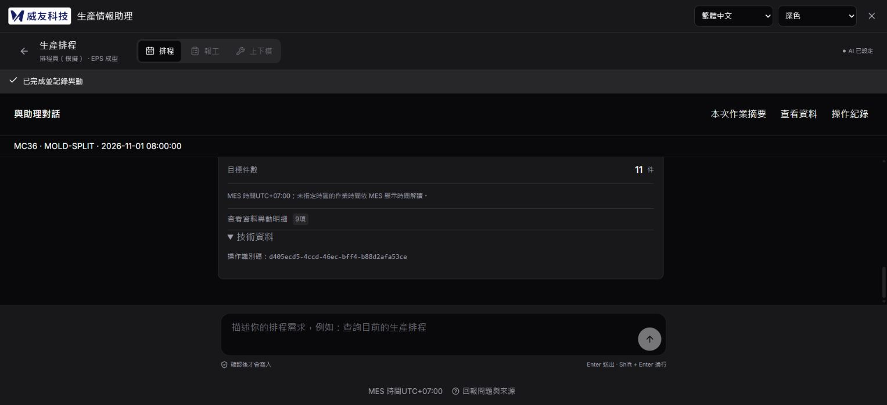
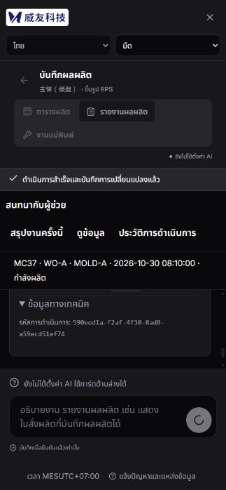
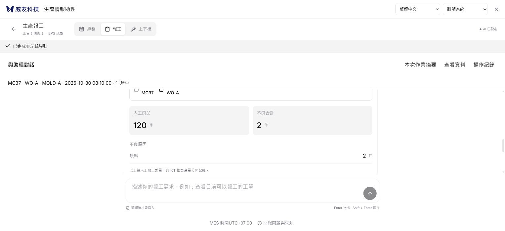
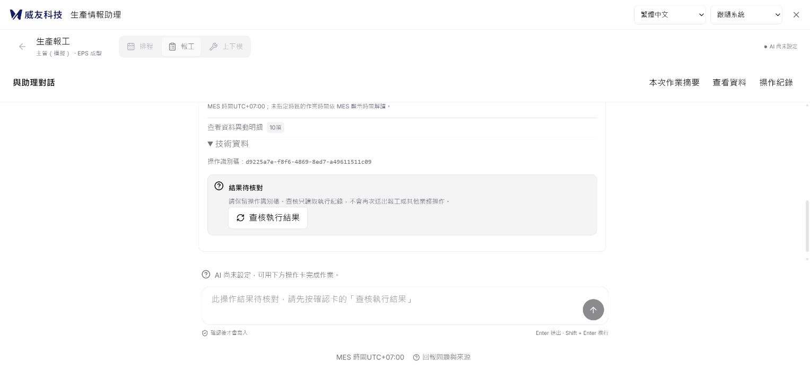

# 對話優先產品實作紀錄

日期：2026-10-31（Asia/Taipei）。基準 `main@71506e7`。規格來源 [PR #14](https://github.com/WeYuTech/KaosuAiAgentTest/pull/14)，規格來源版本 `f97dd1b`；該 PR 在本輪開始時仍開啟，只有文件與原型。追蹤 [Issue #13](https://github.com/WeYuTech/KaosuAiAgentTest/issues/13)，沒有其他產品實作 PR 或留言。本輪不合併文件 PR，也不關閉產品 Issue。

## 現況與差異

舊版永久雙欄有兩個起點，新的預設是單一對話與互動卡，摘要按需打開。編輯器、確認卡與伺服器草稿沿用；摘要只讀，不產生另一套保存與確認。

已閱讀 AGENTS、CONTEXT、兩份 ADR 與 `docs/inventory/` 三模組盤點；原 MES API 的歷史交易缺口仍由既有閘道處理，本輪不改業務規則。原時間預設差異（API 7、adapter 8）記為既有設定議題，顯示使用 API 時區，本輪不改設定。

## E01：功能位置與基準

| 功能 | 新位置與保留來源 |
|---|---|
| 新增人工報工 | 單一對話下方互動卡，既有 guide／proposals／confirm |
| 修改、刪除報工 | 「更多操作」中選單筆人工紀錄；保留 reportDraft 映射 |
| 模穴、整張完工 | 「更多操作」；保留 execution／schedule 區別、跨工單摘要與獨立確認 |
| 新增、修改排程 | 同工作區排程入口，原多明細表單；create/update 與明細識別保留 |
| 上下模四階段、清除 | 同工作區模具入口，保留候選／NEXT_ACTION／歷史／廠別 |
| 工單資料、紀錄 | 附屬面板與對話可展開結果，編輯器不卸載 |
| 九頁 MES 入口 | widget-loader 與 install_widget 未修改，保留原宿主情境 |
| 三語、主題 | 原 i18n／theme 與同源訊息契約，補新文案 |

本機預設 simulation，啟動 `.venv/Scripts/python.exe .local/guided_preview.py`（開發輔助腳本未入 Git），公開前端為 `frontend/dist`，後端沿用 create_app。測試不需要 SQL；明確隔離 gate 的 SQL 測試另列未執行。沒有新增套件、Schema、migration 或後端 action。

## E02～E08：實作

- E02：預設單欄，唯一 Guide 與確認卡留在對話，摘要只讀。有效 session 選模組後直接核對可信身分；入口文字保留。資料回覆不再強制切頁。
- E03：區分未同步、儲存中、內容需修正、失敗／衝突；儲存串行且失敗停止佇列。重新讀版本後人員核對、採伺服器值或明確重套本機輸入。候選讀取採請求世代，Guide讀回在編輯及保存中取消採用。flush等待後重新比較最新本機值與權威args，包含改回原值的競爭。
- E04：重用真實候選、良品與多原因不良欄位；不預填Demo的100／120。換目標沿用必要patch及伺服器清理。數量依Int32上限，原不良欄位最小1保留（後端可接受0，這是原UI較嚴格限制，本輪未擅改）。缺項清單、不良及排程巢狀名稱、欄位定位已補；實際點不良原因缺項可定位第一列選單。
- E05：單一確認、同步防雙擊、實際回傳終態；成功後清單刷新失敗保持成功。成功及 unknown 可見操作識別。長明細保留，確認動作列黏附卡片底部。
- E06：最小送出標記在請求前寫入；每次嘗試獨立鍵，只記conversation／proposal及可選本機拒絕結果。可用時使用Web Locks；原HTTP宿主無Web Locks時獨立鍵仍不覆寫他頁標記，後端原pid保證去重。明確4xx讀回原卡後只把自己的嘗試記為拒絕，不偽造後端終態；刷新仍不能同卡approve，但可取消／返回修改。他頁未知保持鎖定，所有晚到proposal再次套恢復規則，入口優先恢復標記中的原conversation及pid。切模組保存情境文字；有未送文字時阻擋換工單。
- E07：原三模組表單、能力與確認契約保留。完整動作HTTP回歸與新版瀏覽器覆蓋需分開看矩陣，不能將來源未改當成UI全部通過。
- E08：主要內容16px、桌面操作40px、窄畫面44px；窄畫面附屬面板覆蓋而不壓成雙欄。保留 IME 判斷、語言／主題偏好，仍須人工讀屏與200%縮放驗收。

## 實際證據

- 隔離UI：明確選 MC37／WO-A／EPS-A，100／NG01缺料2 → 產卡 → 返回改120 → 產新卡 → 人工確認，取得 `24ee7699-82c4-4929-8677-bd378d47503b` 成功回執。此為產品真實隔離 API，不是 Demo 回執。
- 新 HTTP 測試：確認前業務快照不變，舊100卡 superseded，新120卡重複確認後只新增一筆120件紀錄。
- 故障替身UI：無模型環境提交5件，伺服器已提交但HTTP替身回503、讀回暫假定pending；刷新後確認按鈕0、查核入口保留。移除故障後僅reconcile取得同一 `d9225a7e-f8f6-4869-8ed7-a49611511c09` 的成功結果。這是HTTP故障替身，不是正式 SQL 斷線證據。
- 新前端測試涵蓋持久化失敗零送出、pending刷新仍unknown、4xx明確拒絕不誤鎖、他頁未知標記不能被清除、晚到guide再套恢復。
- 受控保存UI：扣住100保存回應，再填110／120，放行後公開API讀回120；保存121前拒絕請求時輸入保留且核對不產卡；保存122成功但丟失回應時先讀權威版本，不重送；另一HTTP用戶先存777後，UI的123收到409、保留123供核對，再由人員採用777。
- 真實模型：經SSH只轉送模型payload到既有伺服器累計帳本，模型操作的是本機隔離狀態。完成MC37歧義補問、明確08:10 WO-A／EPS-A 100／缺料2產卡、自然語言改120／2、人工確認後取得 `4ae12764-c0c9-4c4b-b6ad-5067bd513c57`。新增7次模型呼叫，累計182次、US$1.199426，未知與預留0，原US$20上限不變。沒有將固定腳本當模型。
- 三語核對卡及成功結果各12組實際DOM尺寸檢查：1366×768、1920×1080、768×1024、390×844，沒有主文件水平溢出，核對按鈕在viewport內。390泰文深色開關摘要、修改為121／2再確認成功。量測見[版面證據](evidence/對話優先版面量測.json)，這不是200%縮放、實際平板或所有錯誤狀態的證明。曾將視窗覆寫套到非顯示分頁，讀到1528寬，該次不列指定尺寸證據；後續逐組核對實際寬高才記錄。

## 後續回歸與審查修復

最終自動回歸：後端200通過／10跳過；前端60通過；型別與建置通過。後端跳過9項隔離SQL gate及1項Windows連結權限；既有Starlette TestClient棄用提示與前端分包／lucide指令警告保留，不為本輪新增套件或調整依賴。

- 數量：負數、小數、空值、超Int32、重複原因、不同原因總量溢位均實際走UI拒絕；合法0仍按原規則處理。422與連線失敗分開，修正後可繼續；舊422不覆蓋新值。
- 保存：除100→110→120外，另扣住110回應後改回原100，權威version27=110時UI仍100且導航停用；放行後version28與UI皆100。保存中的唯讀摘要同步顯示保存中，flush不沿用等待前的dirty。
- 查詢：扣住MC37，讓MC36先回；放行後仍是MC36。舊報工查詢在途切排程，舊回覆不覆蓋新模組3筆資料。查詢503、查看資料與開關摘要均保留目前122件草稿及一個編輯器。
- 拒絕／去重：另一HTTP連線改來源資料，舊報工卡409後刷新仍顯示本機拒絕，不誤鎖unknown、不允許同卡重送；返回重核後UI雙擊，日誌僅一個confirm且一筆100件。新增兩個登入連線先同意後取消／先取消後同意的HTTP回歸，均沿用首次終態並核對實際筆數及稽核。
- 結果：`efc24abb-95bf-438b-94d7-36d2daff8a6f`成功後workspace503，UI保留成功。`7319a2a4-0336-4363-80ec-aaa1d5a759e6`回應遺失，刷新自動恢復原操作；reconcile503仍unknown，移除故障後查得成功，日誌僅一次confirm。
- 入口／身分：使用原loader的隔離宿主，收合／重開保留未送文字；本輪沒有安裝到九個正式頁面。隔離服務cookie失效401後回身分頁，改生管身分不帶主管草稿；這不等於正式MES身分橋接UI驗證。
- 終態：開始下一筆作業會清掉舊卡及舊成功提示，重新整理以權威guide為準，不從歷史訊息復活舊完成卡。

### Standards

以main@71506e7為基準，依AGENTS及code-review規範由獨立審查者複查。未發現新增阻擋規範違反；原pid恢復、獨立嘗試鍵、4xx本機拒絕與未知優先規則已複查。這是靜態／單元證據，與瀏覽器及SQL證據分列。

### Spec

複查指出quiet保存中改回原值會使dirty=false，舊GET及flush可能採110而遺失最後100；已補saving讀取／導航鎖、serverArgs與等待後重比對，並取得上述受控UI證據。摘要保存中／invalid狀態也補齊。沒有保留未修復的已確認缺陷；未執行的矩陣項目仍列出。

### 三模組隔離結果

下列回執由公開audit讀回為simulation／succeeded，包含實際changes；合成資料不冒充正式MES資料。

| 動作 | 本輪操作識別 |
|---|---|
| 修改報工 | `7a63f17f-73ac-45a3-a433-b06e41384972` |
| 刪除報工 | `ac655e4d-5674-4e2b-9258-babb3ff8bd89` |
| 修改模穴 | `43d3676e-6864-449b-b474-66421bae25d0` |
| 整張排程完工 | `0d4c86cc-9554-43e2-a307-54f9908ee5ce` |
| 開始上模 | `fab3480c-07a5-43e9-931c-4736dfcf3754` |
| 完成上模 | `03a11560-4376-4eb5-be3c-d99edd7e6432` |
| 開始下模 | `0dbd83e3-3c4a-4b77-b88b-9868ca7feb78` |
| 完成下模 | `006b47b4-6ff2-4029-b309-3809a87cc256` |
| 清除上下模 | `0adf20e6-0163-4d97-a0e7-911cbf3be83c` |
| 多工單排程修改 | `1a9725cd-5ba2-47ed-b63f-4337bb7a4d76` |
| 同品號兩組明細新增 | `69d23f46-8ed1-474c-9422-7e2699af5ee2` |
| 同品號既有明細修改／返回／刷新 | `d405ecd5-4ccd-46ec-bff4-b88d2afa53ce` |

同品號排程9005，兩列刻意選右64再選左63。完成修改後公開workspace仍為detail9006→64、detail9007→63，修改的9個changes沒有重新指定模具明細、工單或品號。另一筆多工單則分配WO-A／EPS-A與WO-B／EPS-B，完工卡列出全部影響工單及下一排程時間連動。

## E09與限制

可重現受控故障：先 `npm --prefix frontend run build`，再執行 `.venv/Scripts/python.exe tests/manual/conversation_fault_server.py --port 8008`，開啟 `http://127.0.0.1:8008/?embed=1`。寫入 `.local/ux-http-fixture.flag`：`hold-save`、`hold-read`、`save-fail`、`save-lost`、`hold-workspace`、`workspace-fail`、`reconcile-fail`或`pending`；移除旗標才放行或停止故障。`hold-workspace`只扣住報工MC37查詢，MC36及排程仍可先返回。預設無故障，獨立使用`.local/ux-http-fixture.db`，不連正式SQL且不呼叫模型。`pending`先提交合成資料再丟失HTTP回應、GET暫回pending；刷新驗證鎖定後可切reconcile-fail驗證失敗保守鎖定，移除旗標再查核。這個腳本不是正式應用端點，不可安裝到正式MES。多個localhost服務共用同網域Cookie名稱，登入另一隔離服務可能令原頁401，測試時一次使用一個服務。

| 工作 | 本輪狀態 |
|---|---|
| E01 | 完成基準、來源與功能位置盤點；九頁對照見下方清單。 |
| E02 | 已實作單一主線／唯讀摘要；隔離查詢與資料保留通過，正式可信宿主UI未執行。 |
| E03 | 已實作保存協調與晚到保護；保存與查詢競態通過，模型processing的新版UI注入未執行。 |
| E04 | 完成人工報工互動卡的隔離驗收，含換工單、數量、巢狀缺項及100／2改120／2。 |
| E05 | 已實作單一確認與結果；隔離成功、取消、拒絕、未知及雙擊通過，過期／撤權／正式寫入關閉的UI組合未完整執行。 |
| E06 | 完成隔離的保存／刷新／文字接續／原pid恢復驗收；跨裝置與清除儲存的限制保留。 |
| E07 | 三模組既有action的隔離UI與HTTP通過；九頁正式宿主不在本輪部署驗收。 |
| E08 | 已實作三語與配色；指定桌面核對／結果及窄版局部操作通過，IME、讀屏、完整鍵盤、system變更與200%縮放未執行。 |
| E09 | 提供產品程式、可控故障重現、53項矩陣及畫面；完整驗收未完成，Issue #13保持開啟。 |

### 九頁既有入口對照

以下路徑以`/KSS_MES/wwwroot/`為根，來源為`scripts/install_widget.py:PAGES`；全部指向既有`/KSS_MES/ai-agent/`單一入口。本輪保留loader及備份／還原工具，沒有重覆安裝或覆蓋歷史備份。來源情境只作查詢線索，仍須核對身分與工單。

| 原頁面 | 用途 |
|---|---|
| `index.html` | MES首頁三模組入口 |
| `MES-WIP/WIP-menu.html` | WIP選單入口 |
| `MES-WIP/setup/wip-query_schedule_plan_new.html` | 排程清單 |
| `MES-WIP/setup/wip-query_schedule_detail_new.html` | 排程明細；SID沿既有loader映射 |
| `MES-WIP/OPI/schedule_report/wip-opi_schedule_uping.html` | 設備報工清單 |
| `MES-WIP/OPI/schedule_report/wip-query_schedule.html` | 排程報工查詢 |
| `MES-WIP/OPI/schedule_report/wo-schedule.html` | 工單報工 |
| `MES-WIP/OPI/mold/wip-opi_schedule_mold_eqp.html` | 上下模 |
| `MES-WIP/OPI/mold/wip-query_schedule_clear.html` | 上下模歷史與清除 |

逐項結果見本輪驗收矩陣；只有有證據的邊界標通過，其他標未執行。SQL gate、真實新人測試、讀屏、完整鍵盤、200%縮放與所有UI競態不得用既有單元測試代稱通過。瀏覽器儲存被清除、跨裝置或來源URL改變時，前端最小恢復記錄不提供跨裝置送達證明；後端權限／去重仍保持。

正式 MES 本輪未更新部署、未測試寫入；原服務仍是 PR #12 已部署版本。
