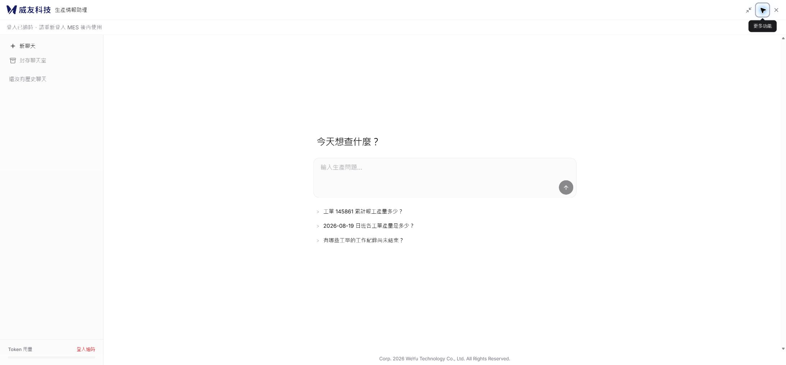
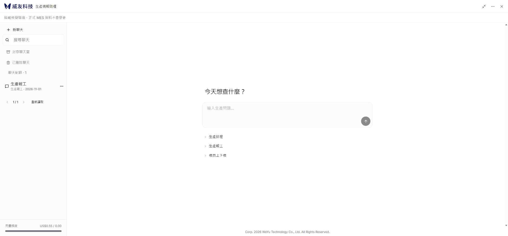

# 截圖原版逐項對齊與驗收

本輪依使用者提供的浮窗、展開畫面，以及本機 4173 原版重新調整正式 React 外框。聊天室內依使用者指示保留 MES 引導操作。變更延續 PR #18，關聯 Issue #13、PR #14 與 PR #16；尚未合併或部署。

## 來源與實作

來源為 `Emerald-automatic-reports/frontend/mes-ai-copilot` 固定版本 `294bc02d3bfb153175513ea7276b44727cb710bb`，並實際讀取原版的有效樣式與畫面。本輪不使用早期深藍／黃色設計。

| 原版元素 | 正式應用調整 |
|---|---|
| 浮窗與入口 | 預設 564 × 733；入口 49.5 × 49.5，距右下各 18px，浮窗底部 83.5px；小螢幕自適應 |
| 標頭 | 高 56px、128 × 30px 商標、固定生產情報助理標題、歷史／新增／對角放大／更多／關閉圖示 |
| 狀態列 | 保留原版位置，顯示實際登入或隔離環境狀態 |
| 展開側欄 | 寬 288px，新聊天、歷史與封存導覽，下方用量區；空清單不顯示無效搜尋與分頁 |
| 歡迎區 | 「今天想查什麼？」、中央留白、直排入口，內容上限 768px、內側實際內容 732px |
| 輸入框 | 原版圓角、45px 最小輸入區、27px 行高、圓形箭頭；桌面整體高度約 111.14px |
| 更多選單 | 四個管理入口、外觀分組、選取標記、用量與收合；方向鍵、Home／End、Escape、外部點擊 |
| 版權 | 原文完整保留，位於主內容底部；展開時不橫跨歷史側欄 |

清除舊窄版商標縮小、頁首加寬留白、首頁提示段落及首頁 MES 次頁尾等衝突。主題、尺寸、摘要與選單不持有另一份 Guide 或確認狀態。桌面宿主 loader 同步預設尺寸，不重建 iframe。

## 同尺寸幾何比較

原版與新版皆以繁中、淺色、2187 × 1018 CSS 像素量測首頁。量測標頭、商標、側欄、標題、輸入框、三列入口、版權的位置與尺寸；全部數值最大差異 **0.0091 CSS px 以下**。此結論僅涵蓋這七個區塊的外接矩形，不代表文字內容、字型逐像素、所有畫面或所有尺寸完全相同。

原始數值：[展開幾何比對](evidence/exact-ui-20261101/展開幾何比對.json)。先前量測原版高 1018、新版高 1022，造成置中相差 2px；已統一尺寸重新量測，未用不同尺寸的數字宣稱相同。

| 原版 | 正式 React |
|---|---|
|  |  |

桌面浮窗與操作畫面：

- [1366 × 768 浮窗](evidence/exact-ui-20261101/新版浮窗-1366.jpg)
- [564 × 733 窄版](evidence/exact-ui-20261101/新版窄版-564.jpg)：整個 viewport 為面板，保留既有窄螢幕觸控尺寸延伸，不能視為桌面浮窗的逐像素裁切。
- [1366 × 768 填寫與摘要](evidence/exact-ui-20261101/報工填寫摘要-1366.jpg)
- [1920 × 1080 核對](evidence/exact-ui-20261101/報工核對-1920.jpg)
- [1920 × 1080 英文深色](evidence/exact-ui-20261101/英文深色核對-1920.jpg)
- [390 × 844 泰文深色](evidence/exact-ui-20261101/泰文深色核對-390.jpg)
- [1920 × 1080 取消結果](evidence/exact-ui-20261101/報工取消結果-1920.jpg)

390 × 844 為要求的 CSS viewport；受裝置縮放取整影響，工具匯出影像為 390 × 843。

畫面內容的必要差異：首頁三列沿用排程／報工／上下模；原版失效登入文字依真實狀態呈現，不偽造登入逾時。歷史使用實際聊天資料。用量顯示既有美元累計帳本，不把美元標成 Token。保留三語、跟隨系統及可恢復刪除入口。來源範例工單、查詢文案不當作 MES 真實資料。

## 本輪驗收

使用獨立 `.local/exact-ui-parity.db`、隔離費用帳本副本及未設定模型的預覽服務 `http://127.0.0.1:8016/`。副本仍含原有 US$0.55 累計費用，測試服務呼叫上限設為 0；因此畫面顯示 0.55 / 0.00，並非重設正式帳本。

| 項目 | 結果與證據 |
|---|---|
| 同尺寸首頁幾何 | 通過；上述七個矩形及 JSON |
| 繁中淺色桌面、英文深色桌面、泰文深色窄版 | 通過本輪取樣；未宣稱所有狀態的完整交叉矩陣 |
| 無模型人工起步 | 通過；作業員 → 新增報工 → 明確選 MC37／WO-A／EPS-A |
| 修改與摘要 | 通過；人工良品 100 改 120，缺料 2，唯讀摘要顯示 120，未新增確認入口 |
| 核對與取消 | 通過；核對卡 120／2，最後顯示已取消、未寫入，沒有按下同意寫入 |
| 切語言與收合 | 通過；核對時繁中 → 英文 → 泰文 → 繁中，深色切換、收合重開，原工單與數量保留 |
| 選單 Escape | 通過；只關閉更多選單，焦點返回更多功能，不關閉助理 |
| 390px 水平溢出 | 通過；DOM viewport 與 scrollWidth 均為 390，版權換行可見 |
| 空清單刪除還原入口 | 程式保留登入後入口，即使最後一筆聊天移出清單仍能進入已刪除聊天；本輪未重跑刪除完整 UI 流程 |
| 前端測試 | 77 通過、0 失敗，包含 Guide、版本、確認、三語、宿主尺寸與恢復契約 |
| TypeScript／正式建置 | 通過；保留大型 chunk、lucide 模組指令警告 |
| 後端 | 本輪沒有後端修改；前輪 214 通過／10 跳過，本輪未重跑 |
| 付費模型、正式 SQL／正式 MES 寫入 | 未執行；沒有新增模型費用 |

初次浮窗預設尺寸變更造成一個舊尺寸斷言失敗，已改成新預設尺寸並通過。拆出主題選單時三語測試發現主題群組缺少可讀名稱，已補 `role=group` 與三語名稱，重新執行全部 77 項通過。裁切截圖工具曾逾時，改保存完整 viewport 截圖；不將逾時視為產品失敗。

仍待整體工作：R06／U15 首次未送出或失敗原句重載恢復、實體 IME、200% 縮放、所有排程／模具動作畫面，以及全套登入失效／明確拒絕／跨分頁 unknown 的瀏覽器組合。既有測試通過不替代這些尚未執行項目。Issue #13 與 PR #18 仍保持未結案／草稿。
