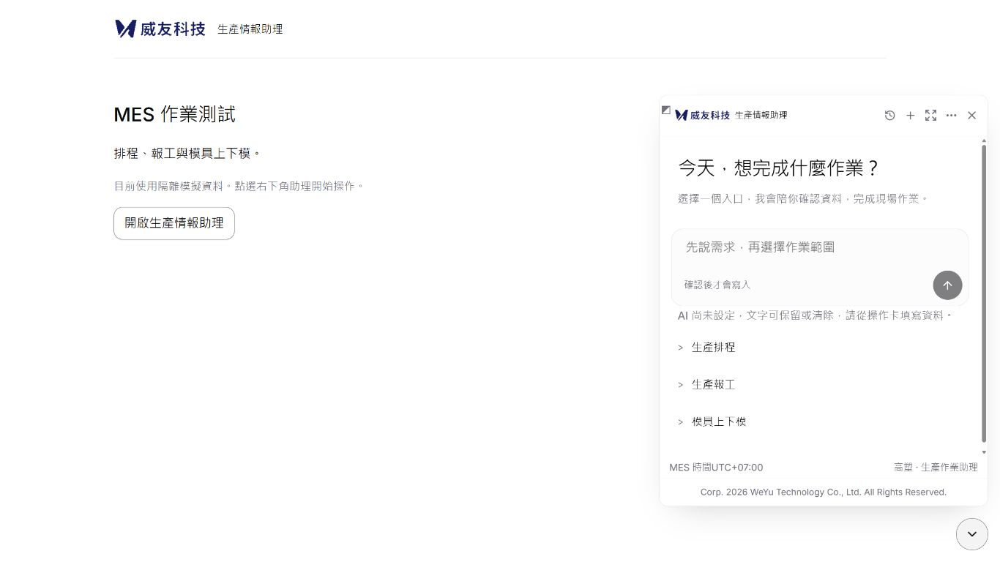
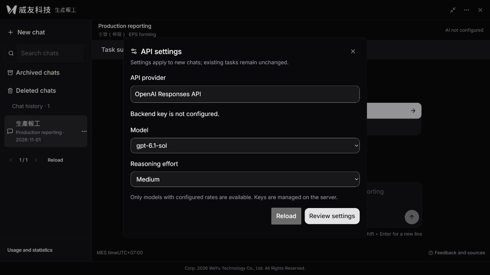
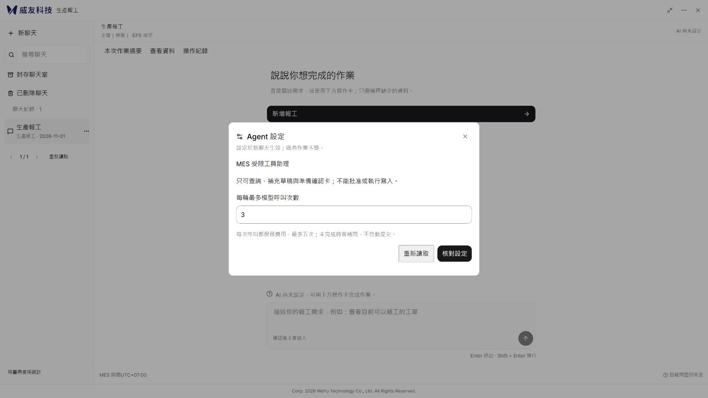
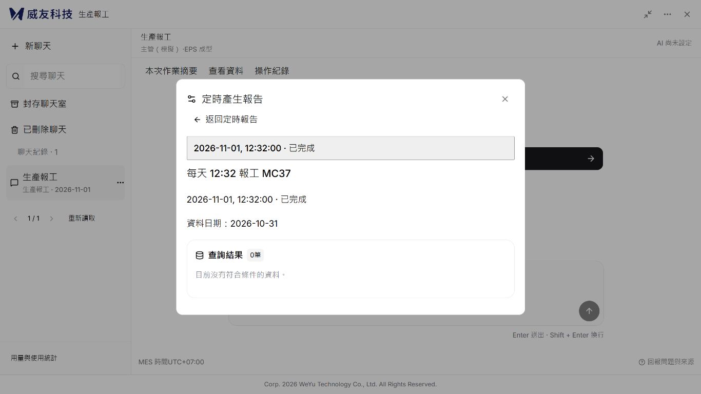
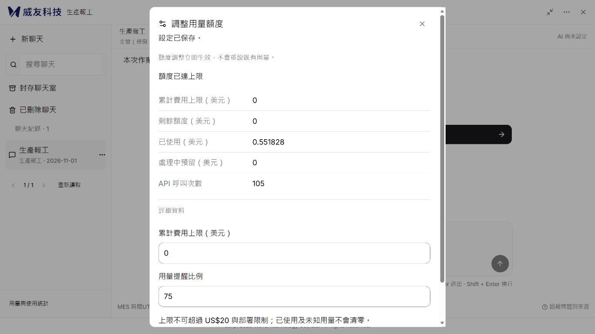
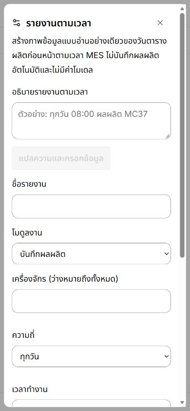
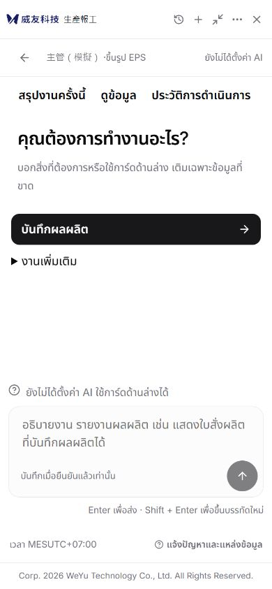

# 管理設定、定時報告與版權驗收

日期：2026-11-01。分支：`codex/weyu-react-ui`，續接 PR #18 與 Issue #13。使用者明確納入三項管理能力，並要求保留原版權聲明；此增量尚未合併或部署正式 MES。

## 正式應用的變更

| 功能 | 本輪實作 | 權限與邊界 |
|---|---|---|
| API 設定 | 查看 Responses 來源、金鑰是否設定；選擇已配置費率的模型與推理強度 | 既有 review 主管才可修改；不回傳或輸入金鑰、不新增任意 URL |
| Agent 設定 | 調整每輪最多 1–5 次模型呼叫，新聊天保存設定快照 | 沿用受限工具，不授予模型批准、執行或新增端點能力 |
| 用量額度 | 累計費用上限、提醒比例、剩餘額度與已用／預留統計 | 取設定、部署限制與 US$20 的最小值；修改與費用預留共用交易，不重設帳本 |
| 定時產生報告 | 三語有限格式解析、核對建立、列出、暫停／恢復、刪除及查看每次執行 | 僅自己有權限的模組，每次重驗帳號與 allowlist；定時唯讀查詢，不使用模型費用 |
| 版權聲明 | 浮窗、展開、手機及主題切換均保留底部原文 | `Corp. 2026 WeYu Technology Co., Ltd. All Rights Reserved.` |

聊天歷史、搜尋、命名、釘選、封存／刪除還原、浮窗尺寸記憶等前輪實作沿用，見 [聊天功能還原與驗收](聊天功能還原與驗收-20261101.md)。聊天室內仍為原 MES 引導、單一草稿與人工確認，管理設定不建立第二個業務確認來源；原操作待確認或結果未知時不允許提交管理修改。

參考為本機 4173 對應 Emerald-automatic-reports 來源的 `ProviderSettingsDialog`、`OperationsDialog` 與 `assistant-modal.aui.tsx`。此輪還原入口、對話框與功能目的，但不照搬外部 Agent ID、Project ID、自訂 API 或每月 Token 計費模型。額度採使用者要求的累計美元上限，Agent 採本專案已有工具迴圈；不能宣稱來源所有後端能力均完全相同。決策見 [ADR 004](adr/004_管理設定與定時唯讀報告.md)。

## 定時報告的真實意義

報告採 MES UTC+07:00 前一個排程日期，沿用各模組既有查詢與來源欄位，並非按實際報工時間彙總的日產量報告。自然語言支援例如「每天 08:00 報工 MC37」、「weekdays 08:00 report MC37」、「ทุกวัน 08:00 ผลผลิต MC37」；時間或模組不明確時拒絕猜測，其他設備名稱可使用表單。

背景 worker 每 15 秒輪詢，以排程／原訂時間唯一領取。超過 15 分鐘才恢復的時段標示錯過；領取後中斷不重跑。查詢失敗顯示未完成，不把失敗顯示零產出。每人最多 20 份未刪除排程；每份最多 100 筆，超出不截斷成成功報告。刪除定義為軟刪除，保留既有報告與稽核；目前管理視窗沒有刪除還原入口。

沿用既有 SQLite STATE／LOG，未新增資料表或欄位。稽核記錄實際 `ZZ_AI_AGENT_OPERATION_STATE` 的 `id` 與 `data` 前後值；執行報告只記結果與執行識別，不聲稱修改 MES 資料表。

## 實際驗收

| 項目 | 狀態 | 證據與限制 |
|---|---|---|
| 後端完整回歸 | 通過／跳過 | `python -m pytest -q`：214 通過、10 跳過；維持須另啟用的 SQL／平台條件，1 項既有 Starlette 相依警告 |
| 前端回歸 | 通過 | `npm test`：77 通過，含既有草稿、確認、unknown、權限隔離與 IME 邏輯 |
| 型別與正式建置 | 通過 | `npm run build`；仍有超過 500 kB 分塊與 lucide use-client 警告 |
| 新增管理 HTTP 驗收 | 通過 | 9 項：主管權限、秘密不外洩、版本衝突、模型白名單、新舊聊天設定、未知用量保留、併發費用預留、報告防重複領取、跨人隔離、啟用／模組撤權、失敗不冒充成功、三語解析及錯過時間 |
| 真實瀏覽器管理設定 | 通過 | Agent 呼叫上限 5 改 3；API 推理 low 改 medium；先核對再保存，重新載入仍存在；未呼叫真實模型 |
| 額度保存 | 通過 | 隔離預覽部署硬上限為 0，提醒 80 改 75；複製帳本仍為 105 次／US$0.551828，沒有歸零或增加呼叫 |
| 背景定時執行 | 通過 | 透過 UI 建立每日 12:32 報工 MC37；2026-11-01 12:32 MES 時間由 worker 產生 2026-10-31 排程日期快照，0 筆為真實隔離查詢結果；未按手動執行按鈕 |
| 暫停與重啟 | 通過 | 人工確認暫停後重新啟動預覽服務，排程仍暫停，報告仍只有一筆已完成執行 |
| 三語與主題 | 通過（指定畫面） | 繁中淺色 1366×768／1920×1080、英文深色 API、泰文淺色 390×844；聊天名稱與資料來源值保留原文 |
| 窄畫面與鍵盤 | 通過（指定操作） | 390px 頁面及對話框無水平溢出；泰文正常換行；Shift+Tab 從關閉回最後按鈕，Escape 關閉後焦點回設定入口 |
| 版權 | 通過 | 浮窗、展開及手機底部可見；內容與來源一致，未改寫年份或公司名稱 |
| 三模組所有動作逐一瀏覽器重跑、實體中文 IME、200% 縮放全矩陣 | 未執行 | 本輪聚焦新管理能力；原有測試通過不等同完整 V08–V16 實機驗收 |
| 真實模型／正式 SQL／IIS 背景服務 | 未執行 | 此輪不產生新費用、不部署、不向正式 MES 寫入；正式背景查詢權限重驗以隔離契約測試驗證 |

本輪先有建置失敗：重複的 `time` 標籤造成 TS1117，已移除重複宣告。瀏覽器另發現管理確認摘要被一般技術欄位摺疊規則隱藏、部分新增按鈕缺翻譯、返回列表的下次執行時間未更新；已逐項修正並複驗。最終無已知失敗測試，以上未執行項目仍保留，不將 Issue #13 或 PR #18 標為全部完成。

原始指令輸出位於本機 `.local/management-tests-final.txt`、`.local/management-frontend-tests-final.txt`、`.local/management-build-final.txt`；初次建置失敗另存 `.local/management-build-initial-failure.txt`，不納入 Git。

## 畫面證據

以下都是隔離預覽，不能作正式 MES 寫入成功證據。

隔離預覽 `http://127.0.0.1:8015/`，模型關閉、作業資料與費用帳本副本獨立；正式站仍是前輪部署版本。本次前後端須一起更新，部署前注意事項見 [IIS 部署](IIS部署.md)。
