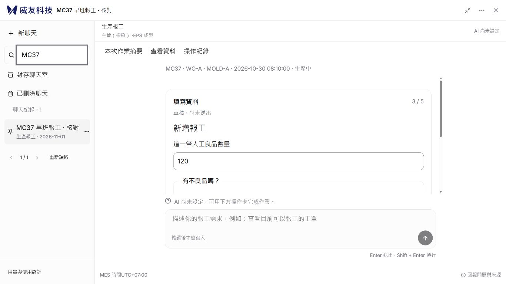
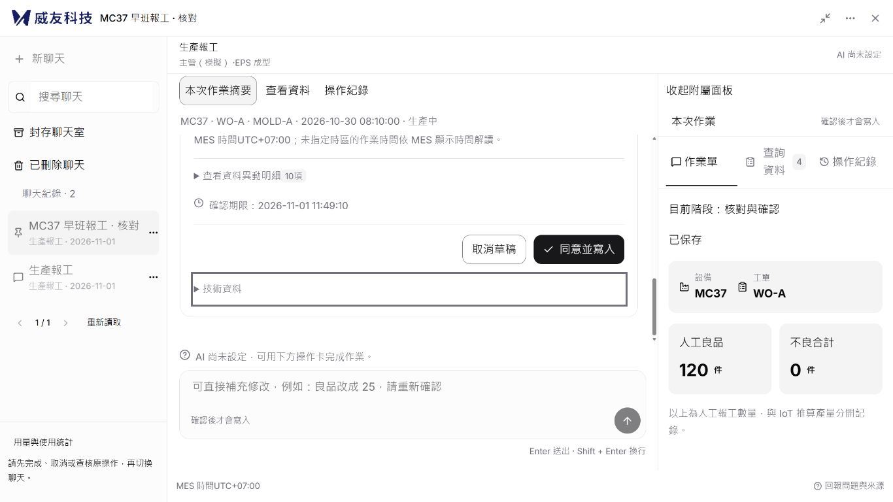
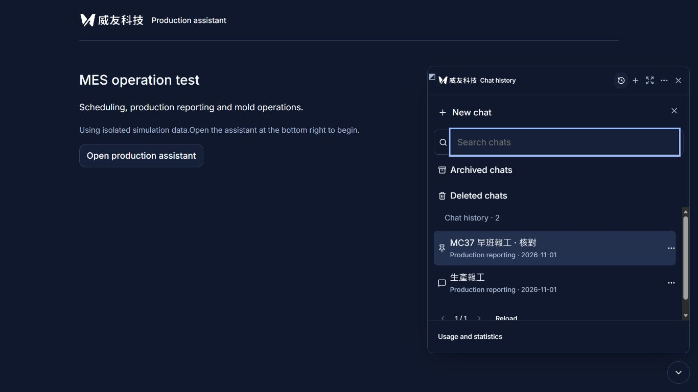
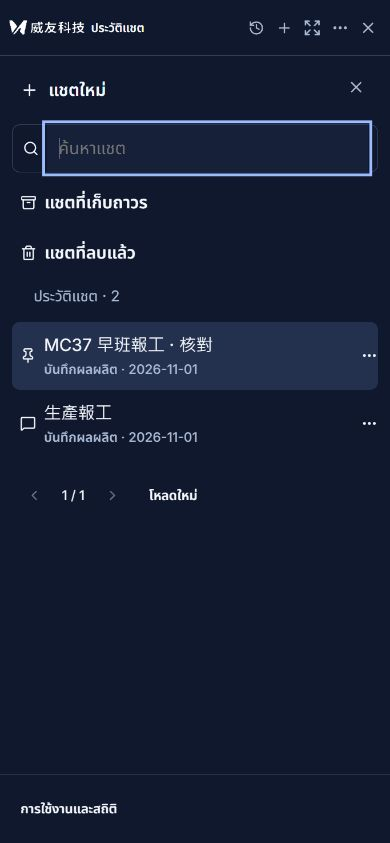
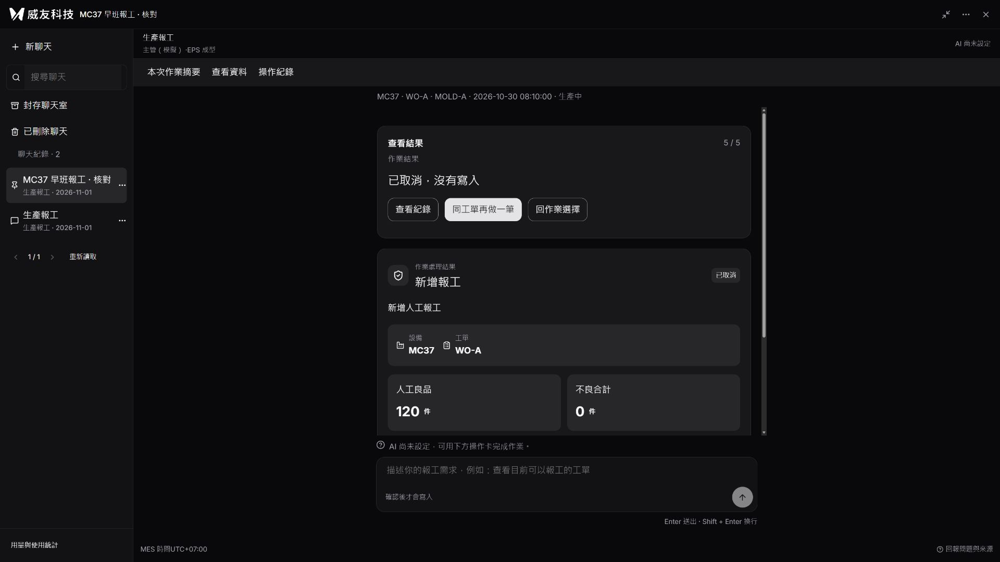

# 聊天功能還原與驗收

本輪依使用者指定的 4173 參考介面，補上聊天管理與視窗功能；聊天室內維持現有 MES 引導、摘要與人工確認。此版本仍在 PR #18，不等同正式主機已部署的 `8a7dfe8`。

## 來源與範圍

參考：本機 `Emerald-automatic-reports/frontend/mes-ai-copilot`，版本 `294bc02d3bfb153175513ea7276b44727cb710bb`。比對 `ConversationListNavigation`、`ConversationActionsMenu`、`ConversationActionsDialog`、`AssistantMoreMenu`、`assistant-modal.aui` 與主題變數；實際開啟 4173。來源 4199 後端未運作，因此來源聊天資料端點未實測，功能依原始碼與可見介面核對。

| 功能 | 本輪結果與適配 |
| --- | --- |
| 圓形入口、精簡標頭、浮窗及全畫面 | 沿用前輪黑白外框；展開顯示聊天側欄，小窗歷史覆蓋內容區，標頭保留 |
| 新聊天、歷史切換、搜尋、分頁 | 接真實 SQLite 對話；搜尋名稱及已存訊息；只列目前可信身分有權限的模組 |
| 更名、釘選、封存、取消封存 | 使用獨立中繼資料版本；衝突需重新讀取；封存唯讀且可還原 |
| 刪除聊天 | 可還原的清單刪除；不刪除 MES 資料、訊息、確認卡或稽核 |
| 尺寸拖曳、鍵盤微調、重設 | React 與 MES 宿主均提供左上角把手；保存瀏覽器尺寸；同一 iframe／Guide 不重建 |
| 淺色、深色、深藍、跟隨系統 | 深藍採參考來源變數；宿主同步；保留繁中／英文／泰文 |
| 用量與統計 | 唯讀讀取原費用帳本；聊天與操作統計依操作者隔離，不提供重設額度 |
| 聊天內容 | 保留三模組引導、查詢、摘要、單一有效確認及結果查核，不移植來源另一套 runtime |
| API／Agent 設定、額度修改、定時報告 | 前輪未實作；使用者後續已確認納入，最新實作與適配限制見 [管理設定、定時報告與版權驗收](管理設定定時報告與版權驗收-20261101.md) |

## 工程契約

- 新增 `GET /api/conversations`（搜尋、範圍、分頁）、`POST /api/conversations/{id}/metadata` 與 `GET /api/conversations/statistics`。
- 沿用 `ZZ_AI_AGENT_OPERATION_CONVERSATION` JSON 記錄，沒有新套件或 DB Schema 變更；舊對話自動使用預設中繼資料。
- `metadata_version` 不取代 Guide 版本，也不修改確認雜湊。待確認、結果未知或模型處理中不得封存／刪除。
- 切換前保存引導草稿；新聊天建立獨立對話。恢復未決提交優先使用原對話及模組，不重送。
- 更名回覆與列表更新受當前身分／操作上下文限制；模型晚到回覆保留最新中繼資料。
- 未送出的自由文字目前沿用既有記憶體草稿；跨重新整理的首次原句恢復仍屬 R06 待辦。已保存的 Guide、訊息與聊天中繼資料可重新讀取。
- 本輪沒有變更 MES 業務規則、正式 SQL 寫入或 US$20 累計上限。

## 驗收結果

隔離預覽：`http://127.0.0.1:8014/`。合成資料庫為 `.local/history-parity.db`；模型未啟用，測試預留上限為 0，沿用既有累計帳本，沒有重設或付費呼叫。

| 項目 | 結果 | 證據／限制 |
| --- | --- | --- |
| 前端回歸 | 通過 | 77 項，含宿主尺寸恢復、同 iframe、三語主題、確認與未知結果契約 |
| 後端回歸 | 通過／跳過 | 205 通過、10 跳過；跳過需明確啟用的 SQL 驗收及 Windows 符號連結條件 |
| 正式建置與型別 | 通過 | 保留既有大於 500 kB 分塊及 lucide use-client 警告 |
| 聊天 HTTP 契約 | 通過 | 新增 5 項：權限隔離、搜尋分頁、版本衝突、草稿保留、待確認及 unknown 阻擋、模型處理中更名、統計隔離 |
| 真實瀏覽器聊天管理 | 通過 | 新建兩個聊天、改名、釘選、搜尋、封存／取消封存、刪除／還原 |
| 草稿切換／重新整理 | 通過 | MC37／WO-A 人工良品 120，切到新聊天無舊數量，再切回恢復 120；重新整理可恢復 |
| 待確認作業 | 通過 | 更名保留同一確認卡；封存拒絕且訊息保留；摘要沒有第二個確認入口；最後取消，未提交業務寫入 |
| 視窗、語言與主題 | 通過 | 英文深藍浮窗、鍵盤寬度增加 64 至 514 px，重載保留；繁中淺／深色展開；泰文 390×844，頁面寬度 390，無水平溢出 |
| 實體中文 IME、200% 縮放全矩陣 | 未執行 | 本輪未操作作業系統輸入法；既有 composer 防誤送測試通過，不能等同實體輸入法驗收 |
| 三模組全部動作逐一瀏覽器重跑 | 未執行 | 既有公開 HTTP 回歸通過；本輪瀏覽器聚焦聊天外框與報工，不宣稱完整 V08–V16 全部完成 |
| 正式 MES／真實模型 | 未執行 | 本輪沒有部署或正式寫入；隔離 UI 截圖不作正式成功證據 |

修正過程保留的失敗說明：舊測試把 `navy` 當無效主題，新增深藍後更新案例；瀏覽器發現統計視窗被祖先 `inert` 阻擋、封存拒絕訊息被列表重讀清除、歷史覆蓋標頭，均已修正並複驗。沒有把初次失敗列為通過。

## 畫面證據

下列為隔離資料，取消結果不代表成功寫入。

## 發行注意

本輪同時增加後端端點，不能只上傳前端靜態檔。正式更新須依 `docs/IIS部署.md` 備份後端程式與前端，保留 `.env`、對話資料庫、稽核與累計用量帳本，更新服務後驗證登入、列表與唯讀查詢。PR #18 保留草稿；Issue #13 未關閉。
